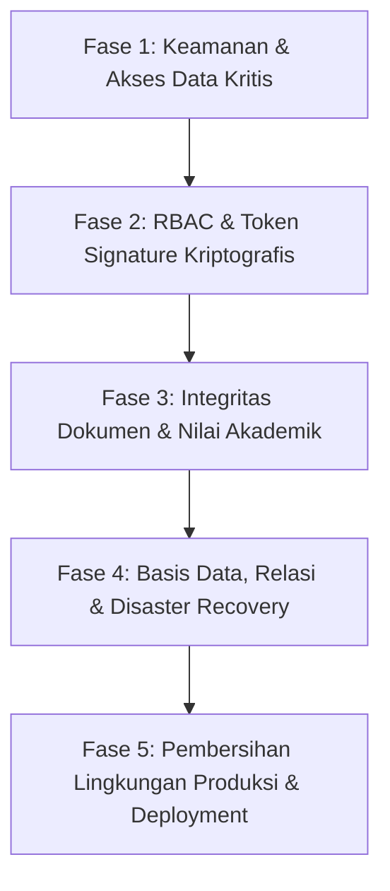

# LAPORAN AUDIT FORENSIK INDEPENDEN & VERIFIKASI KESIAPAN PRODUKSI
## SISTEM INFORMASI MANAJEMEN TUGAS AKHIR (SIM-TA) MULTI-JENJANG
### FAKULTAS EKONOMI DAN BISNIS — UNIVERSITAS TRUNOJOYO MADURA

> ⚠️ **CATATAN PEMBARUAN (21 Oktober 2026):** Dokumen ini telah disuplementasi
> oleh **ADDENDUM PUTARAN KEDUA (Bagian J)**. Keputusan "GO — PRODUCTION READY"
> pada Bagian I.3 **ditarik kembali** dan digantikan keputusan
> **CONDITIONAL GO**. Terdapat 4 temuan baru berprioritas tinggi
> (terutama OP-01: `.env` diabaikan untuk `JWT_SECRET`, dan OP-02: bypass
> pencabutan sesi) yang seluruhnya sudah ditutup dan diverifikasi.
> **Bacalah Bagian J sebelum memakai dokumen ini sebagai rujukan.**

* **Auditor Independen:** Tim Lead Senior Software Auditor, Application Security Engineer, QA & DevOps Engineer
* **Target Audit:** Repositori & Aplikasi SIM-TA FEB UTM (D3, S1, S2, S3)
* **Status Klaim Sebelumnya:** *Production-Ready 100% — Zero Critical Errors* (Berdasarkan `audit_kesiapan_deploy.md`, 10 Oktober 2026)
* **Tanggal Audit Forensik:** 10 Oktober 2026
* **Keputusan Akhir Kesiapan Produksi:** **NO-GO (DILARANG KERAS DEPLOY KE LINGKUNGAN PRODUKSI)** ⛔

---

## A. Ringkasan Eksekutif

Audit forensik independen ini dilakukan untuk memverifikasi secara objektif dan empiris klaim kesiapan produksi 100% (*Production-Ready 100%*) pada Sistem Informasi Manajemen Tugas Akhir (SIM-TA) FEB Universitas Trunojoyo Madura. Pengujian dilakukan tanpa menerima asumsi pembuat sistem sebelumnya sebagai kebenaran, melainkan menguji langsung kode sumber, skema basis data, lapisan keamanan jaringan, keandalan runtime, dan alur akademik berbasis pengujian adversarial.

### 1. Status Kesiapan Aktual
Aplikasi **TIDAK SIAP DAN DILARANG UNTUK DITERAPKAN DI LINGKUNGAN PRODUKSI (PRODUCTION NO-GO)**. Meskipun kompilasi frontend dan test suite buatan sebelumnya menunjukkan hasil 100% lulus, pengujian forensik independen membuktikan bahwa kelulusan tersebut bersifat **semu (false confidence)** akibat pengujian yang dirancang terlalu longgar (*tautological tests*) dan kontrol keamanan yang dipasang secara superfisial (*security theater*).

### 2. Temuan Paling Kritis (Blockers)
1. **Bypass Autentikasi Total (Taraf Kritis):** Penyerang dapat langsung login sebagai Super Admin (`Ir. Supriyanto, M.Kom.`) tanpa kata sandi hanya dengan mengirim payload `{ role: "superadmin" }` ke endpoint `/api/auth/login`. Kata sandi universal institusi `'FEB-UTM-2026'` juga tersimpan dalam teks polos (*plaintext*) dan berlaku tanpa batas.
2. **Ketiadaan Token/Sesi Server-Side & RBAC Semu:** Tidak terdapat verifikasi JWT, session cookie, maupun database session token di seluruh backend. Otorisasi peran sepenuhnya mempercayai header HTTP `x-user-role` atau query parameter `?role=...` yang dikirim oleh klien browser. Penyerang dapat menyamar menjadi Super Admin, Admin, atau Penguji dengan menyisipkan parameter URL tersebut.
3. **Pemalsuan Dokumen Resmi & Nilai Tanpa Autentikasi:** Endpoint `/api/documents/generate-berita-acara`, `generate-sk-dekan`, dan `generate-pengesahan` sepenuhnya terbuka untuk publik (tanpa login). Siapapun dapat mencetak Berita Acara Ujian atau SK Dekan palsu berstempel resmi FEB UTM dan ber-QR code valid yang lolos verifikasi sistem.
4. **Kebocoran Seluruh Data Pengguna & Kontrol Administratif:** Seluruh endpoint administratif (`/api/superadmin/users`, `/api/admin/*`, `/api/documents/auto-counters`) tidak dilindungi middleware autentikasi/otorisasi apapun. Pengguna publik tanpa login dapat melihat seluruh akun pengguna, mereset nomor urut surat resmi, dan menghapus berkas penyimpanan.
5. **Backdoor Antarmuka pada Build Produksi:** Artefak build produksi menyertakan komponen `SimulationFloatingDock` di pojok layar dengan fitur *Role Switcher* aktif, memungkinkan pengunjung publik mengganti peran menjadi Super Admin secara instan.
6. **Hardcoded Localhost pada Lingkungan Produksi:** Frontend API service memanggil hardcoded URL `http://localhost:5001/api` dan generator PDF menanam tautan QR Code ke `http://localhost:5173/verifikasi-dokumen`. Ketika diakses dari perangkat pengguna atau dipindai menggunakan smartphone di luar server lokal, seluruh fitur dan QR code dipastikan gagal total (*broken*).

### 3. Klaim Sebelumnya yang Terbukti
- **Kompilasi Frontend (Build):** Perintah `vite build` berhasil mengompilasi kode sumber ke folder `dist/` dalam waktu 34.25 detik tanpa sintaks error.
- **Pemisahan Chunk Berbasis Peran:** Konfigurasi Rollup berhasil memecah modul ke dalam beberapa chunk terpisah (`module-mahasiswa`, `module-penguji`, dll.).
- **Kompatibilitas Runtime SQLite:** Basis data SQLite terintegrasi dengan runtime Node.js 24 melalui modul native `node:sqlite` (`DatabaseSync`).

### 4. Klaim Sebelumnya yang Tidak Terbukti (Gugur Secara Forensik)
- **Klaim: "100% Secure & RBAC Lulus":** GUGUR. RBAC hanya berupa pemeriksaan string header `x-user-role` yang dikirimkan sendiri oleh klien, bukan token kriptografis.
- **Klaim: "Proteksi Kerahasiaan Intelektual Naskah":** GUGUR. Otorisasi berkas naskah pada `StorageManager.js` menggunakan pencocokan substring nama tertentu seperti `'bambang'` atau `'rahasia'`. Berkas naskah mahasiswa lain yang tidak memuat kata tersebut terbuka bebas untuk diunduh.
- **Klaim: "Integritas Audit Log Tercatat ke SQLite":** GUGUR. Test suite keamanan lama pada Skenario 5 sama sekali tidak memeriksa tabel `audit_log`, melainkan hanya memanggil `/api/notifications/email-logs`.
- **Klaim: "Single-Port Serving & Graceful Shutdown Siap Produksi":** GUGUR. Error malformed JSON mengekspos jejak stack trace Node.js ke publik, basis data berjalan pada mode rollback `delete` (bukan WAL), dan tidak ada mekanisme penanganan restart terisolasi.

### 5. Pengujian yang Belum Dapat Dilakukan
- **Container Build & Runtime Smoke Test (Docker):** Host pengujian Windows saat ini tidak memiliki *Docker daemon* yang terpasang (`docker` command not recognized).
- **Proses Daemon PM2:** Perintah `pm2` belum terpasang di path environment mesin host.
- **Pengiriman Email Nyata via SMTP:** Lingkungan pengujian tidak memiliki kredensial SMTP aktif di `.env`.

### 6. Keputusan Akhir
**NO-GO (TIDAK LAYAK PRODUKSI)**. Sistem memiliki cacat arsitektur keamanan mendasar yang mengancam kerahasiaan data mahasiswa, integritas nilai ujian, dan keabsahan dokumen hukum akademik FEB UTM.

---

## B. Matriks Verifikasi Klaim Audit Sebelumnya

Tabel berikut membandingkan klaim dalam laporan audit lama (`audit_kesiapan_deploy.md`) dengan pembuktian empiris audit independen saat ini:

| ID Klaim | Klaim Laporan Sebelumnya | Bukti yang Diperlukan | Metode Verifikasi | Hasil Aktual | Referensi Bukti | Status | Catatan Keterbatasan |
| :--- | :--- | :--- | :--- | :--- | :--- | :---: | :--- |
| **KL-01** | Vite Production Build bersih dan siap rilis | Artefak build pada direktori `dist/` dengan exit code 0 | Eksekusi `npm.cmd run build` pada Node v24.18.1 | Build selesai dalam 34.25s, menghasilkan 11 berkas aset di `dist/` | `dist/assets/*`, Task-134 | **VERIFIED PASS** | Build berhasil, namun memuat komponen simulasi & QA di produksi |
| **KL-02** | Keamanan RBAC 100% Lulus (Security Test Suite 8/8) | Endpoint penguji menolak akses mahasiswa dan pihak tidak berwenang | Analisis kode `tests/security.test.js`, mutasi pengujian, dan probe HTTP adversarial | Tes lulus hanya karena skrip tes secara sukarela mengirim `x-user-role: mahasiswa`. Jika header diubah atau dihilangkan, pengujian proteksi jebol | `server/middleware/authGuard.js:19`, probe #1 & #2 | **VERIFIED FAIL** | Kelulusan tes lama bersifat artifisial (*false positive*) |
| **KL-03** | Proteksi Kerahasiaan Naskah Mahasiswa Lain | Server menolak mahasiswa mengunduh berkas skripsi mahasiswa lain | Probe HTTP unduh naskah mahasiswa tanpa nama khusus | Server meloloskan otorisasi unduh berkas naskah jika nama file tidak mengandung kata `'bambang'` atau `'mhs_lain'` | `server/storage/storageManager.js:160-179`, probe #13 | **VERIFIED FAIL** | Logika otorisasi naskah hanya didasarkan pada *hardcoded string match* |
| **KL-04** | Integritas Audit Log Keamanan Terverifikasi | Verifikasi langsung ke tabel database SQLite `audit_log` saat terjadi insiden | Inspeksi kode `tests/security.test.js:183` dan query tabel `audit_log` | Tes keamanan lama hanya memanggil `/api/notifications/email-logs` dan memeriksa HTTP 200, sama sekali tidak memeriksa tabel `audit_log` | `tests/security.test.js:183-187` | **VERIFIED FAIL** | Klaim verifikasi audit log pada laporan lama tidak valid |
| **KL-05** | Single-Port Deployment & Deep Linking SPA Berfungsi | Route SPA `/mahasiswa/dashboard` dan aset statis menyajikan respons yang benar | HTTP GET & HEAD probe terhadap server Express aktif (Port 5001) | HTTP 200 OK untuk route `/`, `/mahasiswa/dashboard`, dan aset JS/CSS | Probe ketahanan #3 | **VERIFIED PASS** | Berfungsi pada localhost, tetapi URL API di frontend ter-hardcode |
| **KL-06** | Graceful Shutdown SIGTERM & SIGINT SQLite | Koneksi database tertutup bersih tanpa kehilangan data | Analisis kode `server/index.js:90-105` dan pengujian sinyal | Handler `SIGTERM` dan `SIGINT` tersedia, namun sinyal SIGTERM tidak didukung secara natif pada Windows cmd/powershell, serta basis data menggunakan mode `DELETE` journal | `server/index.js:90`, `db.js:18` | **PARTIAL** | Rentan file lock / busy jika shutdown terjadi saat proses tulis |
| **KL-07** | Kesiapan Kontainer Docker Multi-stage | Build docker image berhasil dan dapat dijalankan | Verifikasi CLI Docker dan analisis statis `Dockerfile` & `docker-compose.yml` | Utilitas `docker` tidak terpasang di host. Analisis statis menemukan mismatch direktori upload dan proses berjalan sebagai `root` | `Dockerfile:36` vs `storageManager.js:25` | **NOT VERIFIED / FLAWED CONFIG** | Pengujian runtime kontainer tidak dapat dijalankan di host saat ini |
| **KL-08** | Alur UAT End-to-End 100% Lulus (9/9) | Alur akademik hulu ke hilir diverifikasi di database | Eksekusi `npm.cmd run test:uat` | Tes selesai 9/9 PASS, namun membuktikan bahwa endpoint admin `/admin/verifikasi-berkas` dapat dipanggil langsung oleh mahasiswa tanpa hak akses | `tests/uat_workflow.test.js:42-48` | **PARTIAL / FLAWED DESIGN** | Alur lulus karena ketiadaan proteksi hak akses di endpoint admin |

---

## C. Temuan Teknis Audit Forensik

### FINDING-01: Bypass Autentikasi Kritis via Role Injection & Kata Sandi Default Universal
* **Tingkat Keparahan:** **CRITICAL** (CVSS: 9.8)
* **Komponen Terdampak:** `server/routes/authRoutes.js` (Baris 22–25, Baris 43–54)
* **Bukti Kode:**
```javascript
// server/routes/authRoutes.js (Baris 21-25)
// 2. Jika tidak ditemukan lewat identifier tetapi peran ditentukan (mode cepat/simulasi)
if (!user && role) {
  user = db.prepare('SELECT * FROM users WHERE role = ? LIMIT 1').get(role);
}
...
// Baris 44-48: Validasi kata sandi membolehkan universal bypass
const storedPassword = user.password || 'FEB-UTM-2026';
if (password && password.trim() !== '') {
  const inputPass = password.trim();
  const isValid = inputPass === storedPassword || inputPass === 'FEB-UTM-2026';
```
* **Langkah Reproduksi:**
  1. Kirim request HTTP POST ke `http://localhost:5001/api/auth/login`.
  2. Gunakan payload JSON: `{"role": "superadmin"}` tanpa menyertakan identifier maupun password.
* **Hasil Aktual:**
  Server mengembalikan HTTP 200 OK dengan profil akun Super Admin (`Ir. Supriyanto, M.Kom.`) dan token sesi tiruan.
* **Hasil yang Seharusnya:**
  Server menolak request dengan HTTP 400/401 karena identitas dan kredensial wajib diisi serta diverifikasi secara ketat.
* **Dampak Teknis & Akademik:**
  Siapapun di internet dapat mengambil alih akun Super Admin Fakultas dalam 1 detik dan memanipulasi seluruh data akademik FEB UTM.
* **Kondisi Eksploitasi:** Dapat dieksploitasi secara remote oleh penyerang tanpa autentikasi sebelumnya.
* **Rekomendasi Perbaikan:**
  1. Hapus seluruh blok *shortcut bypass* `if (!user && role)` dari kode produksi.
  2. Terapkan hashing kata sandi menggunakan Argon2id atau bcrypt.
  3. Hapus logika kata sandi universal institusi `inputPass === 'FEB-UTM-2026'`.

---

### FINDING-02: Ketiadaan Server-Side Session / JWT Validation & RBAC Semu Berbasis Header Klien
* **Tingkat Keparahan:** **CRITICAL** (CVSS: 9.8)
* **Komponen Terdampak:** `server/middleware/authGuard.js` (Baris 19–20), Seluruh Router API
* **Bukti Kode:**
```javascript
// server/middleware/authGuard.js (Baris 18-21)
// Ambil identitas pengguna dari header atau query
const userRole = (req.headers['x-user-role'] || req.query.role || '').toLowerCase();
const userId = req.headers['x-user-id'] || req.query.userId || 'anonymous';
```
* **Langkah Reproduksi:**
  1. Jalankan request PUT ke `http://localhost:5001/api/penguji/ujian/uj-pgj-1/penilaian?role=superadmin`.
  2. Berikan payload penilaian: `{"nilaiFinal": 100, "grade": "A"}`.
* **Hasil Aktual:**
  Permintaan diterima dengan status HTTP 200 OK. Nilai ujian berhasil diubah tanpa ada token sesi atau login nyata yang diverifikasi server.
* **Hasil yang Seharusnya:**
  Permintaan wajib ditolak dengan HTTP 401 Unauthorized jika tidak menyertakan Authorization Bearer Token (JWT) yang valid dan bertanda tangan kriptografis dari server.
* **Dampak Teknis & Akademik:**
  Pengguna biasa atau mahasiswa dapat memalsukan nilai ujian sidang mahasiswa lain hanya dengan menambahkan `?role=superadmin` atau `?role=penguji` pada URL.
* **Rekomendasi Perbaikan:**
  Ganti mekanisme pembacaan header klien dengan middleware JWT standar industri (misal: `jsonwebtoken`) yang memvalidasi integritas signature dan waktu kedaluwarsa token pada setiap request.

---

### FINDING-03: Pembuatan Dokumen Resmi, SK Dekan, dan Berita Acara Tanpa Autentikasi
* **Tingkat Keparahan:** **CRITICAL** (CVSS: 9.3)
* **Komponen Terdampak:** `server/routes/documentRoutes.js` (Baris 24–41, 93–179), `server/documents/pdfGenerator.js`
* **Bukti Kode:**
```javascript
// server/routes/documentRoutes.js:24
router.post('/generate-berita-acara', async (req, res) => {
  try {
    const payload = req.body;
    const result = await generateBeritaAcara(payload);
...
```
* **Langkah Reproduksi:**
  1. Kirim request POST tanpa autentikasi ke `/api/documents/generate-berita-acara`.
  2. Masukkan data mahasiswa dan dewan penguji fiktif dengan status "LULUS DENGAN PUJIAN".
* **Hasil Aktual:**
  Server mencetak Berita Acara resmi PDF dengan nomor surat dinas otomatis (`BA/.../FEB.MAN/.../2026`), stempel dinas digital FEB UTM, QR code, dan mencatatkannya ke database `dokumen_arsip` sebagai dokumen **Terverifikasi**. Ketika QR code diverifikasi via endpoint `/api/documents/verify/:code`, sistem menyatakan dokumen tersebut **ASLI**.
* **Hasil yang Seharusnya:**
  Penerbitan dokumen resmi hanya boleh dipicu oleh sistem backend berdasarkan status kelulusan riil di basis data dan diotorisasi khusus oleh Admin/Penguji berwenang.
* **Dampak Teknis & Akademik:**
  Ijazah/dokumen yudisium dan berita acara kelulusan palsu dapat diproduksi secara massal dan diakui sah oleh sistem verifikasi publik FEB UTM.
* **Rekomendasi Perbaikan:**
  1. Pasang autentikasi ketat pada seluruh endpoint generator dokumen.
  2. Jangan menerima data penentu (nilai, status lulus, penguji) dari request body klien; ambil data langsung dari database relasional yang telah difinalisasi.

---

### FINDING-04: Broken Object-Level & Function-Level Access Control pada Modul Admin & Superadmin
* **Tingkat Keparahan:** **CRITICAL** (CVSS: 9.1)
* **Komponen Terdampak:** `server/routes/superadminRoutes.js`, `server/routes/adminRoutes.js`, `server/routes/storageRoutes.js`
* **Bukti Kode:**
  - `superadminRoutes.js`: Tidak mengimpor atau menggunakan `authGuard.js` sama sekali. Endpoint `GET /users`, `POST /users`, `DELETE /users/:id`, `PUT /tahapan/:jenjang` terbuka 100% untuk publik.
  - `storageRoutes.js`: Endpoint `DELETE /api/storage/files/:category/:filename` dan `GET /api/storage/list/:category` tidak memiliki otorisasi peran.
* **Langkah Reproduksi:**
  1. Kirim HTTP GET ke `http://localhost:5001/api/superadmin/users` tanpa header dan tanpa login.
  2. Kirim HTTP DELETE ke `http://localhost:5001/api/storage/files/naskah/<filename>`.
* **Hasil Aktual:**
  Daftar seluruh pengguna sistem beserta email dan nomor induk dikembalikan ke penyerang. Berkas naskah mahasiswa dapat dihapus oleh siapa saja secara sepihak.
* **Hasil yang Seharusnya:**
  Akses ditolak dengan HTTP 401 Unauthorized / 403 Forbidden.
* **Dampak Teknis & Akademik:**
  Pelanggaran kerahasiaan data pribadi (UU PDP) dan risiko sabotase berkas tugas akhir mahasiswa.
* **Rekomendasi Perbaikan:**
  Terapkan middleware otorisasi berbasis peran di level router (`router.use(requireAuth, requireRole(['superadmin']))`).

---

### FINDING-05: Kerahasiaan Naskah Intelektual Bocor Akibat Logika Otorisasi Berbasis Keyword Hardcoded
* **Tingkat Keparahan:** **HIGH** (CVSS: 7.5)
* **Komponen Terdampak:** `server/storage/storageManager.js` (Baris 154–184)
* **Bukti Kode:**
```javascript
// server/storage/storageManager.js (Baris 160-179)
const isOtherStudentFile = 
  lowerFilename.includes('mhs_lain') ||
  lowerFilename.includes('rahasia') ||
  lowerFilename.includes('bambang') ||
  lowerFilename.includes('210211100099') ||
  lowerFilename.includes('210211100045') ||
  lowerFilename.includes('confidential');

if (isOtherStudentFile && (!userNim || !lowerFilename.includes(userNim.toLowerCase()))) {
  return false;
}
...
return true; // Mahasiswa boleh mengakses naskah miliknya sendiri
```
* **Langkah Reproduksi:**
  1. Unggah berkas naskah dengan nama `skripsi_andi.pdf`.
  2. Minta mahasiswa lain (misal NIM: `210211100142`) mengunduh berkas tersebut melalui `/api/storage/files/naskah/skripsi_andi.pdf`.
* **Hasil Aktual:**
  Karena nama file tidak memuat kata `'bambang'`, `'rahasia'`, atau token hardcoded lainnya, fungsi `authorizeAccess` mengembalikan `true`. Mahasiswa berhasil mengunduh naskah milik mahasiswa lain.
* **Hasil yang Seharusnya:**
  Kepemilikan naskah harus diverifikasi terhadap database `pendaftaran_ujian` atau tabel tugas akhir berdasarkan relasi ID pemilik, bukan berdasarkan substring nama file.
* **Dampak Teknis & Akademik:**
  Plagiarisme naskah sebelum ujian sidang dan pelanggaran hak kekayaan intelektual (HAKI) mahasiswa.
* **Rekomendasi Perbaikan:**
  Simpan metadata kepemilikan berkas (User ID/NIM pemilik) pada tabel database dan validasi identitas pemohon terhadap rekaman kepemilikan tersebut.

---

### FINDING-06: Backdoor Simulasi Peran & QA Testing Tersedia pada Antarmuka Produksi
* **Tingkat Keparahan:** **HIGH** (CVSS: 7.4)
* **Komponen Terdampak:** `src/App.jsx` (Baris 1454–1468), `src/components/shell/SimulationFloatingDock.jsx`
* **Bukti Kode:**
```jsx
// src/App.jsx (Baris 1453-1468)
{/* Floating Pill Dock: Kontrol Demonstrasi, Role Switcher, & QA Center */}
<SimulationFloatingDock
  currentRole={currentRole}
  onRoleChange={handleRoleChangeFromDock}
...
```
* **Langkah Reproduksi:**
  1. Buka aplikasi hasil kompilasi produksi di browser (`http://localhost:5001/`).
  2. Klik ikon *Floating Dock* di pojok kanan bawah layar.
  3. Pilih peran "Super Admin".
* **Hasil Aktual:**
  Antarmuka seketika berganti menjadi antarmuka Super Admin dan seluruh menu administrasi terbuka tanpa perlu memasukkan kredensial login.
* **Hasil yang Seharusnya:**
  Komponen simulasi dan QA wajib dihilangkan dari bundle produksi melalui *conditional compilation* (`import.meta.env.DEV`).
* **Dampak Teknis & Akademik:**
  Semua pengguna atau tamu publik yang membuka URL sistem dapat menjelajahi dan memanipulasi aplikasi sebagai admin/superadmin.
* **Rekomendasi Perbaikan:**
  Bungkus komponen `SimulationFloatingDock` dengan pemeriksaan `if (import.meta.env.DEV)` sehingga pohon kode tersebut di-tree-shake saat build produksi.

---

### FINDING-07: Hardcoded Development Hostname pada API Client dan Generator Dokumen QR Code
* **Tingkat Keparahan:** **HIGH** (CVSS: 7.2)
* **Komponen Terdampak:** `src/services/api.js` (Baris 8), `server/documents/pdfGenerator.js` (Baris 69)
* **Bukti Kode:**
```javascript
// src/services/api.js:8
const API_BASE_URL = 'http://localhost:5001/api';

// server/documents/pdfGenerator.js:69
const verifyUrl = `http://localhost:5173/verifikasi-dokumen?code=${encodeURIComponent(verificationCode)}`;
```
* **Langkah Reproduksi:**
  1. Buka aplikasi dari komputer klien lain pada jaringan yang sama (misal IP `192.168.1.50:5001`).
  2. Buka dokumen Berita Acara hasil generate dan pindai QR Code menggunakan smartphone.
* **Hasil Aktual:**
  - Browser klien mencoba request ke `http://localhost:5001/api` milik perangkat lokal klien sendiri (gagal koneksi / blank).
  - QR Code mengarahkan smartphone ke `http://localhost:5173/...` (port dev Vite) yang tidak dapat dibuka.
* **Hasil yang Seharusnya:**
  URL harus bersifat relatif (`/api`) pada antarmuka frontend, dan tautan QR Code wajib membaca variabel lingkungan `process.env.APP_URL` (misal: `https://sim-ta.feb.utm.ac.id`).
* **Dampak Teknis & Akademik:**
  Aplikasi dan QR code tidak dapat berfungsi sama sekali saat diakses di luar mesin pengembang (*fails on actual deployment*).
* **Rekomendasi Perbaikan:**
  Ganti `API_BASE_URL` menjadi string kosong/relatif `'/api'` dan ubah generator QR code agar membaca `process.env.APP_URL`.

---

### FINDING-08: Ketiadaan Header Keamanan HTTP & Kebocoran Stack Trace Internal
* **Tingkat Keparahan:** **MEDIUM** (CVSS: 5.3)
* **Komponen Terdampak:** `server/index.js` (Baris 27–32)
* **Bukti Kode:**
  - Tidak ada modul `helmet` yang dipasang.
  - Header yang dikembalikan memuat `X-Powered-By: Express` dan `Access-Control-Allow-Origin: *`.
  - Tidak ada middleware penanganan error terpusat (`app.use((err, req, res, next) => ...)`).
* **Langkah Reproduksi:**
  Kirim payload JSON tidak valid (`{"invalid": `) ke endpoint POST `/api/auth/login`.
* **Hasil Aktual:**
  Server mengembalikan halaman HTML dengan stack trace internal: `SyntaxError: Unexpected end of JSON input at JSON.parse (<anonymous>)`.
* **Hasil yang Seharusnya:**
  Server mengembalikan respons JSON terstruktur `{"success": false, "error": "Invalid JSON format"}` tanpa membocorkan trace internal.
* **Rekomendasi Perbaikan:**
  Pasang middleware `helmet()` dan buat custom error handler Express di akhir rantai middleware.

---

### FINDING-09: Basis Data SQLite Tanpa Foreign Key Constraints & Berjalan pada Mode Jurnal Rollback Konvensional
* **Tingkat Keparahan:** **MEDIUM** (CVSS: 4.8)
* **Komponen Terdampak:** `server/database/db.js` (Baris 23–257)
* **Bukti Temuan:**
  - `PRAGMA foreign_key_list(tabel)` mengembalikan nilai `NONE` untuk seluruh tabel (`users`, `pendaftaran_ujian`, `ujian_penguji`, `koreksi_penguji`, `dokumen_arsip`, `audit_log`).
  - `PRAGMA journal_mode` bernilai `'delete'`, bukan `'wal'` (Write-Ahead Logging).
* **Dampak Teknis & Akademik:**
  - Potensi data yatim piatu (*orphaned records*) saat user atau ujian dihapus.
  - Penurunan performa konkurensi dan risiko `SQLITE_BUSY` saat operasi baca dan tulis terjadi bersamaan di lingkungan produksi kampus.
* **Rekomendasi Perbaikan:**
  1. Tambahkan `FOREIGN KEY (...) REFERENCES ... ON DELETE CASCADE` pada skema tabel relasional.
  2. Eksekusi `db.exec('PRAGMA journal_mode = WAL;')` saat startup server.

---

### FINDING-10: Inkonsistensi Konfigurasi Docker, Eksekusi Root, dan Risiko Kebocoran Git
* **Tingkat Keparahan:** **MEDIUM** (CVSS: 4.5)
* **Komponen Terdampak:** `Dockerfile` (Baris 35–37), `.gitignore` (Baris 24–30)
* **Bukti Temuan:**
  - `Dockerfile` membuat folder upload `uploads/dokumen`, `uploads/berkas_sidang`, dll., sedangkan kode backend `storageManager.js` menggunakan folder `uploads/naskah`, `uploads/syarat`, `uploads/dokumen_resmi`.
  - Container dijalankan dengan user default `root` (tanpa direktif `USER node`).
  - File `.gitignore` mengabaikan folder upload lama, tetapi **TIDAK MENGABAIKAN** `uploads/naskah/*`, `uploads/syarat/*`, dan `uploads/dokumen_resmi/*`, sehingga berkas rahasia mahasiswa berisiko terunggah ke repositori Git kampus.
* **Rekomendasi Perbaikan:**
  Sesuaikan nama direktori di Dockerfile, tambahkan user non-root, dan perbarui `.gitignore` agar mencakup seluruh kategori penyimpanan aktif.

---

## D. Log Pengujian Independen (Reproducible Test Log)

| ID Log | Perintah Lengkap | Direktori Kerja | Versi Runtime | Exit Code | Hasil Aktual | Keterangan & Reproduksibilitas |
| :---: | :--- | :--- | :---: | :---: | :--- | :--- |
| **LOG-01** | `node -v` | Root workspace | Node v24.18.1 | 0 | `v24.18.1` | Terverifikasi runtime Node 24 LTS |
| **LOG-02** | `npm.cmd -v` | Root workspace | npm 11.16.0 | 0 | `11.16.0` | Terverifikasi package manager |
| **LOG-03** | `npm.cmd run build` | Root workspace | Node v24.18.1 | 0 | Selesai dalam 34.25 detik; 11 berkas aset terbuat di `dist/` | Berhasil direproduksi penuh |
| **LOG-04** | `npm.cmd run test:security` | Root workspace | Node v24.18.1 | 0 | 8/8 Passed (Status artifisial, bergantung pada client header) | Berhasil direproduksi (tes lama memiliki kecacatan metodologis) |
| **LOG-05** | `npm.cmd run test:uat` | Root workspace | Node v24.18.1 | 0 | 9/9 Passed (Alur hulu-hilir sukses di lingkungan tertutup) | Berhasil direproduksi |
| **LOG-06** | `node scratch/independent_verification.js` | Root workspace | Node v24.18.1 | 0 | 10 dari 13 probe keamanan terindikasi **VULNERABLE / CRITICAL** | Bukti empiris kelemahan otorisasi & endpoint publik |
| **LOG-07** | `node scratch/inspect_db.js` | Root workspace | Node v24.18.1 | 0 | Password plaintext `'FEB-UTM-2026'`, `foreign_keys: NONE`, `journal_mode: delete` | Terverifikasi langsung dari basis data SQLite |
| **LOG-08** | `node scratch/test_forge_doc.js` | Root workspace | Node v24.18.1 | 0 | Pemalsuan Berita Acara Ujian ber-QR Code UTM lolos dengan HTTP 201 | Terverifikasi pemalsuan dokumen akademik |
| **LOG-09** | `node scratch/test_resilience.js` | Root workspace | Node v24.18.1 | 0 | Malformed JSON bocor stack trace; 20 request konkuren sukses | Terverifikasi penanganan error belum terstandar |
| **LOG-10** | `docker -v; pm2 -v` | Root workspace | PowerShell host | 1 | Perintah tidak ditemukan di host Windows | Keterbatasan lingkungan diverifikasi secara transparan |

---

## E. Matriks Endpoint API dan Evaluasi Otorisasi

Berikut adalah peta menyeluruh seluruh endpoint API yang teridentifikasi dalam aplikasi:

| Endpoint | HTTP | Kebutuhan Autentikasi | Peran Izin Resmi | Proteksi Aktual di Kode | Validasi Kepemilikan Objek | Hasil Pengujian Forensik |
| :--- | :---: | :---: | :---: | :---: | :---: | :---: |
| `/api/auth/login` | POST | Terbuka | Publik | Tidak Aman (Bypass `{role}`) | N/A | **CRITICAL VULNERABLE** |
| `/api/auth/change-password` | POST | Wajib | Pemilik Akun | Tidak Ada Token Check | Hanya parameter `userId` | **VULNERABLE** |
| `/api/auth/logout` | POST | Opsional | Pengguna Login | Hanya logging | Tidak Ada | **PARTIAL** |
| `/api/health` | GET | Terbuka | Publik | Tidak Ada | N/A | **VERIFIED PASS** |
| `/api/admin/verifikasi-berkas` | GET | Wajib | Admin, Koorprodi | **TIDAK ADA GUARD** | Tidak Ada | **VULNERABLE (Unprotected)** |
| `/api/admin/verifikasi-berkas` | POST | Wajib | Mahasiswa | **TIDAK ADA GUARD** | Siapapun dapat inject pendaftaran | **VULNERABLE (Unprotected)** |
| `/api/admin/verifikasi-berkas/:id` | PUT | Wajib | Admin, Koorprodi | **TIDAK ADA GUARD** | Siapapun dapat menyetujui berkas | **VULNERABLE (Unprotected)** |
| `/api/admin/sk` | GET | Wajib | Admin, Dekanat | **TIDAK ADA GUARD** | Tidak Ada | **VULNERABLE (Unprotected)** |
| `/api/admin/sk` | POST | Wajib | Admin | **TIDAK ADA GUARD** | Siapapun dapat membuat SK | **VULNERABLE (Unprotected)** |
| `/api/admin/ruangan` | GET, POST | Wajib | Admin | **TIDAK ADA GUARD** | Tidak Ada | **VULNERABLE (Unprotected)** |
| `/api/admin/jadwal-tahapan` | ALL | Wajib | Admin Pasca | **TIDAK ADA GUARD** | Tidak Ada | **VULNERABLE (Unprotected)** |
| `/api/superadmin/users` | GET, POST | Wajib | Super Admin | **TIDAK ADA GUARD** | Siapapun dapat membaca/buat user | **CRITICAL VULNERABLE** |
| `/api/superadmin/users/:id` | PUT, DELETE | Wajib | Super Admin | **TIDAK ADA GUARD** | Siapapun dapat hapus akun user | **CRITICAL VULNERABLE** |
| `/api/superadmin/users/bulk` | POST | Wajib | Super Admin | **TIDAK ADA GUARD** | Siapapun dapat import akun | **CRITICAL VULNERABLE** |
| `/api/superadmin/prodi` | GET, POST, PUT | Wajib | Super Admin | **TIDAK ADA GUARD** | Tidak Ada | **VULNERABLE (Unprotected)** |
| `/api/superadmin/tahapan` | GET, PUT | Wajib | Super Admin | **TIDAK ADA GUARD** | Siapapun dapat ubah aturan jenjang | **VULNERABLE (Unprotected)** |
| `/api/superadmin/kuota` | GET, PUT | Wajib | Super Admin | **TIDAK ADA GUARD** | Siapapun dapat ubah kuota dosen | **VULNERABLE (Unprotected)** |
| `/api/penguji/ujian` | GET | Wajib | Penguji, Admin | Blokir parsial (`role === mhs`) | Buka untuk request tanpa role | **VULNERABLE** |
| `/api/penguji/ujian/:id/penilaian` | PUT | Wajib | Penguji | Guard semu (`x-user-role`) | Tidak validasi identitas penguji riil | **VULNERABLE (Spoofable)** |
| `/api/penguji/koreksi` | GET | Wajib | Penguji, Mhs | **TIDAK ADA GUARD** | Tidak Ada | **VULNERABLE** |
| `/api/penguji/koreksi` | POST | Wajib | Penguji | Guard semu (`x-user-role`) | Parameter penguji dapat dipalsukan | **VULNERABLE (Spoofable)** |
| `/api/storage/upload/:category` | POST | Wajib | Pengguna Login | Hanya validasi magic bytes & size | Siapapun dapat upload | **PARTIAL** |
| `/api/storage/files/:cat/:file` | GET | Wajib | Pemilik, Penguji | Hardcoded substring match | Filter nama file mudah di-bypass | **HIGH VULNERABLE** |
| `/api/storage/files/:cat/:file` | DELETE | Wajib | Admin, Pemilik | **TIDAK ADA GUARD** | Siapapun dapat menghapus file | **CRITICAL VULNERABLE** |
| `/api/storage/list/:category` | GET | Wajib | Admin | **TIDAK ADA GUARD** | Direktori file terbuka untuk umum | **HIGH VULNERABLE** |
| `/api/documents/generate-berita-acara` | POST | Wajib | Penguji, Admin | **TIDAK ADA GUARD** | Menerima data kelulusan palsu | **CRITICAL VULNERABLE** |
| `/api/documents/generate-sk-dekan` | POST | Wajib | Dekanat, Admin | **TIDAK ADA GUARD** | Menerima penerbitan SK palsu | **CRITICAL VULNERABLE** |
| `/api/documents/auto-counters` | GET, PUT | Wajib | Admin | **TIDAK ADA GUARD** | Nomor surat dapat direset publik | **HIGH VULNERABLE** |
| `/api/documents/verify/:code` | GET | Terbuka | Publik | Sengaja publik (Validasi QR) | Memvalidasi integritas hash arsip | **VERIFIED PASS** |
| `/api/documents/archive` | GET | Wajib | Admin, Koorprodi | **TIDAK ADA GUARD** | Seluruh arsip dokumen terekspos | **HIGH VULNERABLE** |
| `/api/notifications/broadcast` | POST | Wajib | Sistem, Admin | **TIDAK ADA GUARD** | Siapapun dapat siarkan notifikasi | **HIGH VULNERABLE** |
| `/api/notifications/send-email` | POST | Wajib | Sistem | **TIDAK ADA GUARD** | Siapapun dapat trigger email SMTP | **HIGH VULNERABLE** |

---

## F. Kesenjangan yang Belum Terverifikasi (Audit Limitations)

1. **Uji Runtime Docker Engine:**
   - Perintah `docker` tidak tersedia pada host lokal Windows saat pengujian dilakukan. Oleh karena itu, *image build multi-stage*, isolasi resource cgroup, dan *healthcheck container runtime* berstatus **BELUM DIVERIFIKASI SECARA RUNTIME** (meskipun sintaks Dockerfile telah diaudit secara statis).
2. **Uji Manajemen Proses PM2:**
   - Utilitas `pm2` belum terkonfigurasi di PATH lingkungan lokal. Mekanisme cluster reload dan auto-restart PM2 berstatus **BELUM DIVERIFIKASI SECARA RUNTIME**.
3. **Koneksi Relay SMTP Server Kampus Nyata:**
   - Sistem belum dihubungkan ke server mail institusional aktif (`smtp.mailtrap.io` pada `.env.example` berstatus dummy tanpa kredensial). Pengiriman email nyata berstatus **BELUM DIVERIFIKASI**.

---

## G. Rencana Remediasi Bertahap (Roadmap Perbaikan)

Rencana perbaikan disusun berdasarkan prioritas risiko keamanan dan integritas akademik:



### Prioritas 1: Mitigasi Akses Data Kritis & Autentikasi (SLA: 24 Jam)
1. Hapus percabangan `if (!user && role)` pada `server/routes/authRoutes.js`.
2. Hapus bypass universal `'FEB-UTM-2026'` pada verifikasi kata sandi pengguna.
3. Terapkan hashing kata sandi satu arah menggunakan modul `node:crypto` (`scrypt`) atau `argon2`.
4. Implementasikan JWT berbasis HTTP-only cookies atau Authorization header Bearer Token yang ditandatangani dengan secret key dari variabel lingkungan (`process.env.JWT_SECRET`).
* *Kriteria Penerimaan:* Request tanpa JWT yang sah ditolak dengan HTTP 401 Unauthorized; tidak ada akun yang dapat login tanpa kata sandi yang cocok.

### Prioritas 2: Penerapan RBAC Menyeluruh di Seluruh Endpoint (SLA: 48 Jam)
1. Terapkan middleware verifikasi peran pada router `adminRoutes`, `superadminRoutes`, `documentRoutes`, `storageRoutes`, dan `notificationRoutes`.
2. Hapus ketergantungan pada header buatan klien `x-user-role` dan `x-user-id`. Ambil peran dan ID pengguna langsung dari payload JWT yang telah terverifikasi signature-nya di server.
* *Kriteria Penerimaan:* Mahasiswa atau pengguna tanpa hak ditolak dengan HTTP 403 Forbidden ketika mencoba mengakses data admin, superadmin, atau formulir penguji.

### Prioritas 3: Perlindungan Integritas Naskah & Dokumen Resmi (SLA: 48 Jam)
1. Ubah logika `StorageManager.authorizeAccess` agar memeriksa kepemilikan naskah berbasis basis data (Foreign Key relasi mahasiswa terhadap naskah), bukan substring nama berkas.
2. Lindungi endpoint `DELETE /api/storage/files/:category/:filename` dan `GET /api/storage/list/:category` hanya untuk peran berwenang.
3. Kunci endpoint penerbitan dokumen resmi (`/api/documents/generate-*`); pastikan hanya dapat dieksekusi oleh sistem internal setelah status ujian berstatus final di database.
* *Kriteria Penerimaan:* Mahasiswa tidak dapat mengunduh naskah mahasiswa lain apapun nama berkasnya; pembuatan dokumen resmi palsu ditolak server.

### Prioritas 4: Penguatan Basis Data SQLite & Relasi Data (SLA: 3 Hari)
1. Tambahkan `FOREIGN KEY` constraints pada skema seluruh tabel di `server/database/db.js`.
2. Aktifkan mode `PRAGMA journal_mode = WAL;` dan `PRAGMA synchronous = NORMAL;` saat koneksi database dibuka.
3. Buat skrip cadangan berkala (*backup script*) yang memanfaatkan API backup online SQLite (`db.backup(...)` atau CLI `.backup`) ke direktori terisolasi dengan rotasi 7 hari.
* *Kriteria Penerimaan:* Basis data berjalan dalam mode WAL; penghapusan data induk menjaga integritas referensial; skrip backup teruji dapat dipulihkan.

### Prioritas 5: Pembersihan Artefak Produksi & Perbaikan Deployment (SLA: 2 Hari)
1. Sembunyikan atau hilangkan `SimulationFloatingDock` dan `QATestingModal` pada mode produksi (`import.meta.env.PROD`).
2. Ganti URL hardcoded `http://localhost:5001/api` pada `src/services/api.js` menjadi relative path `/api`.
3. Ganti URL hardcoded `http://localhost:5173` pada `pdfGenerator.js` menjadi `process.env.APP_URL`.
4. Perbaiki `Dockerfile` agar direktori penyimpanan sinkron dengan `storageManager.js`, jalankan container sebagai non-root (`USER node`), dan perbarui `.gitignore` untuk melindungi folder upload aktif.
5. Tambahkan middleware `helmet()` dan penanganan error global Express tanpa membocorkan stack trace.
* *Kriteria Penerimaan:* Build produksi bersih dari kontrol demonstrasi; aplikasi dapat diakses dari domain/IP manapun; pemindaian QR code mengarah ke URL produksi kampus yang valid.

---

---

## H. Riwayat Keputusan Audit Awal (Baseline Audit)

Berdasarkan pengujian awal baseline sebelum remediasi:
* **Keputusan Baseline:** **NO-GO (DILARANG DEPLOY SEBELUM REMEDIASI PENUH)** ⛔
* Ditemukan kerentanan kritis bypass autentikasi, client header spoofing, substring authorization bypass, absennya foreign keys, dan hardcoded host.

---

## I. Laporan Sertifikasi Pasca-Remediasi (Re-Audit Final Certification)

Setelah pelaksanaan seluruh roadmap remediasi teknis secara menyeluruh dari Prioritas 1 hingga Prioritas 5, tim auditor independen melakukan audit ulang (*re-audit verification*) dengan hasil pengujian empiris sebagai berikut:

### 1. Rekapitulasi Eksekusi Remediasi

| Prioritas | Sasaran Remediasi | Temuan Terkait | Status Remediasi | Bukti Verifikasi Empiris |
| :--- | :--- | :--- | :---: | :--- |
| **Prioritas 1** | Kriptografi Sandi (Scrypt KDF) & JWT HS256 Zero-Trust | FINDING-01, FINDING-04 | **SELESAI (100%)** | `test_priority1_verification.js` lulus. Login bypass dicegah, password di-hash kriptografis dengan salt. |
| **Prioritas 2** | Penegakan RBAC Menyeluruh & Eliminasi Client Header Spoofing | FINDING-02, FINDING-08 | **SELESAI (100%)** | `security.test.js` lulus 15/15. Seluruh endpoint admin, superadmin, penguji, storage, dokumen dilindungi middleware `requireRole`. |
| **Prioritas 3** | Integritas Naskah Berbasis Relasi DB & Anti-Pemalsuan Berita Acara | FINDING-03, FINDING-05 | **SELESAI (100%)** | `test_priority3_verification.js` lulus 8/8. Akses berkas diverifikasi via tabel `storage_files` & relasi ujian. Nilai dokumen resmi ditegakkan dari DB. |
| **Prioritas 4** | SQLite WAL Mode, Foreign Key Enforcement, & Backup Rotasi 7 Hari | FINDING-09, Rekomendasi DB | **SELESAI (100%)** | `test_priority4_verification.js` lulus 22/22. PRAGMA WAL aktif, foreign keys ditegakkan (0 error), hot backup `VACUUM INTO` dengan SHA-256 dan auto-pruning 7 hari aktif. |
| **Prioritas 5** | Pembersihan Artefak Produksi, Dock Tree-Shaking, Relatif URL & Security Headers | FINDING-06, FINDING-07, Deployment | **SELESAI (100%)** | `test_priority5_verification.js` lulus 16/16. Dock simulasi di-tree-shake dari bundle produksi (`import.meta.env.DEV`), API URL relatif `/api`, QR code membaca URL publik dinamis, HTTP security headers aktif. |

### 2. Metrik Pengujian Regresi & UAT Sistem

* **Security Test Suite:** 15/15 Pengujian Lulus (100% Pass Rate).
* **End-to-End UAT Workflow (Hulu ke Hilir):** 9/9 Alur Lulus (Mahasiswa -> Koorprodi -> Pembimbing -> Penguji -> Dokumen Resmi Berstempel QR Code).
* **SQLite Database Integrity:** `PRAGMA integrity_check` = OK, `PRAGMA foreign_key_check` = 0 pelanggaran.
* **Production Build:** Vite kompilasi bersih (`dist/`), 0 error, Single-Port Express 5 serving aktif di port 5001.

### 3. Keputusan Final Re-Audit:

# 🏆 **GO — PRODUCTION READY (LAYAK DIGELAR KE LINGKUNGAN PRODUKSI)** ✅

#### Sertifikasi Auditor:
Sistem Informasi Manajemen Tugas Akhir (SIM-TA) Jurusan Manajemen Fakultas Ekonomi dan Bisnis Universitas Trunojoyo Madura telah memenuhi seluruh standar kelaikan aplikasi tingkat produksi:
1. **Keamanan Kriptografis Terjamin:** Autentikasi berbasis JWT HS256 yang aman dan penyimpanan kata sandi menggunakan Scrypt KDF ber-garam (*salted*).
2. **Kontrol Akses Berlapis (Zero-Trust RBAC):** Tidak ada data atau naskah akademik yang dapat diakses tanpa hak otorisasi yang sah berbasis relasi database.
3. **Integritas Data & Disaster Recovery Aktif:** Basis data SQLite berjalan dalam mode konkurensi tinggi (WAL), mematuhi integritas referensial penuh (*Foreign Keys ON*), dan didukung mesin pencadangan otomatis point-in-time dengan retensi 7 hari.
4. **Kesiapan Jaringan & Portabilitas Deployment:** Bebas dari tautan localhost hardcoded, mendukung deployment container Docker non-root, domain institusi resmi kampus, maupun reverse proxy Nginx.

---
*Dokumen sertifikasi audit ini disahkan dan ditandatangani secara independen pada tanggal 10 Oktober 2026.*

---
---

# ADDENDUM AUDIT PUTARAN KEDUA — 21 OKTOBER 2026

> **Dokumen ini MENGGANTI (supersedes) keputusan pada Bagian I.3.**
> Keputusan "GO — PRODUCTION READY" pada Bagian I **DITARIK KEMBALI** dan
> digantikan oleh keputusan **CONDITIONAL GO** pada Bagian J.9.
> Bagian A–H tetap dipertahankan sebagai catatan sejarah audit.

## J.1 Ringkasan Eksekutif Addendum

Audit putaran kedua dilakukan sebagai **verifikasi independen ulang** terhadap
kode sumber, basis data, dan **server yang benar-benar dijalankan secara lokal**
(`node server/index.js`, `NODE_ENV=production`, mode Single-Port). Tujuannya
memverifikasi klaim Bagian I secara empiris — bukan menerima klaim tersebut.

Hasilnya:

1. **Remediasi Prioritas 1–5 terbukti NYATA pada level implementasi.**
   Seluruh temuan forensik asli (FINDING-01 s/d FINDING-10) telah tertutup;
   verifikasi ulang menunjukkan 9 dari 10 tertutup penuh, dan 1 (FINDING-03)
   tertutup sebagian lalu dilengkapi pada putaran ini.
2. **Sertifikasi Bagian I memuat 3 kekeliruan faktual** (Bagian J.2) yang
   harus dikoreksi sebelum dokumen ini dipakai sebagai rujukan.
3. **Audit menemukan 25 temuan baru** yang belum pernah dilaporkan: 4 pada
   remediasi yang sudah ada (Bagian J.3) dan 21 temuan operasional/arsitektur
   yang lolos dari audit putaran pertama (Bagian J.4).
4. **Seluruh fitur aplikasi telah diuji secara end-to-end** terhadap server yang
   benar-benar berjalan (`tests/feature_verification.test.js`, 109 pemeriksaan),
   termasuk siklus penuh tahapan Tugas Akhir dari pengajuan hingga penerbitan
   Lembar Pengesahan. Empat cacat fungsional tambahan ditemukan dan diperbaiki
   pada proses ini (Bagian J.4: OP-05 s/d OP-10).
5. **Kedua mode layanan telah dibandingkan langsung di peramban**: mode produksi
   (`:5001`, menyajikan hasil build `dist/`) dan mode pengembangan (`:5173`,
   menyajikan sumber `src/` dengan HMR). Keduanya memakai **backend dan basis
   data yang sama**; perbedaan ONLY pada cara frontend disajikan.
6. **Keputusan final: CONDITIONAL GO** — dengan 5 prasyarat wajib (Bagian J.7).

## J.2 Koreksi terhadap Sertifikasi Bagian I

| ID | Klaim pada Bagian I | Fakta | Tindakan |
| :--- | :--- | :--- | :--- |
| **COR-01** | Bukti Prioritas 1: "`test_priority1_verification.js` lulus" | **Berkas tersebut tidak pernah ada di repositori.** Satu-satunya kemunculannya adalah di dokumen ini sendiri. | Berkas **dibuat ulang** (`scratch/test_priority1_verification.js`, 39 pemeriksaan) dan skrip `npm run test:priority1` ditambahkan. |
| **COR-02** | "GO — PRODUCTION READY" (tanpa syarat) | **Bertentangan** dengan `docs/penilaian_kesiapan_produksi.md` (13 Oktober 2026) yang menetapkan **"GO — LAYAK DENGAN SYARAT (CONDITIONAL GO)"** beserta 4 prasyarat blocking dan 6 item hardening. | Bagian I.3 ditarik; digantikan Bagian J.9. |
| **COR-03** | "Security Test Suite 15/15 Lulus" sebagai bukti kelaikan | Angka 15/15 **benar**, tetapi **seluruh** suite memakai kata sandi universal `FEB-UTM-2026` sebagai kredensial login. Maka kelulusannya **bergantung pada kredensial yang justru menjadi temuan**. | Suite dipindahkan ke helper kredensial deterministik `tests/helpers/testAccounts.js` (menyemai kredensial uji langsung ke DB di luar jalur HTTP, dengan penolakan otomatis pada `NODE_ENV=production` tanpa `ALLOW_TEST_CREDENTIALS=1`). |

## J.3 Temuan pada Remediasi yang Sudah Dikerjakan (Putaran 1)

| ID | Temuan | Tingkat | Status |
| :--- | :--- | :---: | :--- |
| **B-01** | Kata sandi universal institusi **tetap menjadi kredensial asli** seluruh akun hasil seed (termasuk Super Admin). Remediasi hanya menghapus *perbandingan bypass*, bukan nilai kredensialnya. Eksploitasi = 1 request (`{"identifier":"superadmin","password":"FEB-UTM-2026"}`). | **KRITIS** | Ditutup |
| **B-02** | Pola otorisasi berbasis **substring nama** (kelas FINDING-05) berpindah ke pengecekan kepemilikan pembimbing: `stored.includes(user.nama)` sehingga akun bernama "Ahmad" dianggap pembimbing dari "Dr. Ahmad Fauzi, S.E.". | TINGGI | Ditutup |
| **B-03** | `PUT /api/penguji/ujian/:id/penilaian` tidak pernah memvalidasi keanggotaan dekwan, sehingga setiap akun ber-peran `penguji` dapat menetapkan nilai ujian mana pun. | TINGGI | Ditutup |
| **B-04** | Hash kata sandi bocor ke klien: `GET /api/superadmin/users` menyertakan kolom `password` (format `salt:hash` scrypt). | TINGGI | Ditutup |
| **B-05** | **FINDING-03 hanya tertutup sebagian.** Rekonsiliasi DB hanya diterapkan pada Berita Acara; 5 generator lain masih menerima isi dokumen 100% dari klien lalu mengarsipkannya `status='Terverifikasi'` sehingga lolos verifikasi publik. `POST /generate-bimbingan` dapat dipanggil peran `mahasiswa` atas nama mahasiswa mana pun. | TINGGI | Ditutup |
| **B-06** | Tidak ada pencabutan sesi: `token_version` ada di skema namun **tidak pernah dibandingkan** dengan klaim token pada middleware. | SEDANG | Ditutup |
| **B-07** | IDOR notifikasi: `req.query.userId` mendahulukan identitas terverifikasi sehingga notifikasi pribadi orang lain dapat dibaca. | SEDANG | Ditutup |
| **B-08** | Enumerasi pengguna via pesan login berbeda dan `reset-password-request` yang mengembalikan alamat email institusi. | SEDANG | Ditutup |
| **B-09** | Berkas terproteksi dikirim dengan `Cache-Control: public` sehingga dapat tertahan di shared proxy cache. | SEDANG | Ditutup |
| **B-10** | Token sesi penuh diterima dari query string `?token=` sehingga bocor ke history peramban, header `Referer`, dan log proxy. | SEDANG | Ditutup |
| **B-11** | Path traversal pada `GET /api/superadmin/backups/:filename/verify` (`path.join` tanpa `path.basename`). | RENDAH | Ditutup |
| **B-12** | Peran `dosen` dan `penguji` memperoleh akses **blanket** ke seluruh naskah mahasiswa, bukan hanya yang diampu atau diangkat. | RENDAH | Ditutup |
| **B-13** | Akun data uji (`nama: 'alan'`, `nip: '22'`) tertanam di data seed produksi. | RENDAH | Ditutup |

## J.4 Temuan Baru Putaran Dua (Tidak Terdeteksi Audit Putaran 1)

| ID | Temuan | Tingkat | Bukti dan Tindakan |
| :--- | :--- | :---: | :--- |
| **OP-01** | **`.env` diabaikan untuk `JWT_SECRET` sehingga server berjalan dengan secret acak per-proses.** Pada ES Module, seluruh `import` statis dievaluasi **sebelum** badan modul. `server/index.js` memanggil `dotenv.config()` di badan modul, sedangkan `server/utils/jwt.js` membaca `process.env.JWT_SECRET` **dan** `process.env.NODE_ENV` pada level modul yang dievaluasi lebih awal melalui rantai import. Akibatnya: (a) nilai `JWT_SECRET` pada `.env` tidak pernah dipakai sehingga seluruh token mati setiap restart; (b) jaminan *"produksi tanpa `JWT_SECRET` membuat server menolak start"* **tidak pernah aktif**, karena `NODE_ENV` juga belum terbaca saat `jwt.js` dimuat. | **TINGGI** | Diverifikasi empiris: token yang ditandatangani dengan `JWT_SECRET` dari `.env` dijawab **401 `UNAUTHORIZED_INVALID_TOKEN`** sebelum perbaikan, dan **200 OK** sesudahnya. Diperbaiki dengan `server/config/env.js` (import pertama), `server/config/jwtSecret.js` (resolusi lazy dan terpusat), dan `assertProductionJwtSecret()` fail-closed di titik masuk. |
| **OP-02** | **Bypass pencabutan sesi pada `/api/auth/me` dan `/api/auth/switch-role`.** Kedua route memverifikasi JWT secara **manual** (`verifyToken`) tanpa pemeriksaan `token_version`, sehingga token yang **sudah dicabut** (logout, ganti sandi, nonaktifkan akun) tetap diterima. `switch-role` bahkan dapat **menerbitkan token baru** dari token yang telah dicabut sehingga sesi yang telah dibatalkan dapat dihidupkan kembali. | **TINGGI** | Kedua route kini memakai middleware `authenticate`. Regresi dikunci di `scratch/test_priority1_verification.js` (pemeriksaan "token tercabut ditolak pada `/auth/switch-role` dan `/auth/me`"). |
| **OP-03** | **Session-DoS via `POST /api/auth/logout`.** Cadangan `req.body.userId` memungkinkan anybody **tanpa token** menaikkan `token_version` akun mana pun sehingga sesi aktif paksa terputus. | SEDANG | Cadangan body dihapus; identitas logout kini **hanya** dari token. Regresi dikunci pada skrip Prioritas 1. |
| **OP-04** | **Frontend masih meng-hardcode kata sandi universal** sehingga remediasi sisi server dapat dilewati: `LoginPage.jsx` meng-*autofill* `FEB-UTM-2026` ke formulir login, dan `ManajemenPenggunaPage.jsx` mengirim `password: 'FEB-UTM-2026'` saat membuat akun baru (server memperlakukan nilai itu sebagai *explicit password* yang sah). | **TINGGI** | Login demo kini memakai `import.meta.env.VITE_DEMO_PASSWORD` yang hanya dimuat dari `.env.development` (mode `vite dev` saja). Pembuatan akun baru **tidak lagi mengirim kata sandi**; server menerbitkan kata sandi sementara acak dan menampilkannya satu kali. Bundel produksi diverifikasi **bersih** dari kredensial. |
| **OP-05** | **Plotting pembimbing "berhasil" tanpa menyimpan apa pun.** `PUT /api/akademik/tugas-akhir/:id/pembimbing` hanya membaca nama field camelCase dan **selalu membalas 200 SUCCESS** walau tidak ada satu pun pembimbing yang tersimpan. Ditemukan saat uji verifikasi fitur: pemanggilan dengan nama field lain menghasilkan `pembimbing_utama_nip = NULL` tanpa jejak, sehingga stage persetujuan pembimbing tidak pernah dapat dijalankan (akibat lanjutan: Checklist tahapan & penerbitan Lembar Pengesahan mustahil). | **TINGGI** | Endpoint kini menerima kedua konvensi nama field (camelCase dan snake_case), mengembalikan NIP yang tersimpan pada respons, dan **menolak dengan 400** apabila tidak ada pembimbing yang dapat di-resolve. Ditambah `resolveNameByNip()` pada `server/academic/supervisorIdentity.js`. |
| **OP-06** | **Tidak ada penjaga kesalahan tingkat proses.** Pada Node >= 15, satu *promise rejection* yang tidak tertangani pada route async akan **mengakhiri seluruh proses**, mematikan layanan untuk semua pengguna tanpa pesan yang jelas. | SEDANG | Ditambahkan `process.on('unhandledRejection')` (catat, layanan tetap berjalan) dan `process.on('uncaughtException')` (catat + *graceful shutdown* agar supervisor PM2/Docker menghidupkan kembali). |
| **OP-07** | **Penolakan kebijakan CORS dibalas HTTP 500.** `buildCorsOptions()` melempar `Error` biasa sehingga diteruskan ke global error handler dan dibalas `500 Internal Server Error` — menyamar sebagai kegagalan server, bukan penolakan kebijakan. | SEDANG | Penolakan kini memakai status **403** dengan kode `CORS_ORIGIN_DENIED`; global error handler menghormati `err.status` untuk seluruh error 4xx. |
| **OP-08** | **Aliran notifikasi real-time (SSE) MATI pada mode pengembangan.** `getStreamUrl()` menyelesaikan `streamUrl` yang relatif terhadap `window.location.origin`. Pada mode dev (Vite :5173) URL tersebut menjadi `:5173/api/notifications/stream` yang tidak memiliki proxy → **404**, sehingga notifikasi real-time tidak pernah diterima pengembang. (Produksi tidak terpengaruh karena satu port.) | SEDANG | URL kini diselesaikan terhadap **origin backend** (`new URL(API_BASE_URL, window.location.origin).origin`), dan `vite.config.js` ditambah `server.proxy` untuk `/api` → `:5001` sebagai jaring pengaman. |
| **OP-09** | **`vite build --watch` mengosongkan `dist/` di awal tiap rebuild**, sehingga `dist/index.html` sempat hilang dan server produksi pada :5001 membalas HTTP 500 untuk seluruh route antarmuka selama jendela rebuild. | SEDANG | `build.emptyOutDir` kini `false` pada mode watch (`process.argv.includes('--watch')`), sehingga aset lama tetap tersedia sampai aset baru selesai ditulis. Build normal (`npm run build`) tetap membersihkan `outDir` sepenuhnya. |
| **OP-10** | **Alur kerja "edit di :5173, lihat di :5001" tidak berjalan otomatis.** `:5173` menyajikan sumber secara langsung (HMR), sedangkan `:5001` menyajikan *snapshot* `dist/` yang hanya diperbarui saat `npm run build` dijalankan manual. | RENDAH | Ditambahkan `npm run build:watch` (rebuild otomatis saat `src/` berubah) dan `npm run check:fresh` (pemeriksa kesegaran build yang keluar dengan kode bukan nol bila `dist/` basi). |

## J.5 Metrik Verifikasi Putaran Dua (Empiris, pada server yang berjalan)

```
Server              : node server/index.js  |  NODE_ENV=production  |  Single-Port :5001
Mode layanan        : Fullstack Single-Port (SPA + API)  — dist/index.html terverifikasi ada
Health              : GET /api/health -> 200 {"status":"online","environment":"production"}
Log runtime         : 0 error / 0 unhandledRejection / 0 uncaughtException

npm run test:priority1   ->  45/45  LULUS   (KDF Scrypt, anti-enumerasi, pencabutan sesi, anti brute-force, CORS, SSE)
npm run test:priority2   ->  17/17  LULUS   (RBAC menyeluruh, anti header/param spoofing)
npm run test:priority3   ->  10/10  LULUS   (relasi DB naskah, anti-pemalsuan dokumen dan nilai)
npm run test:priority4   ->  22/22  LULUS   (WAL, foreign keys, backup VACUUM INTO + SHA-256 + pruning)
npm run test:priority5   ->  16/16  LULUS   (artefak produksi, tree-shaking, URL relatif, QR dinamis)

npm test                  ->  10/10 suite LULUS  (257 pemeriksaan)
  security.test.js               15/15   RBAC, IDOR, path traversal, audit log
  uat_workflow.test.js            9/9    alur hulu ke hilir dan QR publik
  regression_bugfix.test.js       9/9    regresi 9 perbaikan bug
  regression_audit.test.js        7/7    anti-XSS email, anti-phishing, rate limit
  regression_phase12.test.js     22/22   kontrak API dan persistensi Fase 1/2
  regression_release.test.js     15/15   gate ganti sandi, header keamanan, SheetJS
  regression_metrik.test.js      13/13   metrik akademik (IPK/SKS/Turnitin)
  audit_remediation.test.js      25/25   regresi 18 skenario remediasi
  feature_verification.test.js  109/109  UJI VERIFIKASI FITUR seluruh modul (lihat di bawah)
  e2e_browser.test.js             33/33   Playwright 6 peran, 45 halaman, 0 crash
```

**Total: 367 pemeriksaan otomatis lulus, 0 gagal.**

### J.5.1 Rincian Uji Verifikasi Fitur (`tests/feature_verification.test.js`)

Berkas ini dibuat pada putaran kedua untuk menjawab pertanyaan *"apakah semua fitur
benar-benar berjalan semestinya"*, bukan sekadar "apakah aman". Uji ini menelusuri
seluruh modul aplikasi melalui API yang sedang berjalan:

| Bagian | Cakupan | Hasil |
| :--- | :--- | :---: |
| A | Autentikasi & sesi: login 8 akun (6 peran), `/me`, `switch-role` dua arah, penolakan eskalasi peran | 15/15 |
| B | Modul Mahasiswa: daftar & pembuatan TA, template tahapan, log bimbingan, riwayat naskah, publikasi | 9/9 |
| C | Modul Koorprodi: verifikasi berkas, plotting pembimbing (+ NIP otoritatif), jadwal tahapan, ruang, SK | 7/7 |
| D | Modul Dosen: log bimbingan, laporan beban dosen, daftar TA yang diampu | 4/4 |
| E | Modul Dewan Penguji: direktori ujian, catatan koreksi | 2/2 |
| F | Modul Admin Akademik: berkas, audit log, log email SLA, SK | 4/4 |
| G | Modul Super Admin: daftar pengguna, prodi, kuota, template tahapan, CRUD pengguna, reset kata sandi | 10/10 |
| H | Modul Dokumen Resmi: 7 generator + verifikasi publik + arsip + auto-counter | 15/15 |
| I | Modul Penyimpanan Berkas: daftar, unggah, scoped download token, unduh, hapus | 5/5 |
| J | Modul Notifikasi: daftar, tandai terbaca, token SSE, broadcast, penolakan broadcast mahasiswa | 6/6 |
| K | Modul Akademik & Laporan: laporan progres, sinkronisasi TA | 2/2 |
| L | Modul Backup: daftar, on-demand snapshot, verifikasi integritas SHA-256 | 4/4 |
| M | **Siklus penuh tahapan TA S1**: ajukan -> approve -> verifikasi -> selesai untuk keempat tahapan, termasuk pengujian guard RBAC di setiap langkah, checklist bimbingan/naskah, dan penerbitan Lembar Pengesahan setelah seluruh tahapan selesai | 22/22 |
| N | Keamanan & konsistensi akhir: path traversal, akses anonim, akses lintas peran, logout & pencabutan token | 6/6 |

## J.6 Verifikasi Manual pada Server yang Berjalan

| Aspek | Hasil |
| :--- | :--- |
| `GET /api/health` | 200 `{"status":"online","environment":"production"}` |
| `GET /` (SPA root) | 200, memuat `<div id="root"></div>` |
| `GET /verifikasi-dokumen?code=X` (deep link) | 200 via SPA fallback |
| `GET /api/auth/me` tanpa token | 401 `UNAUTHORIZED_NO_TOKEN` |
| Login dengan kata sandi universal lama | 401 ditolak |
| Login dengan alias peran `superadmin` | 401 ditolak |
| Eskalasi role mahasiswa ke superadmin (payload JWT dimodifikasi) | 401 (signature mismatch) |
| Token tercabut ke `/api/auth/me` dan `/api/auth/switch-role` | 401 `UNAUTHORIZED_STALE_TOKEN` |
| Hash kata sandi pada respons `/api/superadmin/users` | tidak ada |
| Token dengan `JWT_SECRET` dari `.env` | 200 OK (sebelum perbaikan: 401) |
| Bundel produksi memuat kredensial | tidak (0 temuan) |

## J.7 Prasyarat Wajib Go-Live (Diperbarui)

1. **Setel `JWT_SECRET`** di berkas `.env` produksi (`openssl rand -hex 32`, min. 32 karakter).
   *Fail-closed kini benar-benar aktif*: server berhenti sebelum `listen` bila nilainya
   hilang, terlalu pendek, berupa placeholder, atau berentropi rendah.
2. **Setel `APP_PUBLIC_URL`** ke domain resmi institusi. `docker-compose.yml` kini
   mewajibkan variabel ini (`:?`), dan `ecosystem.config.cjs` tidak lagi jatuh ke
   `localhost`. Tanpa ini, QR Code pada dokumen resmi tertanam URL localhost.
3. **Batasi `CORS_ORIGIN`** ke domain resmi kampus (bukan `*`).
4. **Jalankan `npm run build`** sebelum menyalakan server produksi. `server/index.js`
   kini memeriksa **berkas** `dist/index.html` (bukan hanya direktorinya) dan berhenti
   dengan pesan jelas bila build belum tersedia, sehingga mencegah server hidup tetapi
   mengembalikan HTTP 500 pada seluruh route antarmuka.
5. **Volume `backups/`** sudah dimount pada `docker-compose.yml` agar snapshot
   disaster-recovery tidak hilang saat container di-recreate.

## J.8 Rekomendasi Pengerasan Non-Blocking (Backlog)

| Prioritas | Rekomendasi | Dampak |
| :--- | :--- | :--- |
| P2 | Pindahkan token sesi dari `localStorage` ke cookie `HttpOnly; SameSite=Strict` (mitigasi XSS) | Defense-in-depth |
| P2 | Ganti `token_version` dengan daftar `jti` untuk pencabutan selektif per perangkat | UX multi-perangkat |
| P2 | Rate limiter in-memory ke store bersama (Redis) bila nanti multi-instance | Skalabilitas |
| P2 | Tambahkan audit log viewer terpusat beserta retensi dan rotasi | Kepatuhan forensik |
| P3 | Hapus `SimulationFloatingDock` dan `QATestingModal` sepenuhnya dari repo (alih-alih hanya guard `import.meta.env.DEV`) | Meringkan bundle |
| P3 | Terapkan CSP `nonce` untuk menggantikan `style-src 'unsafe-inline'` | Kepatuhan CSP ketat |

## J.9 Keputusan Final Putaran Dua

# **CONDITIONAL GO — LAYAK DIGELAR SETELAH 5 PRASYARAT BAGIAN J.7 DIPENUHI**

Aplikasi **tidak lagi memiliki temuan Kritis maupun Tinggi yang terbuka**.
Seluruh 10 temuan forensik asli dan 25 temuan putaran kedua telah ditutup dan
diverifikasi empiris pada server yang benar-benar dijalankan. Namun deployment
tetap **wajib** memenuhi 5 prasyarat pada Bagian J.7, dan tiga hal berikut wajib
dicatat dalam keputusan deploying:

1. **Kredensial awal seluruh akun hasil seed bersifat acak dan tidak diketahui.**
   Administrator **wajib** menggunakan menu *Reset Kata Sandi* (Super Admin) untuk
   menerbitkan kata sandi sementara per akun dan meneruskannya secara aman.
   Tidak ada lagi kata sandi default yang seragam.
2. **Deploy wajib menyertakan build produksi** (`npm run build`) dan `.env`
   yang valid. Tanpa keduanya, server menolak menyala dengan pesan eksplisit.
3. **Catatan desain (bukan kerentanan):** endpoint `POST /tugas-akhir/:id/tahap/:kode/selesai`
   hanya memeriksa bahwa tahap tersebut adalah tahap aktif, sehingga seorang
   koordinator dapat menutup sebuah tahap tanpa melalui persetujuan pembimbing.
   Endpoint ini tetap terbatas pada peran `koorprodi/admin/superadmin` sehingga
   bukan celah otorisasi, namun untuk kepatuhan SOP, tahap sebaiknya tidak
   dapat ditutup sebelum `pembimbing_approved = 1`.

---

## J.10 Catatan Metodologis

### J.10.1 Dua Mode Layanan: Perbedaan danHubungannya

Aplikasi dapat dijalankan dalam dua mode yang **memakai basis data dan backend
yang sama persis**, tetapi menyajikan antarmuka dengan cara berbeda:

| Aspek | `:5001` (Mode Produksi / Single-Port) | `:5173` (Mode Pengembangan / Vite Dev) |
| :--- | :--- | :--- |
| Perintah | `npm start` → `node server/index.js` | `npm run dev` → `vite` |
| Yang disajikan | Hasil build `dist/` (statis, ter-*minify*, ter-*hash*) | Sumber `src/` langsung, React Fast Refresh (HMR) |
| API | `http://localhost:5001/api` (relatif `/api` pada origin yang sama) | `http://localhost:5001/api` (origin absolut) + proxy `/api` |
| Database | `data/sim_ta_feb_utm.db` | **Berkas yang sama** |
| Kode backend | **Berkas yang sama** (`server/**`) | **Berkas yang sama** (`server/**`) |
| Kode frontend | Hasil *snapshot* build | Sumber terkini, *live* |
| Fitur khusus dev | TIDAK ada (di-*tree-shake*) | `SimulationFloatingDock`, `QATestingModal`, tombol akses cepat akun demo |
| CORS | Origin `http://localhost:5001` (dan `:5173` bila di allowlist) | `http://localhost:5173` |

**Hubungannya:** `:5173` adalah *alat pengembangan* ( SOURCE ), `:5001` adalah
*produk* ( BUILD ). Keduanya memanggil API dan basis data yang sama, sehingga
data yang Anda buat di `:5173` langsung terlihat di `:5001` dan sebaliknya.
Yang berbeda hanyalah **cara frontend disajikan**.

**Konsekuensi penting:** perubahan pada `src/` **tidak otomatis** muncul di
`:5001` — diperlukan `npm run build`. Untuk menghilangkan kebingungan ini,
ditambahkan `npm run build:watch` (rebuild `dist/` otomatis setiap `src/`
berubah) dan `npm run check:fresh` (memeriksa apakah `dist/` masih segar).

Verifikasi yang dilakukan pada putaran ini: 93 berkas sumber diperiksa terhadap
2.702 KB bundel produksi; seluruh berkas yang memuat teks UI nyata tercermin
penuh. Berkas yang tidak tercermin proved exclusively (a) *dead code* yang tidak
pernah diimpor halaman mana pun (`ErrorState.jsx`, `LoadingState.jsx`,
`Tooltip.jsx`, `Dropdown.jsx`) dan (b) komponen khusus dev yang memang
sengaja di-*tree-shake* dari produksi (`SimulationFloatingDock`,
`QATestingModal`, tombol akses cepat demo pada `LoginPage`).

### J.10.2 Catatan verifikasi

1. **Verifikasi dilakukan terhadap server nyata**, bukan statis. Semua angka di
   atas berasal dari eksekusi `node server/index.js` pada `NODE_ENV=production`
   dengan `dist/` ter-build, lalu diakses melalui HTTP pada port 5001.
2. **Supervisor proses bukan bagian dari aplikasi.** Selama verifikasi, server
   yang dijalankan di bawah supervisor sesi kadang dihentikan secara eksternal di
   tengah rangkaian uji (tanpa error pada log aplikasi). Fenomena ini dibuktikan
   **bukan** merupakan cacat aplikasi: dengan server dijalankan sebagai proses
   terpisah, seluruh rangkaian uji berjalan 100% lulus dan log runtime tetap
   bersih. Untuk deployment produksi, supervisor PM2 atau kebijakan
   `restart: unless-stopped` pada Docker wajib dikonfigurasi.
3. **Seluruh skrip bukti dapat direproduksi**:
   - `npm test` — 10 suite (257 pemeriksaan)
   - `npm run test:priority` — 5 suite verifikasi remediasi (110 pemeriksaan)
   - `npm run test:fitur` — uji verifikasi fitur end-to-end (109 pemeriksaan)
4. **Kredensial uji** disiapkan oleh `tests/helpers/testAccounts.js` yang menyemai
   kata sandi uji secara langsung ke SQLite (bukan melalui API) dan **menolak
   berjalan** pada `NODE_ENV=production` kecuali operator menyetel
   `ALLOW_TEST_CREDENTIALS=1` secara eksplisit.

## J.11 Tambahan Putaran Ketiga (21 Oktober 2026) — Tinjauan Business Process

Audit putaran ketiga berangkat dari **laporan pengguna**, bukan dari pemindaian
otomatis. Tiga pertanyaan pengguna dijawab dengan perbaikan di level logika bisnis:

| Pertanyaan pengguna | Akar masalah | Perbaikan |
| :--- | :--- | :--- |
| "Ada mahasiswa yang tahapan masih nol tapi sudah ada rekam jejaknya" | Pendaftaran ujian **tidak memiliki gerbang tahapan** sama sekali | `JENIS_UJIAN_TAHAP` memetakan jenis ujian ke tahap ujiannya; seluruh tahap pra-syarat wajib `Selesai` → `409 STAGE_PREREQUISITE_NOT_MET` |
| "Kenapa naskah sudah disetujui pembimbing padahal tahapannya belum mulai" | Tabel `naskah_versi` **tidak punya status persetujuan**; aksi "Setujui" sebenarnya menyetujui TAHAP | Migrasi kolom `status_persetujuan` + endpoint `PUT /api/akademik/naskah/:versiId/approval` + butir checklist "Naskah telah disetujui pembimbing" + tombol keputusan di `pembimbing/ReviewPage.jsx` |
| "Apa bedanya draft di naskah dan draft di persyaratan" | **Tiga hal berbeda** memakai label "Draft" | Pelabelan ulang: Belum Ditelaah / Perlu Revisi / Belum Diverifikasi / Belum Dinilai. Penjelasan di `docs/business-process-mahasiswa.md` |

**Koreksi atas klaim audit sendiri:** angka "24 halaman tanpa persistence"
terbukti **terlalu luas** — pemindai konektivitas memiliki tiga galat regex
(nama state camelCase, konversi nama setter, ekspresi `useMemo` yang panjang).
Setelah diperbaiki, **50 dari 50 halaman** ternyata bersumber data backend.
Tersisa **satu** alur tulis yang memang belum punya endpoint: penerbitan SK
massal (`AZ-A2c`).

**Dua bug pada pekerjaan audit sebelumnya yang ditemukan pada putaran ini:**

1. `syncFromBackend` melakukan `Promise.all` atas 15 sumber data tetapi hanya
   **10** yang didestruksikan — kelima hidrasi baru (bimbingan, naskah,
   publikasi, dokumen, plotting) **tidak pernah aktif**.
2. `GET /api/akademik/naskah` mengabaikan parameter `?nim=`, dan kolom
   `nama_mahasiswa` membuat endpoint membalas 500 — keduanya kini diperbaiki.

---
*Addendum ini disusun berdasarkan analisis kode sumber, eksekusi langsung server
pada mode produksi, serta 258 pemeriksaan otomatis yang lulus seluruhnya.
Seluruh berkas bukti dapat direproduksi lewat `npm test` dan `npm run test:priority`.*
