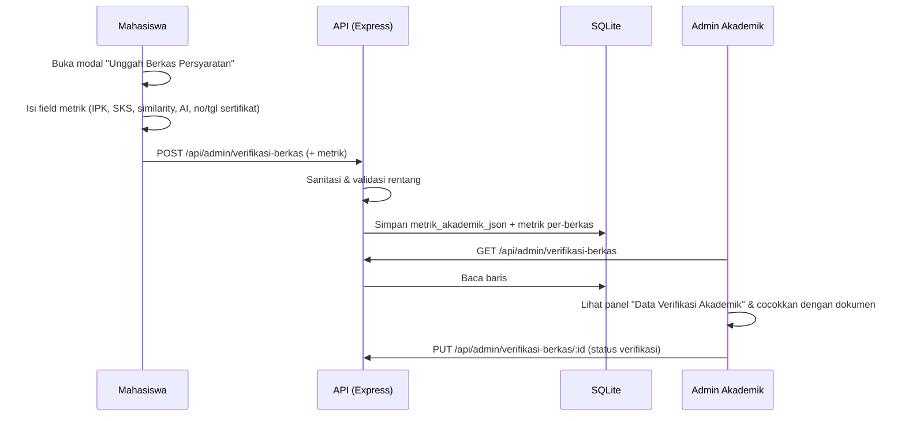

# Fitur Metrik Verifikasi Akademik

Dokumen ini menjelaskan fitur pengisian data terstruktur oleh mahasiswa saat
mengunggah dokumen persyaratan, agar Admin Akademik cukup **memverifikasi
kebenaran angka** tanpa harus menafsirkan teks bebas.

## 1. Latar belakang & tujuan

Sebelumnya, mahasiswa hanya melampirkan berkas dan catatan bebas. Admin harus
membaca setiap dokumen untuk menemukan angka penting (IPK, SKS, skor plagiasi,
dsb.). Dengan fitur ini, mahasiswa mengisi angka terstruktur yang langsung
tampil berdampingan dengan berkas, sehingga verifikasi lebih cepat dan konsisten.

## 2. Field metrik

| Field | Tipe | Rentang valid | Relevan untuk |
|---|---|---|---|
| `ipk` | number | 0 – 4 | Transkrip / KRS (Administrasi Akademik) |
| `sksLulus` | number | 0 – 300 | Transkrip / KRS (Administrasi Akademik) |
| `toeflScore` | number | 0 – 700 | Sertifikat bahasa Inggris (Kompetensi Bahasa) |
| `similarity` | number (%) | 0 – 100 | Turnitin (Integritas Akademik) |
| `aiDetection` | number (%) | 0 – 100 | Turnitin (Integritas Akademik) |
| `sertifikatNo` | string | maks 200 char | Sertifikat/surat apa pun |
| `sertifikatTgl` | string (YYYY-MM-DD) | maks 20 char | Sertifikat/surat apa pun |

Semua field **opsional** — mahasiswa mengisi yang relevan. Field kosong tidak
dikirim (menjadi `null`).

## 3. Alur



## 4. Model data

- Tabel `pendaftaran_ujian` mendapat kolom baru **`metrik_akademik_json`** (TEXT),
  menyimpan objek metrik agregat (migrasi otomatis saat server start).
- Metrik juga **disisipkan ke item berkas** yang bersangkutan di dalam
  `berkas_json` (`berkasList[n].metrik`), sehingga nilai tertaut ke dokumen yang diverifikasi.

Contoh isi `metrik_akademik_json`:

```json
{
  "ipk": 3.74,
  "sksLulus": 126,
  "toeflScore": 487,
  "similarity": 18,
  "aiDetection": 22,
  "sertifikatNo": "NO.SK-PLAG-S1/FEB-UTM/10/2026",
  "sertifikatTgl": "2026-10-10"
}
```

## 5. API

### `POST /api/admin/verifikasi-berkas`
Peran: `mahasiswa`, `admin`, `superadmin`.

Body (potongan relevan):
```jsonc
{
  "nim": "210211100142",
  "namaMahasiswa": "Dinda Ayu Larasati",
  "berkasList": [ { "id": "krs_s1_takt", "nama": "Transkrip", "file": "tr.pdf" } ],
  "metrik": { "ipk": 3.74, "sksLulus": 126, "similarity": 18, "aiDetection": 22 }
}
```

**Aturan sanitasi (server):**
- Nilai di luar rentang valid **dibuang** (mis. `ipk: 9.9`, `similarity: 150`).
- Bukan angka → dibuang. String kosong → tidak disimpan.
- Bila tidak ada field valid, `metrik_akademik_json` disimpan `null`.
- Nilai valid yang tersisa tetap disimpan (sanitasi per-field, bukan semua-atau-tidak).

### `GET /api/admin/verifikasi-berkas`
Peran: `admin`, `koorprodi`, `superadmin`. Mengembalikan setiap baris dengan
`metrikAkademik` (objek hasil parse `metrik_akademik_json`, atau `null`).

## 6. Antarmuka

- **Mahasiswa** (`src/pages/mahasiswa/PersyaratanPage.jsx`): panel
  "Data Verifikasi Akademik" pada modal unggah. Nilai awal diambil dari profil
  mahasiswa (IPK/SKS/TOEFL/similarity/AI) dan dapat disesuaikan.
- **Admin** (`src/pages/admin/VerifikasiBerkasPage.jsx`): panel
  "Data Verifikasi Akademik (diisikan oleh Mahasiswa)" pada modal "Periksa Berkas",
  menampilkan tiap metrik dengan label; metrik per-berkas ditampilkan terpisah.
  Halaman menyinkronkan data terbaru dari API saat dibuka.

## 7. Pengujian

- `tests/regression_metrik.test.js` — API + DB: penyimpanan, sanitasi rentang,
  pembacaan kembali oleh admin, dan kontrol akses (13 asersi).
- `tests/e2e_browser.test.js` (bagian 8) — browser: mahasiswa mengisi metrik →
  tersimpan di SQLite → admin melihat panel metrik.

Jalankan: `npm run test:metrik` atau seluruhnya `npm test`.

## 8. Catatan pengembangan lanjutan

- Field metrik saat ini ditampilkan untuk **semua** jenis persyaratan (belum
  kontekstual per jenis).
- Ringkasan metrik belum ditampilkan pada kolom tabel verifikasi admin (baru
  muncul setelah membuka modal "Periksa Berkas").

---

*Bagian dari pengembangan SIM-TA FEB UTM — verifikasi berkas yang lebih efisien.*
