# PEDOMAN PENGGUNAAN SIM-TA FEB UTM

**Sistem Manajemen Tugas Akhir, Tesis, dan Disertasi**
**Fakultas Ekonomi dan Bisnis — Universitas Trunojoyo Madura**

---

| Keterangan | Isi |
|---|---|
| Nama Sistem | SIM-TA FEB UTM (Sistem Informasi Manajemen Tugas Akhir) |
| Unit Pengelola | Jurusan Manajemen, Fakultas Ekonomi dan Bisnis, Universitas Trunojoyo Madura |
| Cakupan Jenjang | D3 Entrepreneurship, S1 Manajemen, S2 Magister Manajemen, S3 Doktor Ilmu Manajemen |
| Versi Dokumen | 1.0 |
| Tanggal Terbit | 13 Oktober 2026 |
| Dasar Hukum | Buku Pedoman Tugas Akhir Jurusan Manajemen FEB UTM 2026 |
| Penyusun | Tim Penyusun Pedoman Penggunaan SIM-TA FEB UTM |
| Alamat Aplikasi | http://localhost:5173 (lingkungan pengembangan lokal) |
| Alamat API | http://localhost:5001 |

> Dokumen ini disusun berdasarkan antarmuka aplikasi SIM-TA FEB UTM yang sedang berjalan.
> Seluruh tangkapan layar diambil langsung dari aplikasi menggunakan akun demo resmi.

---

## 2. Daftar Isi

- [1. Halaman Judul](#pedoman-penggunaan-sim-ta-feb-utm)
- [2. Daftar Isi](#2-daftar-isi)
- [3. Tentang Sistem dan Tujuan](#3-tentang-sistem-dan-tujuan)
- [4. Persyaratan Akses](#4-persyaratan-akses)
- [5. Cara Login dan Akun Demo](#5-cara-login-dan-akun-demo)
- [6. Peran dan Hak Akses](#6-peran-dan-hak-akses)
- [7. Panduan per Peran](#7-panduan-per-peran)
  - [7.1 Mahasiswa](#71-mahasiswa)
  - [7.2 Dosen Pembimbing](#72-dosen-pembimbing)
  - [7.3 Dewan Penguji](#73-dewan-penguji)
  - [7.4 Koorprodi](#74-koorprodi)
  - [7.5 Admin Akademik](#75-admin-akademik)
  - [7.6 Superadmin](#76-superadmin)
- [8. Alur Proses Utama End-to-End](#8-alur-proses-utama-end-to-end)
- [9. Standar Operasional Prosedur (SOP)](#9-standar-operasional-prosedur-sop)
  - [9.1 SOP Bimbingan](#91-sop-bimbingan)
  - [9.2 SOP Unggah Naskah, Uji Turnitin, dan Bebas Plagiasi](#92-sop-unggah-naskah-uji-turnitin-dan-bebas-plagiasi)
  - [9.3 SOP Verifikasi Berkas dan Pendaftaran Ujian](#93-sop-verifikasi-berkas-dan-pendaftaran-ujian)
  - [9.4 SOP Plotting Pembimbing dan Penetapan Dewan Penguji](#94-sop-plotting-pembimbing-dan-penetapan-dewan-penguji)
  - [9.5 SOP Penjadwalan dan Pelaksanaan Ujian/Sidang](#95-sop-penjadwalan-dan-pelaksanaan-ujiansidang)
  - [9.6 SOP Penilaian dan Pengesahan Nilai](#96-sop-penilaian-dan-pengesahan-nilai)
  - [9.7 SOP Revisi Pasca Ujian](#97-sop-revisi-pasca-ujian)
  - [9.8 SOP Penerbitan Dokumen, SK, dan Berita Acara](#98-sop-penerbitan-dokumen-sk-dan-berita-acara)
  - [9.9 SOP Publikasi Ilmiah dan Skema TAKK](#99-sop-publikasi-ilmiah-dan-skema-takk)
  - [9.10 Aturan Kelayakan Akademik per Jenjang](#910-aturan-kelayakan-akademik-per-jenjang)
  - [9.11 SOP Administrasi dan Linimasa Tahapan per Jenjang](#911-sop-administrasi-dan-linimasa-tahapan-per-jenjang)
  - [9.12 Matriks Ringkas SOP per Peran](#912-matriks-ringkas-sop-per-peran)
- [10. Fitur Lain](#10-fitur-lain)
- [11. Troubleshooting dan FAQ](#11-troubleshooting-dan-faq)
- [12. Glosarium](#12-glosarium)

### Daftar Gambar

| Gambar | Berkas | Keterangan |
|---|---|---|
| Gambar 1 | 01-login.png | Halaman login SIM-TA |
| Gambar 2 | 02-login-akun-demo.png | Cara login dan Akses Cepat Pengujian / Akun Demo |
| Gambar 3 | 03-mahasiswa-dashboard.png | Dashboard Mahasiswa |
| Gambar 4 | 04-mahasiswa-detail-tugas-akhir.png | Detail Tugas Akhir Mahasiswa |
| Gambar 5 | 05-mahasiswa-tahapan.png | Tahapan Mahasiswa |
| Gambar 6 | 06-mahasiswa-persyaratan.png | Persyaratan Mahasiswa |
| Gambar 7 | 07-mahasiswa-bimbingan.png | Bimbingan Mahasiswa |
| Gambar 8 | 08-mahasiswa-naskah.png | Naskah Mahasiswa |
| Gambar 9 | 09-mahasiswa-ujian.png | Ujian Mahasiswa |
| Gambar 10 | 10-mahasiswa-revisi.png | Revisi Mahasiswa |
| Gambar 11 | 11-mahasiswa-publikasi.png | Publikasi Mahasiswa |
| Gambar 12 | 12-mahasiswa-dokumen.png | Dokumen Mahasiswa |
| Gambar 13 | 13-dosen-dashboard.png | Dashboard Dosen Pembimbing |
| Gambar 14 | 14-dosen-mahasiswa-bimbingan.png | Mahasiswa Bimbingan |
| Gambar 15 | 15-dosen-bimbingan.png | Bimbingan Dosen |
| Gambar 16 | 16-dosen-naskah-masuk.png | Naskah Masuk |
| Gambar 17 | 17-dosen-review-naskah.png | Review Naskah |
| Gambar 18 | 18-dosen-persetujuan.png | Persetujuan Dosen |
| Gambar 19 | 19-dosen-pemantauan-revisi.png | Pemantauan Revisi Dosen |
| Gambar 20 | 20-dosen-jadwal-ujian.png | Jadwal Ujian Dosen |
| Gambar 21 | 21-penguji-dashboard.png | Dashboard Dewan Penguji |
| Gambar 22 | 22-penguji-daftar-ujian.png | Daftar Ujian Penguji |
| Gambar 23 | 23-penguji-naskah-ujian.png | Naskah Ujian |
| Gambar 24 | 24-penguji-form-penilaian.png | Form Penilaian |
| Gambar 25 | 25-penguji-catatan-koreksi.png | Catatan / Koreksi |
| Gambar 26 | 26-penguji-verifikasi-revisi.png | Verifikasi Revisi |
| Gambar 27 | 27-koorprodi-dashboard.png | Dashboard Koorprodi |
| Gambar 28 | 28-koorprodi-daftar-mahasiswa.png | Daftar Mahasiswa |
| Gambar 29 | 29-koorprodi-pengajuan-masuk.png | Pengajuan Masuk |
| Gambar 30 | 30-koorprodi-plotting-pembimbing.png | Plotting Pembimbing |
| Gambar 31 | 31-koorprodi-dewan-penguji.png | Dewan Penguji (Koorprodi) |
| Gambar 32 | 32-koorprodi-penerbitan-dokumen-kolektif.png | Penerbitan Dokumen Kolektif |
| Gambar 33 | 33-koorprodi-jadwal-ujian-sidang.png | Jadwal Ujian dan Sidang |
| Gambar 34 | 34-koorprodi-matriks-persyaratan.png | Matriks Persyaratan |
| Gambar 35 | 35-koorprodi-pemantauan-revisi.png | Pemantauan Revisi Koorprodi |
| Gambar 36 | 36-koorprodi-arsip-dokumen-prodi.png | Arsip Dokumen Prodi |
| Gambar 37 | 37-admin-dashboard.png | Dashboard Admin Akademik |
| Gambar 38 | 38-admin-jadwal-tahapan.png | Jadwal Tahapan |
| Gambar 39 | 39-admin-otomasi-dokumen.png | Otomasi Dokumen |
| Gambar 40 | 40-admin-verifikasi-berkas.png | Verifikasi Berkas |
| Gambar 41 | 41-admin-penerbitan-sk.png | Penerbitan SK |
| Gambar 42 | 42-admin-alokasi-ruang-sidang.png | Alokasi Ruang Sidang |
| Gambar 43 | 43-superadmin-dashboard.png | Dashboard Superadmin |
| Gambar 44 | 44-superadmin-master-data-prodi.png | Master Data Prodi |
| Gambar 45 | 45-superadmin-tahapan-regulasi.png | Tahapan dan Regulasi |
| Gambar 46 | 46-superadmin-kuota-bimbingan.png | Kuota Bimbingan |
| Gambar 47 | 47-superadmin-manajemen-pengguna.png | Manajemen Pengguna |
| Gambar 48 | 48-notifikasi.png | Panel Notifikasi dan Action Item |
| Gambar 49 | 49-ganti-kata-sandi.png | Modal Pembaruan Kata Sandi Akun |
| Gambar 50 | 50-menu-mobile-drawer.png | Menu drawer pada tampilan mobile |

---

## 3. Tentang Sistem dan Tujuan

SIM-TA FEB UTM adalah sistem informasi terpadu yang mengelola seluruh siklus Tugas Akhir, Tesis, dan Disertasi di Jurusan Manajemen Fakultas Ekonomi dan Bisnis Universitas Trunojoyo Madura, mulai dari pengajuan topik dan plotting pembimbing, penyusunan proposal, pencatatan bimbingan, pengunggahan naskah, verifikasi kelengkapan persyaratan, pendaftaran ujian, penetapan dewan penguji, penjadwalan dan alokasi ruang sidang, penilaian serta berita acara, pemantauan revisi, hingga publikasi dan pengesahan dokumen; sistem ini bertujuan menyatukan seluruh proses tersebut dalam satu pangkalan data yang tertelusur, transparan, dan sesuai Buku Pedoman Tugas Akhir Jurusan Manajemen FEB UTM 2026 sehingga setiap pemangku kepentingan (mahasiswa, dosen pembimbing, dewan penguji, koorprodi, admin akademik, dan superadmin) memperoleh hak akses yang tepat sesuai perannya.

---

## 4. Persyaratan Akses

| Komponen | Ketentuan |
|---|---|
| Peramban (browser) | Google Chrome, Microsoft Edge, Mozilla Firefox, atau Safari versi terbaru (mendukung JavaScript modern) |
| Resolusi layar | Minimal 1366 x 768 piksel; optimal 1440 x 900 piksel |
| Jaringan | Terhubung ke jaringan kampus atau internet stabil (aplikasi memanggil API pada port 5001) |
| Alamat Frontend | http://localhost:5173 |
| Alamat Backend API | http://localhost:5001 |
| Akun | Nomor Induk (NIM/NIP) atau email institusi, beserta kata sandi akun |
| Perangkat | Komputer/laptop, tablet, atau telepon pintar (tersedia tampilan mobile dengan menu drawer) |

Halaman pertama yang ditampilkan saat membuka alamat aplikasi adalah halaman login institusional, seperti pada Gambar 1.

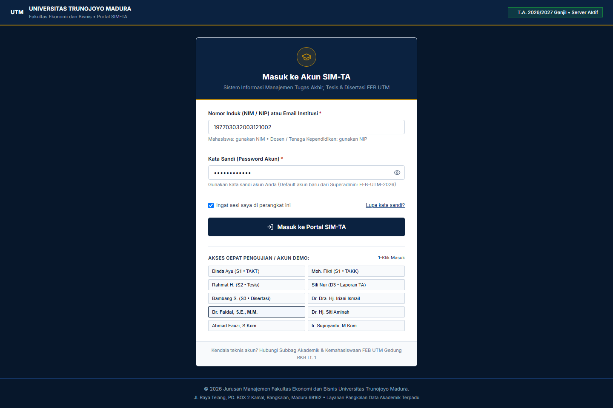

> **Catatan.** Pada lingkungan pengembangan, sistem menampilkan indikator status server ("T.A. 2026/2027 Ganjil • Server Aktif") di bagian kanan atas halaman login.

---

## 5. Cara Login dan Akun Demo

Lakukan langkah berikut untuk masuk ke aplikasi:

1. Buka peramban dan akses http://localhost:5173. Halaman login akan tampil seperti pada Gambar 1.
2. Isi kolom **Nomor Induk (NIM / NIP) atau Email Institusi** dengan NIM atau NIP Anda.
3. Isi kolom **Kata Sandi (Password Akun)** dengan kata sandi akun Anda.
4. (Opsional) Biarkan **Ingat sesi saya di perangkat ini** tercentang bila perangkat bersifat pribadi.
5. Klik tombol **Masuk ke Portal SIM-TA**.
6. Bila kredensial benar, sistem menampilkan pesan keberhasilan dan mengarahkan Anda ke portal sesuai peran.

Penjelasan setiap elemen formulir dan panel **Akses Cepat Pengujian / Akun Demo** ditunjukkan pada Gambar 2.

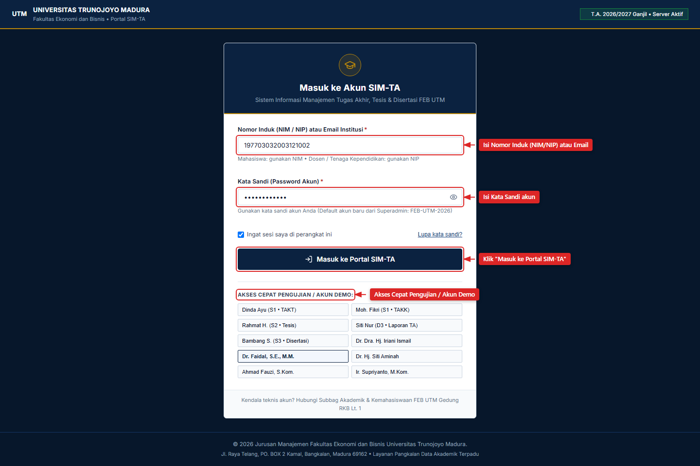

### Akun Demo untuk Pengujian

Aplikasi menyediakan panel **Akses Cepat Pengujian / Akun Demo** di bawah formulir login. Klik salah satu tombol untuk mengisi NIM/NIP secara otomatis, kemudian klik **Masuk ke Portal SIM-TA**. Kata sandi default seluruh akun demo adalah **FEB-UTM-2026**.

| Peran | Nomor Induk (NIM/NIP) | Keterangan pada Panel Demo |
|---|---|---|
| Mahasiswa S1 | 210211100142 | Dinda Ayu (S1 • TAKT) — Skripsi Reguler |
| Mahasiswa S1 | 210211100219 | Moh. Fikri (S1 • TAKK) — Portofolio Bisnis |
| Mahasiswa S2 | 230221600018 | Rahmat H. (S2 • Tesis) |
| Mahasiswa D3 | 230201100055 | Siti Nur (D3 • Laporan TA) |
| Mahasiswa S3 | 220231600004 | Bambang S. (S3 • Disertasi) |
| Dosen Pembimbing | 196201081987032001 | Dr. Dra. Hj. Iriani Ismail |
| Dewan Penguji | 197703032003121002 | Dr. Faidal, S.E., M.M. |
| Koorprodi | 197802142003122001 | Dr. Hj. Siti Aminah |
| Admin Akademik | 198104122008121002 | Ahmad Fauzi, S.Kom. |
| Superadmin | 197405102000031001 | Ir. Supriyanto, M.Kom. |

> **Peringatan.** Akun demo hanya untuk keperluan pengujian dan pelatihan. Jangan menggunakan data pribadi nyata di luar akun demo pada lingkungan demonstrasi.

### Lupa Kata Sandi

1. Klik tautan **Lupa kata sandi?** pada halaman login.
2. Isi Nomor Induk atau email institusi Anda pada modal yang muncul.
3. Sistem mengirimkan tautan pemulihan ke alamat email institusi terdaftar.

---

## 6. Peran dan Hak Akses

Aplikasi mengenali enam peran dengan menu utama sebagai berikut (label menu sesuai antarmuka).

| Peran | Menu Utama |
|---|---|
| Mahasiswa | Dashboard, Detail Tugas Akhir, Tahapan, Persyaratan, Bimbingan, Naskah, Ujian, Revisi, Publikasi, Dokumen |
| Dosen Pembimbing | Dashboard, Mahasiswa Bimbingan, Bimbingan, Naskah Masuk, Review Naskah, Persetujuan, Pemantauan Revisi, Jadwal Ujian |
| Dewan Penguji | Dashboard, Daftar Ujian, Naskah Ujian, Form Penilaian, Catatan / Koreksi, Verifikasi Revisi |
| Koorprodi | Dashboard, Daftar Mahasiswa, Pengajuan Masuk, Plotting Pembimbing, Dewan Penguji, Penerbitan Dokumen Kolektif, Jadwal Ujian & Sidang, Matriks Persyaratan, Pemantauan Revisi, Arsip Dokumen Prodi |
| Admin Akademik | Dashboard, Jadwal Tahapan, Otomasi Dokumen, Verifikasi Berkas, Penerbitan SK, Alokasi Ruang Sidang |
| Superadmin | Dashboard, Master Data Prodi, Tahapan & Regulasi, Kuota Bimbingan, Manajemen Pengguna |

> **Catatan.** Perpindahan peran kerja aktif dilakukan melalui menu profil di kanan atas, dan hanya tersedia bagi akun yang memiliki penugasan lebih dari satu peran (umumnya dosen/tenaga kependidikan). Akun mahasiswa terkunci pada peran mahasiswa.

---

## 7. Panduan per Peran

Setiap bab peran memuat ringkasan tugas, langkah kerja, tabel kolom/tombol penting, serta catatan dan peringatan.

### 7.1 Mahasiswa

**a. Ringkasan tugas.** Mahasiswa mengelola seluruh kelengkapan tugas akhirnya: melihat ringkasan progres, melengkapi berkas persyaratan, mencatat bimbingan, mengunggah naskah, mendaftar ujian, menindaklanjuti revisi, mencatat publikasi, dan mengunduh dokumen resmi.

**b. Langkah kerja.**

1. Masuk dengan akun mahasiswa. Sistem menampilkan ringkasan posisi akademik, judul terdaftar, dan agenda sidang seperti pada Gambar 3.

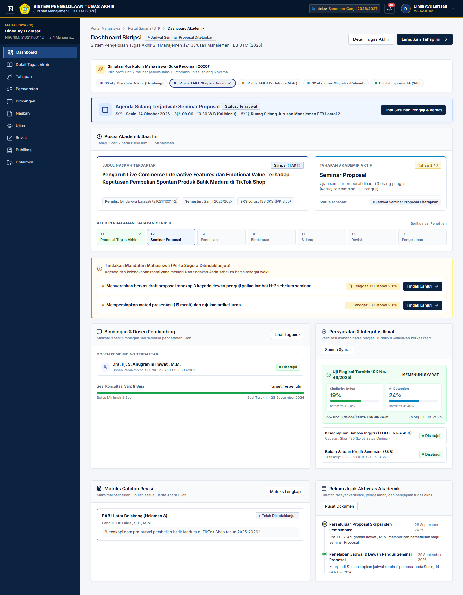

2. Klik menu **Detail Tugas Akhir** untuk memeriksa identitas karya ilmiah dan skema tugas akhir (Gambar 4). Gunakan tombol **Cetak Lembar Identitas** untuk mengunduh lembar identitas, atau **Ajukan Perubahan Judul** untuk mengajukan perubahan judul.

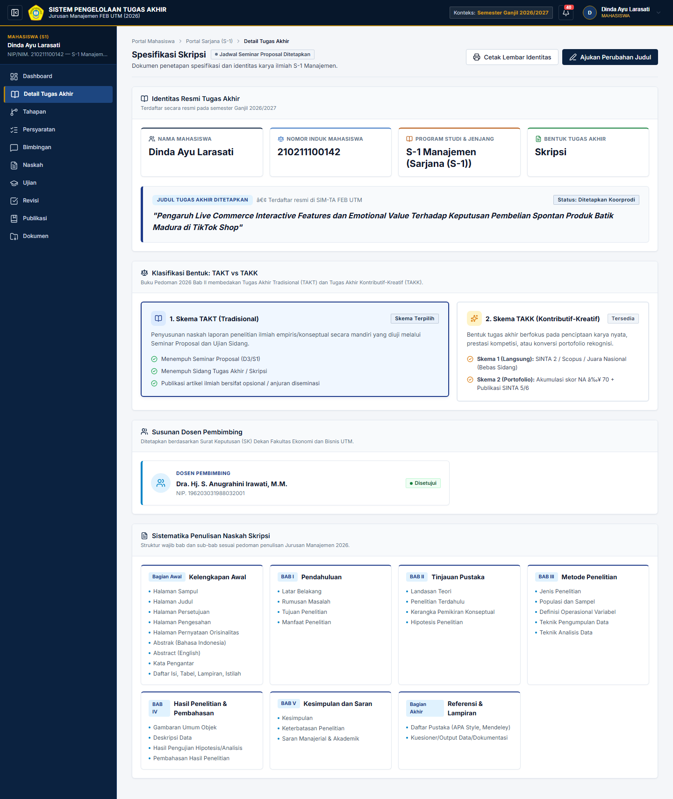

3. Klik menu **Tahapan** untuk melihat alur perjalanan akademik dan posisi tahap aktif (Gambar 5). Klik **Lihat Persyaratan Tahap Ini** atau **Buka Rincian & Jadwal Ujian** untuk menelusuri kelengkapan tahap berjalan.

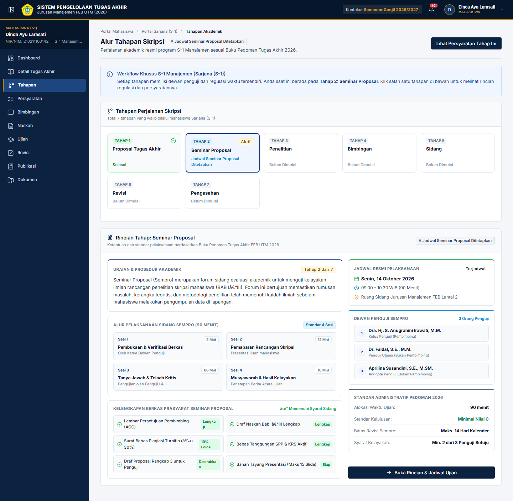

4. Klik menu **Persyaratan** untuk melengkapi berkas (Gambar 6). Klik **Unggah Berkas Persyaratan**, pilih **Jenis Persyaratan** yang sesuai pada formulir, unggah berkas, lalu klik **Unggah**. Berkas akan masuk ke antrean verifikasi Admin Akademik.

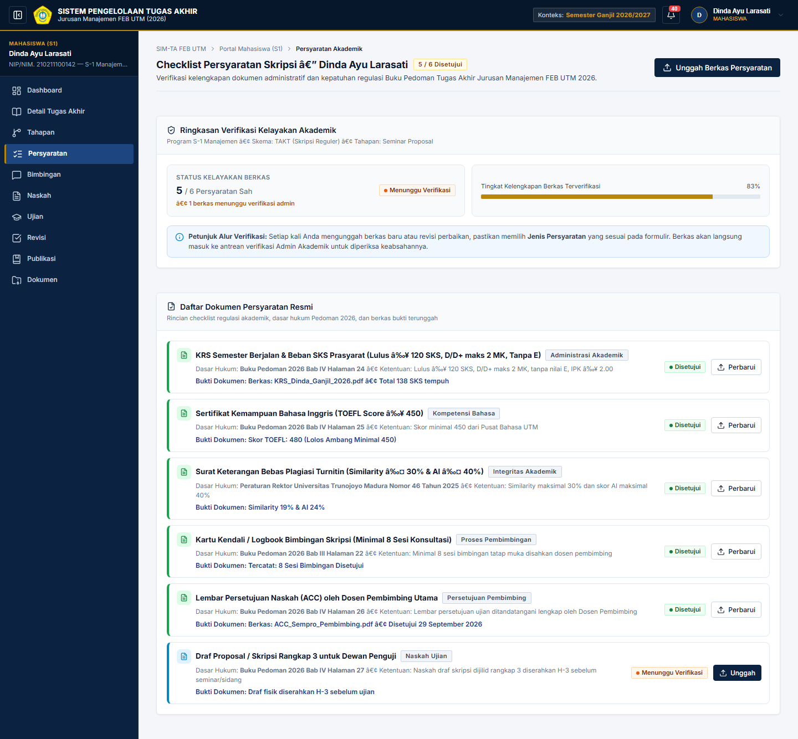

5. Klik menu **Bimbingan** untuk melihat logbook bimbingan (Gambar 7). Klik **Catat Sesi Bimbingan** untuk mencatat sesi baru, atau **Cetak Rekap Bimbingan** untuk mengunduh rekap.

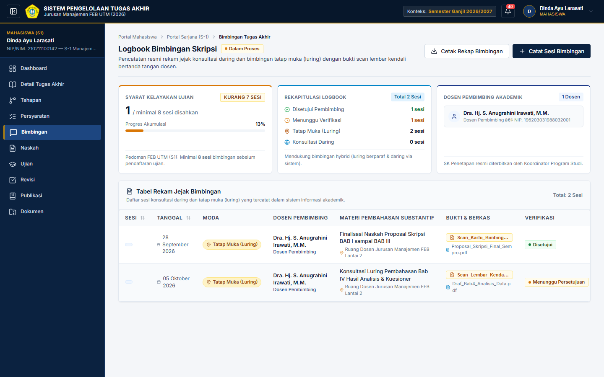

6. Klik menu **Naskah** untuk mengelola naskah (Gambar 8). Gunakan tab **Dossier Naskah Aktif**, **Uji Plagiasi Turnitin**, dan **Riwayat Versi Draf**, serta tombol **Unggah Versi Baru** dan **Unduh Naskah Terkini**.

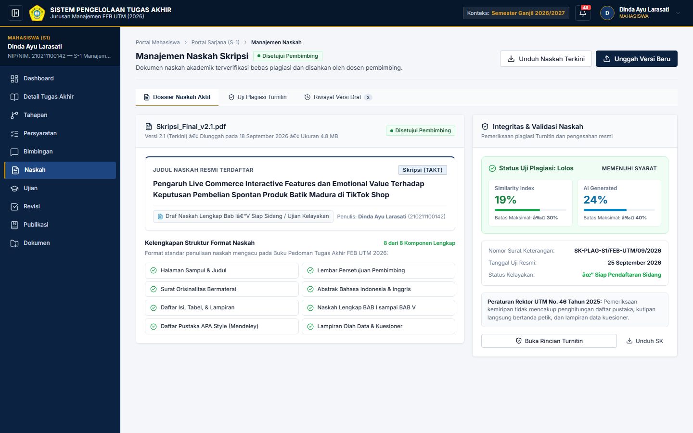

7. Klik menu **Ujian** untuk melihat jadwal dan susunan dewan penguji (Gambar 9). Klik **Pendaftaran Ujian** untuk mendaftar, atau **Unduh Jadwal & Dokumen** untuk mengunduh berkas ujian.

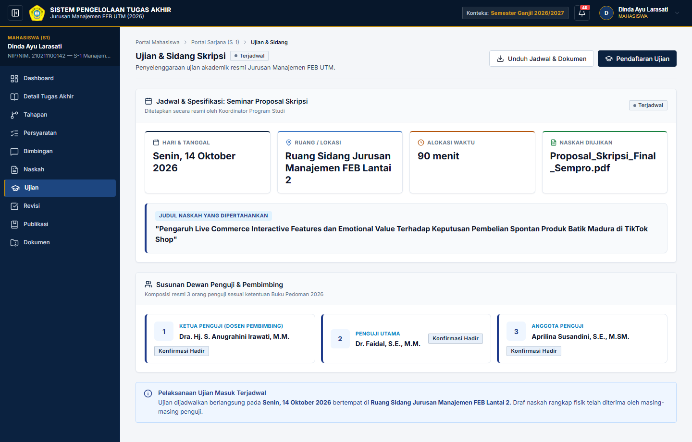

8. Klik menu **Revisi** untuk menindaklanjuti catatan dewan penguji (Gambar 10). Klik **Tindak Lanjuti** pada setiap butir, lalu **Cetak Matriks Pengesahan** setelah seluruh butir selesai.

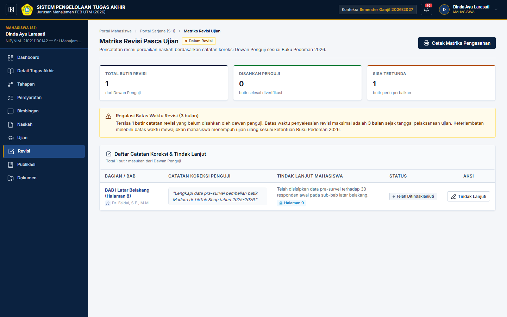

9. Klik menu **Publikasi** untuk mencatat luaran ilmiah (Gambar 11). Klik **Daftarkan Publikasi Baru** bila artikel telah terbit.

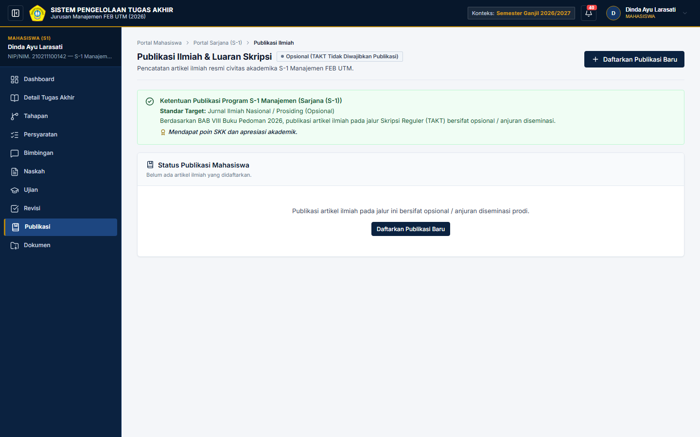

10. Klik menu **Dokumen** untuk mengakses arsip dokumen resmi (Gambar 12). Gunakan filter kategori (**Semua**, **Naskah**, **Bukti Plagiasi**, **Publikasi**, **Berita Acara**, **Persyaratan**) dan tombol **Cetak Lembar Pengesahan**, **Cetak Kartu Bimbingan**, atau **Unggah Naskah / Berkas**.

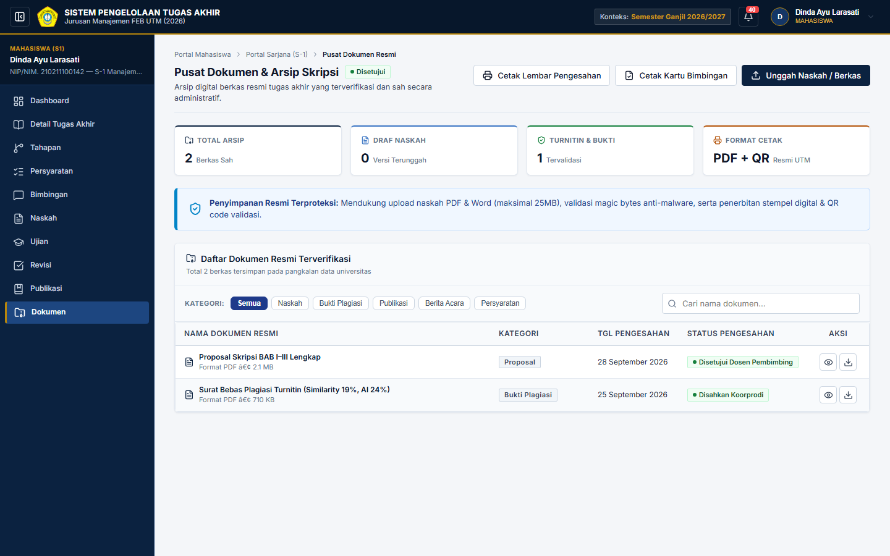

**c. Kolom dan tombol penting.**

| Halaman | Kolom | Tombol Utama |
|---|---|---|
| Dashboard | Posisi Akademik Saat Ini, Judul Naskah Terdaftar, Tahapan Akademik Aktif | Detail Tugas Akhir, Lanjutkan Tahap Ini |
| Bimbingan | Sesi, Tanggal, Moda, Dosen Pembimbing, Materi Pembahasan Substantif, Bukti & Berkas, Verifikasi, Aksi | Catat Sesi Bimbingan, Cetak Rekap Bimbingan |
| Revisi | Bagian / Bab, Catatan Koreksi Penguji, Tindak Lanjut Mahasiswa, Status, Aksi | Tindak Lanjuti, Cetak Matriks Pengesahan |
| Dokumen | Nama Dokumen Resmi, Kategori, Tgl Pengesahan, Status Pengesahan, Aksi | Cetak Lembar Pengesahan, Unggah Naskah / Berkas |

**d. Catatan dan peringatan.**

- Persyaratan kelayakan S1 (TAKT) mengacu Buku Pedoman 2026 Bab IV: lulus minimal 120 SKS, IPK minimal 2.00, TOEFL minimal 450, serta Turnitin Similarity maksimal 30% dan AI maksimal 40%.
- Batas waktu penyelesaian revisi maksimal 3 bulan sejak tanggal ujian; keterlambatan melebihi batas waktu mewajibkan ujian ulang.
- Pada jalur Skripsi Reguler (TAKT), publikasi artikel ilmiah bersifat opsional/anjuran diseminasi.

### 7.2 Dosen Pembimbing

**a. Ringkasan tugas.** Dosen pembimbing/promotor memantau mahasiswa bimbingan, mencatat dan mengesahkan bimbingan, menelaah naskah, memberi persetujuan maju ujian, memantau revisi, serta mengikuti jadwal ujian.

**b. Langkah kerja.**

1. Masuk dengan akun dosen. Dashboard menampilkan ringkasan mahasiswa bimbingan, naskah yang perlu review, antrean persetujuan, dan jadwal ujian terdekat seperti pada Gambar 13.

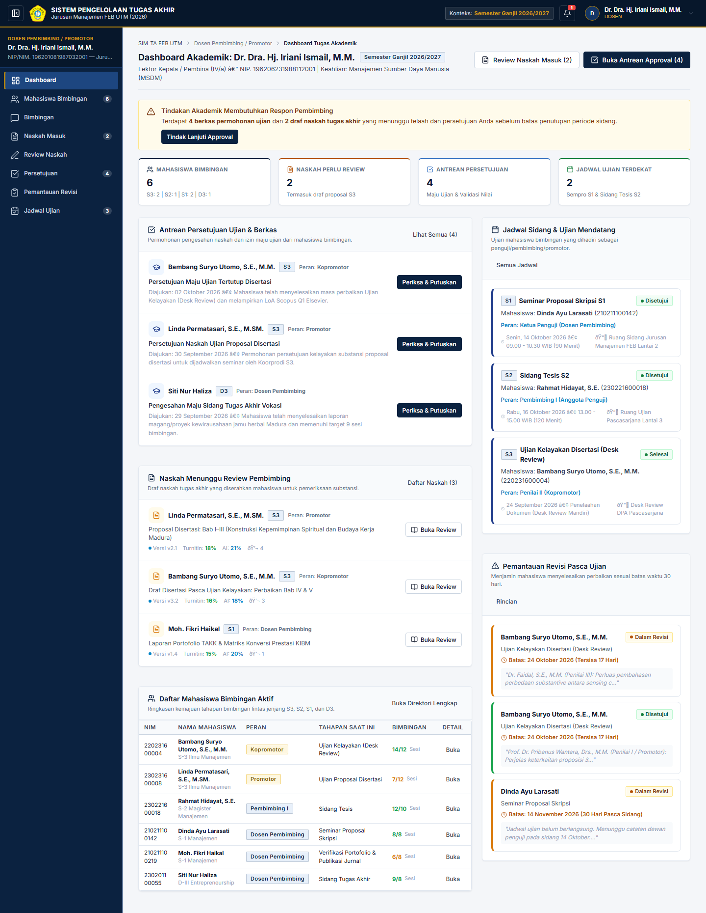

2. Klik menu **Mahasiswa Bimbingan** untuk melihat direktori mahasiswa (Gambar 14). Gunakan filter jenjang (**Semua Jenjang**, **S3**, **S2**, **S1**, **D3**) dan tombol **Detail** atau **Catat Konsultasi Baru**.

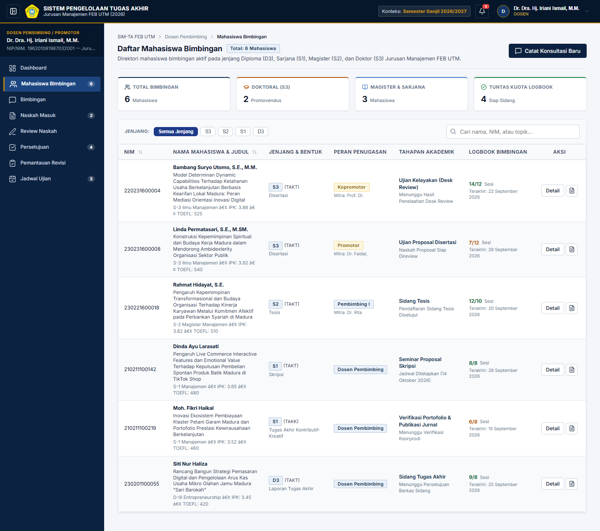

3. Klik menu **Bimbingan** untuk mengelola logbook (Gambar 15). Klik **Catat Sesi Bimbingan Baru** untuk menambah catatan dan **Sahkan** untuk mengesahkan bukti scan lembar kendali.

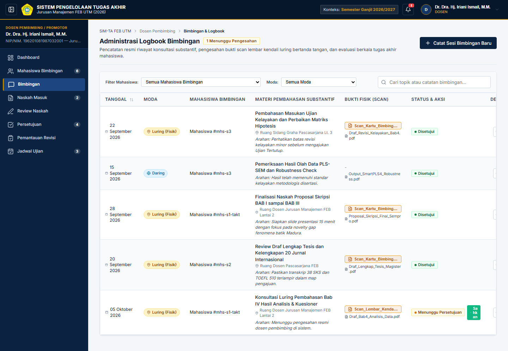

4. Klik menu **Naskah Masuk** untuk memeriksa draf naskah (Gambar 16). Klik **Review** untuk menelaah atau **Buka Lembar Persetujuan (Approval)** untuk langsung membuka lembar persetujuan.

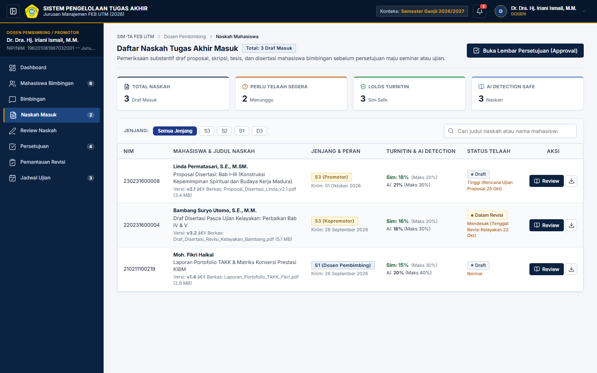

5. Pada halaman **Review Naskah** (Gambar 17), gunakan mode **PDF** atau **Teks Bab**, klik **Tambah Catatan Telaah** untuk memberi catatan, lalu **Lanjut ke Persetujuan (Approval)**.

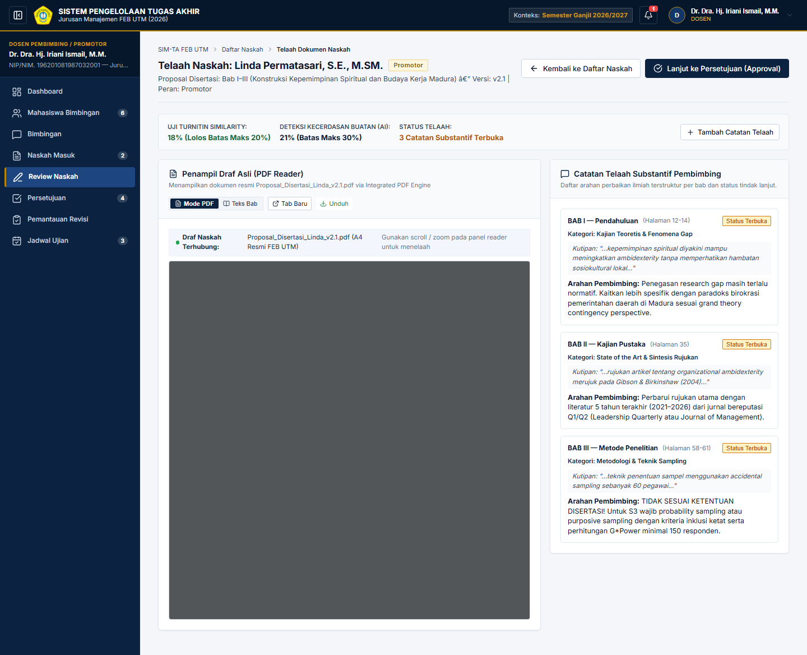

6. Klik menu **Persetujuan** untuk memutuskan permohonan maju ujian (Gambar 18). Gunakan tombol **Setujui Maju Ujian**, **Kembalikan untuk Perbaikan**, atau **Tolak Permohonan**.

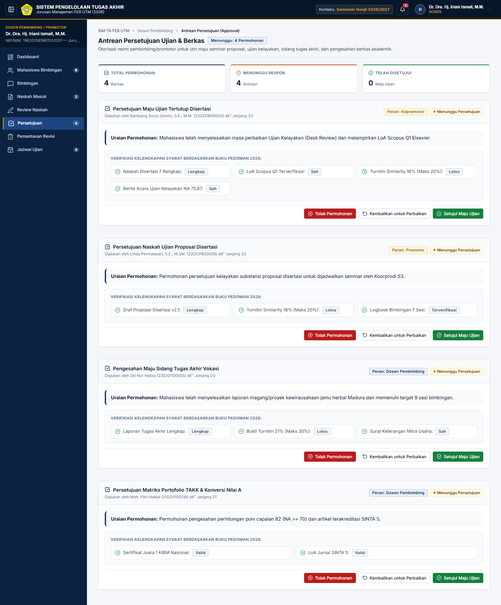

7. Klik menu **Pemantauan Revisi** untuk memantau respon perbaikan mahasiswa (Gambar 19), lengkap dengan kolom **Batas Waktu** dan **Status Revisi**.

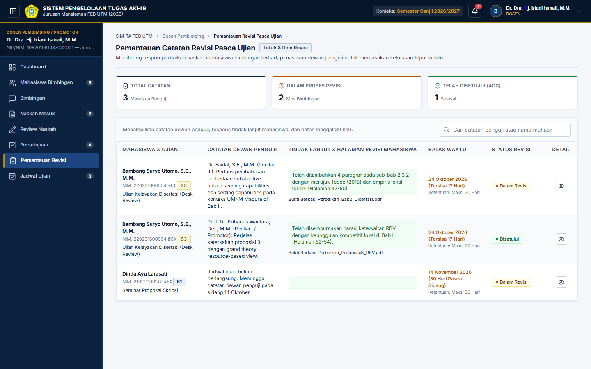

8. Klik menu **Jadwal Ujian** untuk melihat agenda sidang (Gambar 20). Klik **Lihat Sidang** untuk membuka rincian.

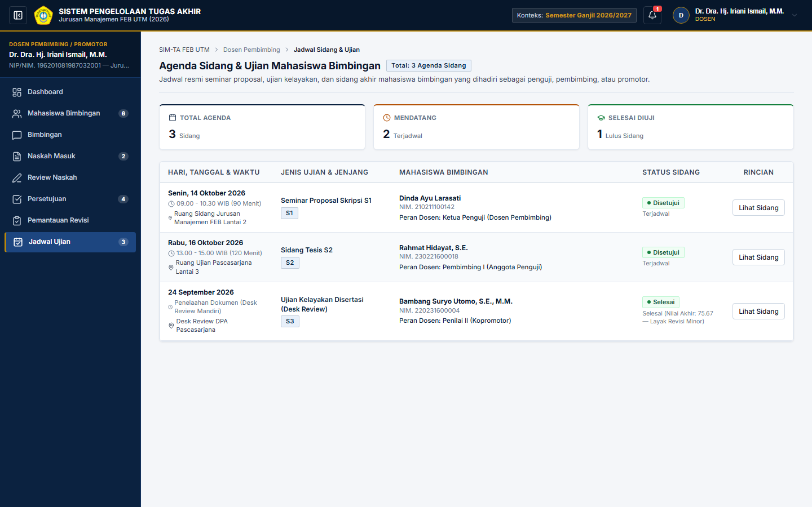

**c. Kolom dan tombol penting.**

| Halaman | Kolom | Tombol Utama |
|---|---|---|
| Mahasiswa Bimbingan | NIM, Nama Mahasiswa & Judul, Jenjang & Bentuk, Peran Penugasan, Tahapan Akademik, Logbook Bimbingan, Aksi | Catat Konsultasi Baru, Detail |
| Bimbingan | Tanggal, Moda, Mahasiswa Bimbingan, Materi Pembahasan Substantif, Bukti Fisik (Scan), Status & Aksi, Detail | Catat Sesi Bimbingan Baru, Sahkan |
| Naskah Masuk | NIM, Mahasiswa & Judul Naskah, Jenjang & Peran, Turnitin & AI Detection, Status Telaah, Aksi | Review, Buka Lembar Persetujuan (Approval) |
| Persetujuan | Uraian Permohonan, Verifikasi Kelengkapan Syarat | Setujui Maju Ujian, Kembalikan untuk Perbaikan, Tolak Permohonan |
| Pemantauan Revisi | Mahasiswa & Ujian, Catatan Dewan Penguji, Tindak Lanjut & Halaman Revisi Mahasiswa, Batas Waktu, Status Revisi, Detail | — |
| Jadwal Ujian | Hari, Tanggal & Waktu, Jenis Ujian & Jenjang, Mahasiswa Bimbingan, Status Sidang, Rincian | Lihat Sidang |

**d. Catatan dan peringatan.**

- Setiap sesi bimbingan wajib memiliki bukti scan lembar kendali bertanda tangan agar dapat disahkan.
- Persetujuan maju ujian hanya dapat diberikan bila seluruh syarat kelengkapan (naskah, Turnitin, logbook bimbingan) terpenuhi.

### 7.3 Dewan Penguji

**a. Ringkasan tugas.** Dewan penguji menelaah naskah ujian, mengisi rubrik penilaian dan mengesahkan nilai, mencatat koreksi, serta memverifikasi revisi naskah pasca ujian.

**b. Langkah kerja.**

1. Masuk dengan akun penguji. Dashboard menampilkan agenda sidang yang perlu dinilai, approval revisi, dan filter jenjang seperti pada Gambar 21.

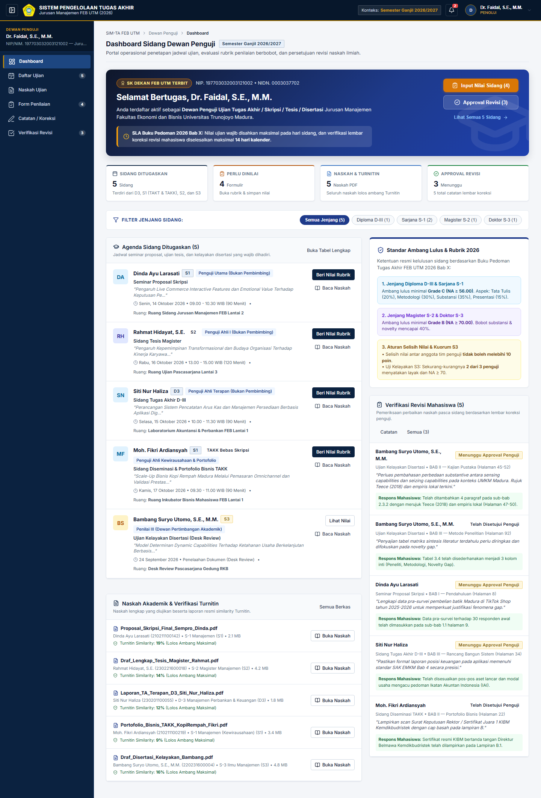

2. Klik menu **Daftar Ujian** untuk melihat seluruh agenda yang ditugaskan (Gambar 22). Gunakan filter jenjang dan status (**Semua Status**, **Perlu Dinilai**, **Selesai Dinilai**).

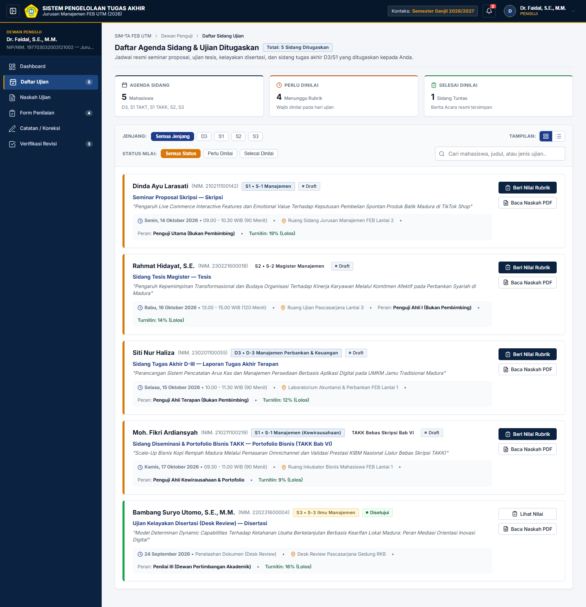

3. Klik **Baca Naskah PDF** atau menu **Naskah Ujian** untuk menelaah naskah (Gambar 23). Gunakan panel **Pembaca Naskah Digital**, **Verifikasi Turnitin & AI**, **Rekap Catatan Koreksi**, dan **Informasi Dewan & Sidang**.

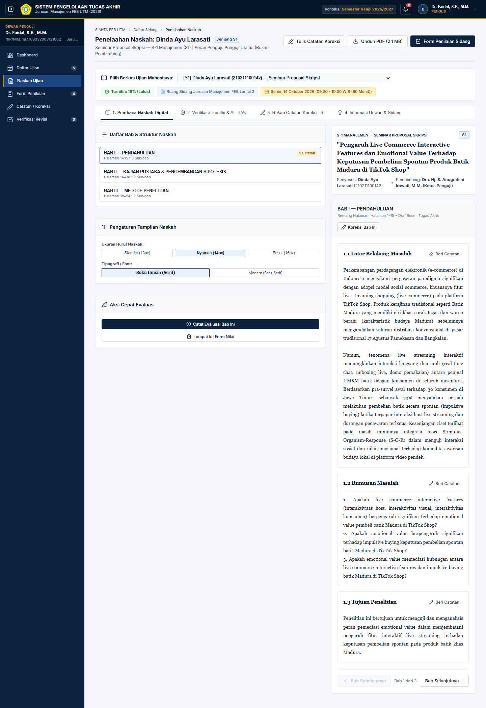

4. Klik menu **Form Penilaian** untuk mengisi rubrik (Gambar 24). Isi setiap aspek penilaian, lalu klik **Simpan & Sahkan Nilai** atau **Cetak Berita Acara Digital (PDF)**.

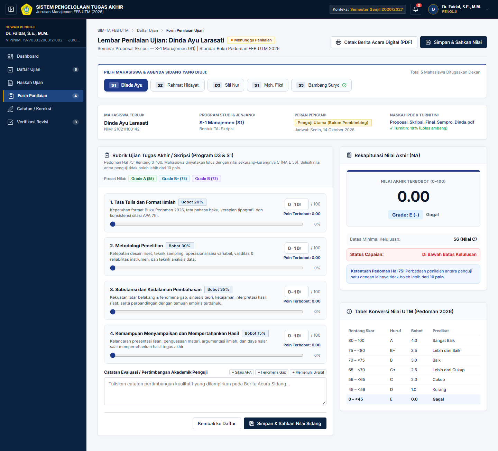

5. Klik menu **Catatan / Koreksi** untuk mendokumentasikan catatan evaluasi (Gambar 25). Klik **Tambah Catatan Koreksi** untuk menambah butir, lalu **Verifikasi** atau **Lihat Draf**.

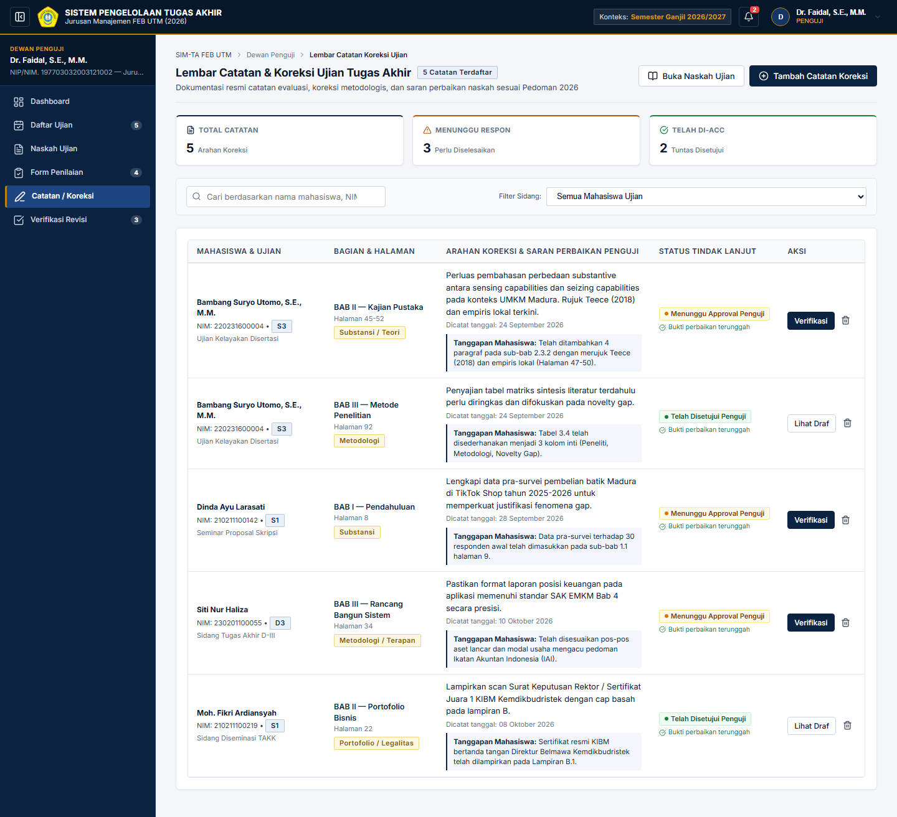

6. Klik menu **Verifikasi Revisi** untuk memeriksa tindak lanjut perbaikan (Gambar 26). Gunakan tombol **Setujui (Acc)** atau **Minta Perbaikan Ulang**.

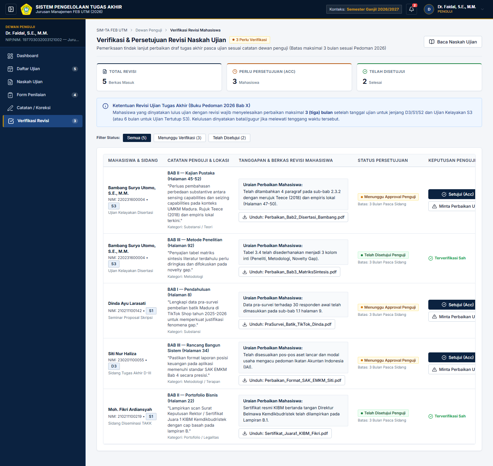

**c. Kolom dan tombol penting.**

| Halaman | Kolom | Tombol Utama |
|---|---|---|
| Form Penilaian | Rentang Skor, Huruf, Bobot, Predikat | Simpan & Sahkan Nilai, Cetak Berita Acara Digital (PDF) |
| Catatan / Koreksi | Mahasiswa & Ujian, Bagian & Halaman, Arahan Koreksi & Saran Perbaikan Penguji, Status Tindak Lanjut, Aksi | Tambah Catatan Koreksi, Verifikasi |
| Verifikasi Revisi | Mahasiswa & Sidang, Catatan Penguji & Lokasi, Tanggapan & Berkas Revisi Mahasiswa, Status Persetujuan, Keputusan Penguji | Setujui (Acc), Minta Perbaikan Ulang |

**d. Catatan dan peringatan.**

- Mahasiswa dinyatakan lulus dengan nilai sekurang-kurangnya C (NA ≥ 56); selisih nilai antar penguji tidak boleh lebih dari 10 poin.
- Mahasiswa yang lulus dengan revisi wajib menyelesaikan perbaikan maksimal 3 bulan setelah tanggal ujian untuk jenjang D3/S1/S2 dan Ujian Kelayakan S3 (atau 6 bulan untuk Ujian Tertutup S3). Kelulusan dapat dinyatakan gugur bila melewati tenggang waktu tersebut.

### 7.4 Koorprodi

**a. Ringkasan tugas.** Koorprodi memverifikasi pengajuan ujian, melakukan plotting pembimbing, menetapkan dewan penguji, mengelola jadwal sidang dan berita acara, memantau kepatuhan persyaratan serta batas revisi, menerbitkan dokumen kolektif, dan mengarsipkan dokumen prodi.

**b. Langkah kerja.**

1. Masuk dengan akun koorprodi. Dashboard menampilkan ringkasan pengajuan masuk, sidang, monitoring revisi, dan akses cepat seperti pada Gambar 27.

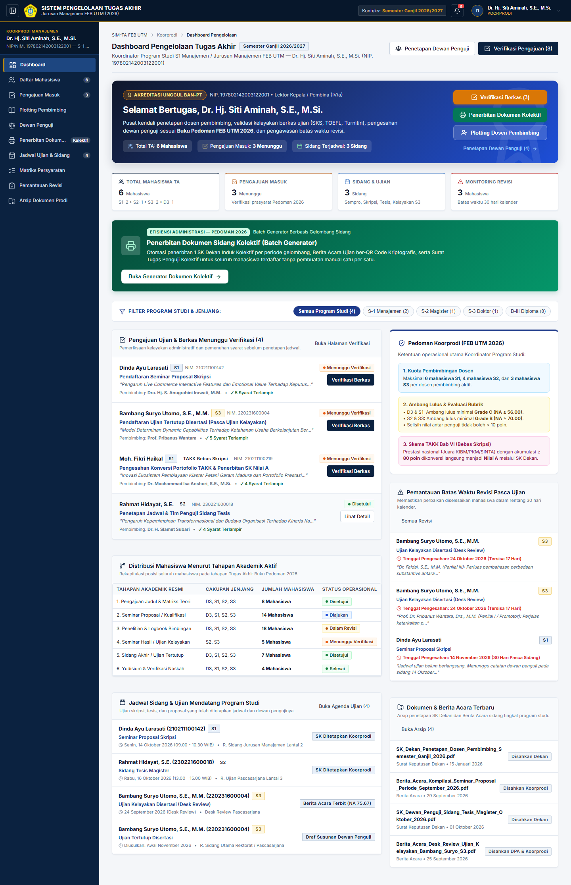

2. Klik menu **Daftar Mahasiswa** untuk melihat pangkalan data mahasiswa (Gambar 28). Klik **Ekspor Data (XLSX)** untuk mengunduh rekap atau **Detail** untuk membuka profil mahasiswa.

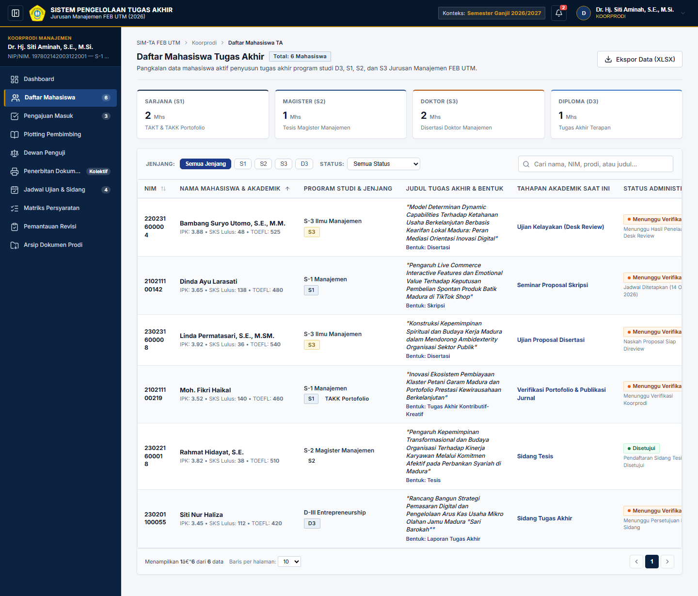

3. Klik menu **Pengajuan Masuk** untuk memverifikasi permohonan ujian (Gambar 29). Periksa panel **Verifikasi Kelayakan Syarat Administratif**, lalu klik **Sahkan & Alokasikan Penguji** atau **Tolak Pengajuan**.

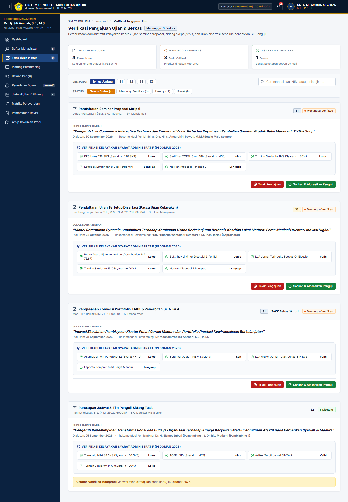

4. Klik menu **Plotting Pembimbing** untuk mengalokasikan pembimbing (Gambar 30). Klik **Alokasikan Pembimbing Baru** atau **Plotting** pada baris dosen, dengan memperhatikan batas kuota S1 (maks 6), S2 (maks 4), dan S3 (maks 3).

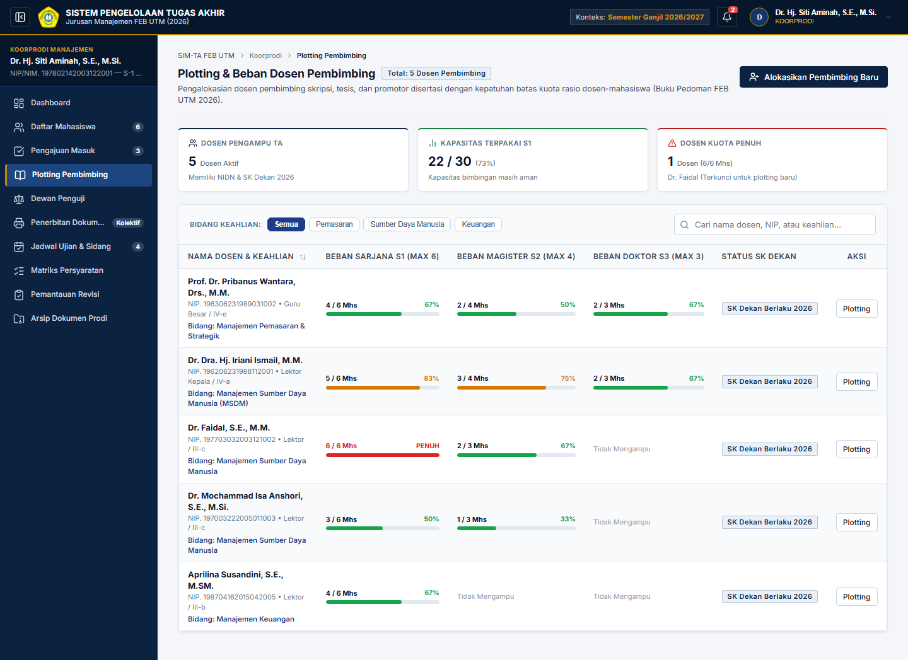

5. Klik menu **Dewan Penguji** untuk menetapkan komposisi penguji (Gambar 31). Klik **Tetapkan Tim Penguji Baru**.

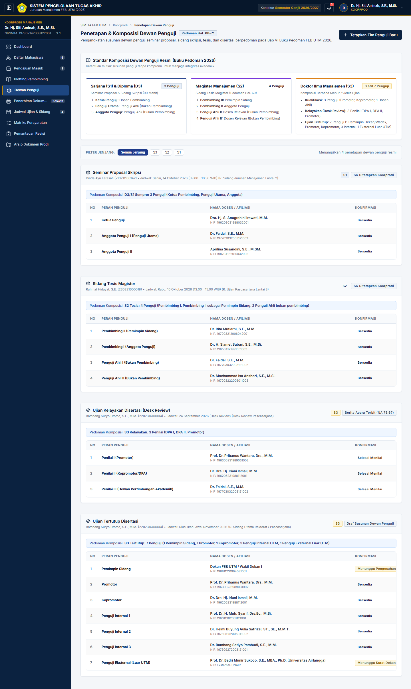

6. Klik menu **Penerbitan Dokumen Kolektif** untuk menerbitkan dokumen sidang massal (Gambar 32). Pilih gelombang sidang dan jenis ujian, centang berkas mahasiswa, klik **Input PIN Otorisasi Dekan**, lalu **Proses Penerbitan** atau **Unduh Master ZIP**.

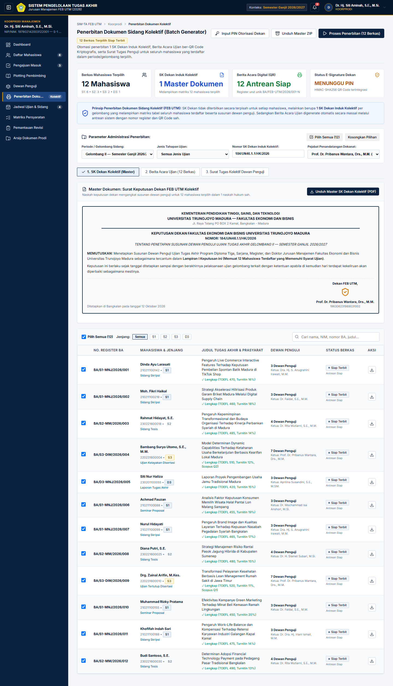

7. Klik menu **Jadwal Ujian & Sidang** untuk mengelola jadwal dan berita acara (Gambar 33). Klik **Jadwalkan Sidang Baru** atau **Rincian & BA** pada baris agenda.

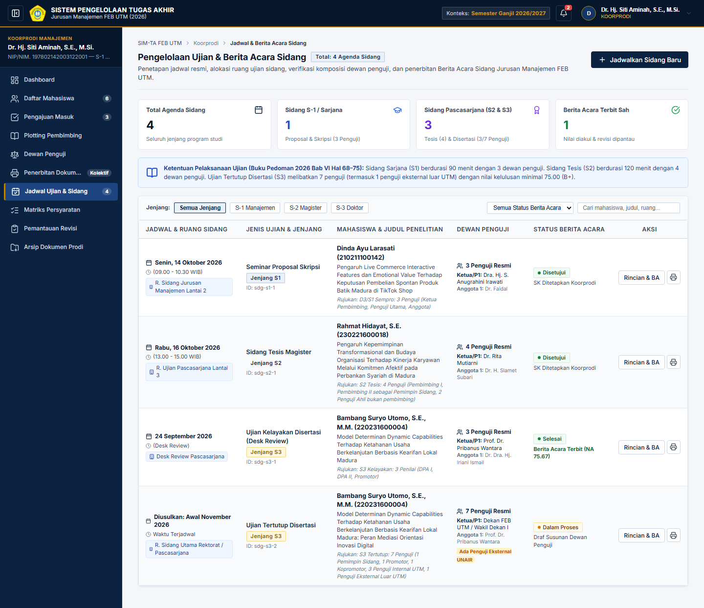

8. Klik menu **Matriks Persyaratan** untuk memantau kepatuhan prasyarat akademik (Gambar 34), meliputi SKS, IPK, TOEFL, Turnitin, dan kelayakan ujian.

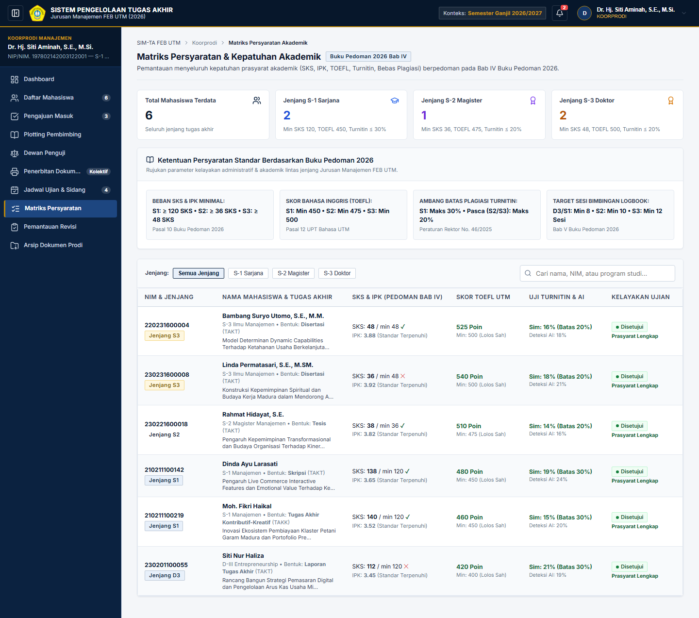

9. Klik menu **Pemantauan Revisi** untuk mengawasi tenggat revisi (Gambar 35). Gunakan kolom **SLA Batas Waktu (30 Hari)** dan tombol **Matriks**.

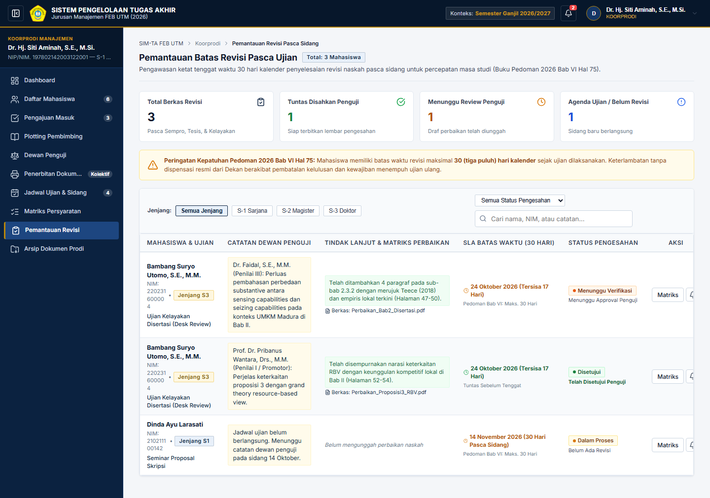

10. Klik menu **Arsip Dokumen Prodi** untuk mengakses pangkalan dokumen resmi (Gambar 36). Gunakan filter **Semua Dokumen**, **Surat Keputusan Dekan**, dan **Berita Acara Sidang**, serta tombol **Arsipkan Dokumen Baru**.

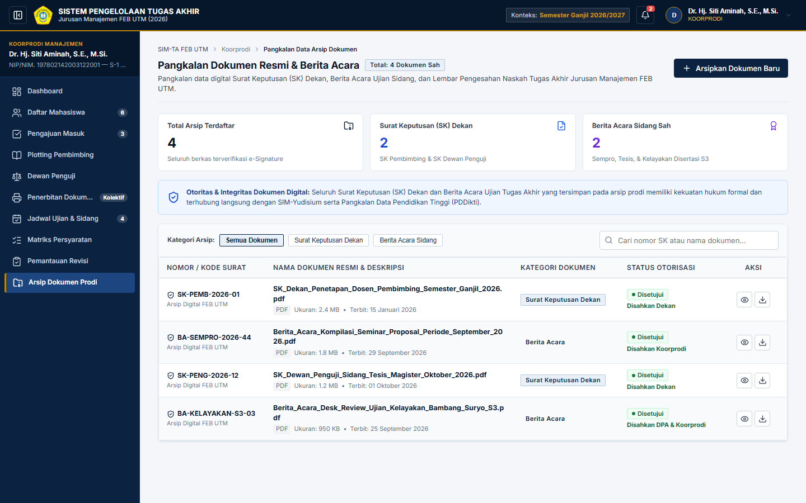

**c. Kolom dan tombol penting.**

| Halaman | Kolom | Tombol Utama |
|---|---|---|
| Daftar Mahasiswa | NIM, Nama Mahasiswa & Akademik, Program Studi & Jenjang, Judul Tugas Akhir & Bentuk, Tahapan Akademik Saat Ini, Status Administratif, Aksi | Ekspor Data (XLSX), Detail |
| Pengajuan Masuk | Judul Karya Ilmiah, Verifikasi Kelayakan Syarat Administratif | Sahkan & Alokasikan Penguji, Tolak Pengajuan |
| Plotting Pembimbing | Nama Dosen & Keahlian, Beban Sarjana S1 (Max 6), Beban Magister S2 (Max 4), Beban Doktor S3 (Max 3), Status SK Dekan, Aksi | Alokasikan Pembimbing Baru, Plotting |
| Penerbitan Dokumen Kolektif | No. Register BA, Mahasiswa & Jenjang, Judul Tugas Akhir & Prasyarat, Dewan Penguji, Status Berkas, Aksi | Input PIN Otorisasi Dekan, Proses Penerbitan, Unduh Master ZIP |
| Jadwal Ujian & Sidang | Jadwal & Ruang Sidang, Jenis Ujian & Jenjang, Mahasiswa & Judul Penelitian, Dewan Penguji, Status Berita Acara, Aksi | Jadwalkan Sidang Baru, Rincian & BA |
| Matriks Persyaratan | NIM & Jenjang, Nama Mahasiswa & Tugas Akhir, SKS & IPK, Skor TOEFL UTM, Uji Turnitin & AI, Kelayakan Ujian | — |
| Pemantauan Revisi | Mahasiswa & Ujian, Catatan Dewan Penguji, Tindak Lanjut & Matriks Perbaikan, SLA Batas Waktu (30 Hari), Status Pengesahan, Aksi | Matriks |
| Arsip Dokumen Prodi | Nomor / Kode Surat, Nama Dokumen Resmi & Deskripsi, Kategori Dokumen, Status Otorisasi, Aksi | Arsipkan Dokumen Baru |

**d. Catatan dan peringatan.**

- Sidang Sarjana (S1) berdurasi 90 menit dengan 3 dewan penguji; Sidang Tesis (S2) berdurasi 120 menit dengan 4 dewan penguji; Ujian Tertutup Disertasi (S3) melibatkan 7 penguji dengan nilai kelulusan minimal 75.00 (B+).
- SK Dekan tidak diterbitkan per mahasiswa, melainkan 1 SK Dekan Induk Kolektif per gelombang yang melampirkan matriks seluruh mahasiswa terdaftar.
- Halaman **Pemantauan Revisi** memakai indikator **SLA Batas Waktu (30 Hari)** sebagai peringatan dini, sedangkan ketentuan resmi Buku Pedoman 2026 Bab X menetapkan batas maksimal 3 bulan (6 bulan untuk Ujian Tertutup S3).

### 7.5 Admin Akademik

**a. Ringkasan tugas.** Admin Akademik mengelola jadwal dan linimasa tahapan, menerbitkan dokumen otomatis dan SK, memverifikasi berkas pendaftaran ujian, serta mengalokasikan ruang sidang.

**b. Langkah kerja.**

1. Masuk dengan akun admin. Dashboard menampilkan ringkasan jadwal tahapan dan berkas yang perlu diperiksa seperti pada Gambar 37.

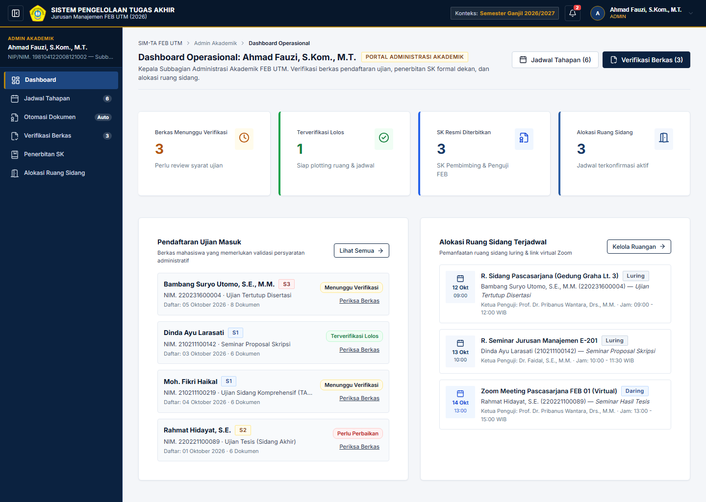

2. Klik menu **Jadwal Tahapan** untuk mengatur periode tahapan (Gambar 38). Klik **Buat Jadwal Tahapan** untuk menambah periode, atau **Buka Periode**, **Tutup Periode**, **Edit**, **Siarkan Pengumuman**, dan **Broadcast Pengumuman** pada periode yang ada.

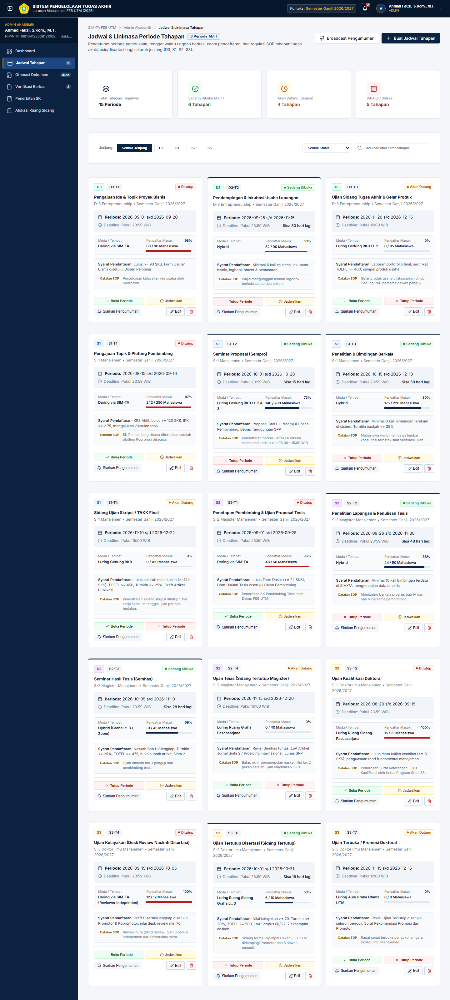

3. Klik menu **Otomasi Dokumen** untuk menerbitkan dokumen secara otomatis (Gambar 39). Gunakan tab **1-Click Exam Package Generator**, **Generator Dokumen Mandiri**, **Arsip Dokumen Resmi Terbit**, dan **Format & Nomor Urut Dinas**.

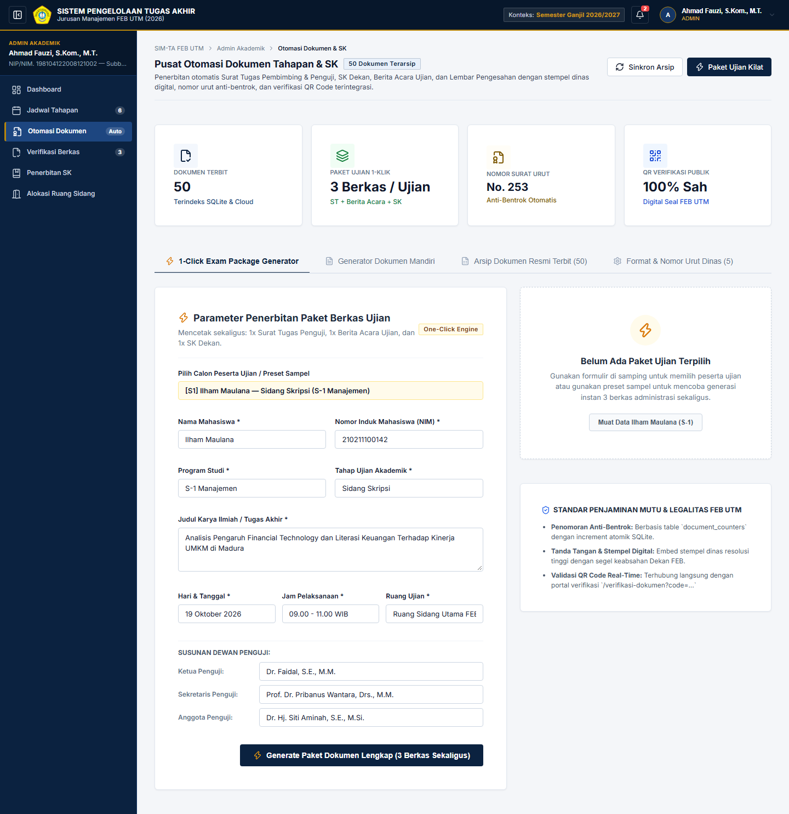

4. Klik menu **Verifikasi Berkas** untuk memeriksa kelengkapan berkas (Gambar 40). Klik **Periksa Berkas** pada baris mahasiswa untuk meninjau kelengkapan dokumen dan status verifikasi.

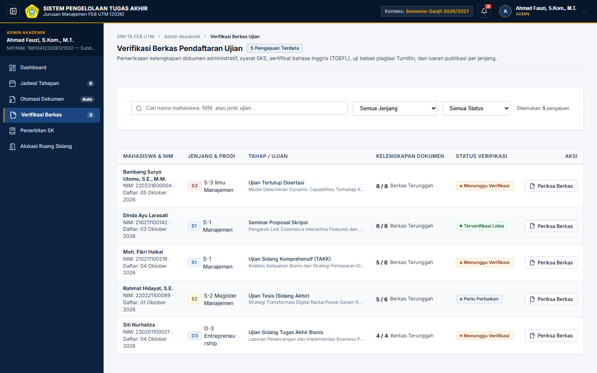

5. Klik menu **Penerbitan SK** untuk menerbitkan Surat Keputusan (Gambar 41). Klik **Buat SK Baru** untuk menerbitkan SK, atau **Lihat SK** dan **PDF** untuk membuka arsip.

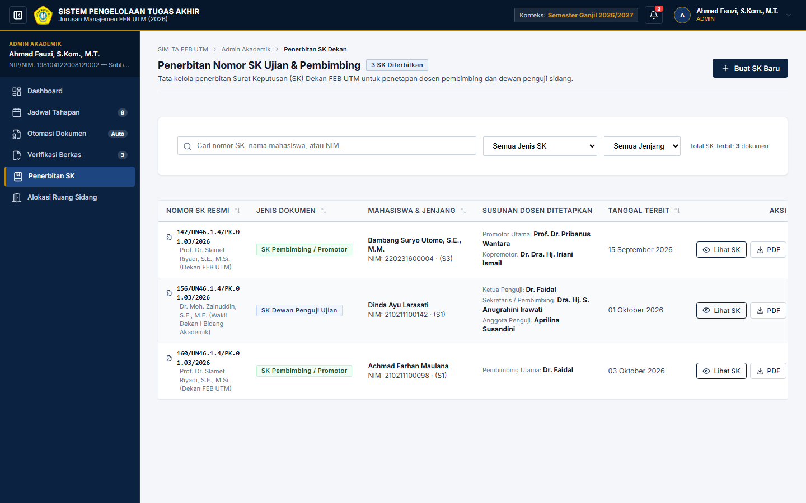

6. Klik menu **Alokasi Ruang Sidang** untuk menata ruang ujian (Gambar 42). Klik **Plotting Ruang Ujian** untuk menetapkan ruang dan waktu, dengan deteksi pencegahan bentrok jadwal otomatis.

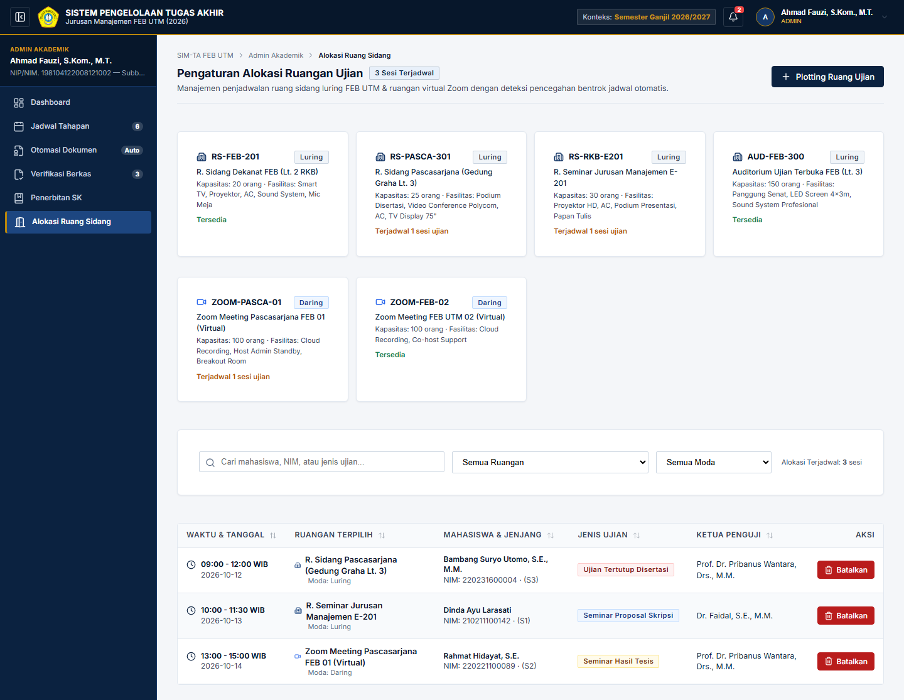

**c. Kolom dan tombol penting.**

| Halaman | Kolom | Tombol Utama |
|---|---|---|
| Jadwal Tahapan | Tahap, Jenjang, Periode, Status | Buat Jadwal Tahapan, Buka Periode, Tutup Periode, Broadcast Pengumuman |
| Verifikasi Berkas | Mahasiswa & NIM, Jenjang & Prodi, Tahap / Ujian, Kelengkapan Dokumen, Status Verifikasi, Aksi | Periksa Berkas |
| Penerbitan SK | Nomor SK Resmi, Jenis Dokumen, Mahasiswa & Jenjang, Susunan Dosen Ditetapkan, Tanggal Terbit, Aksi | Buat SK Baru, Lihat SK, PDF |
| Alokasi Ruang Sidang | Waktu & Tanggal, Ruangan Terpilih, Mahasiswa & Jenjang, Jenis Ujian, Ketua Penguji, Aksi | Plotting Ruang Ujian |

**d. Catatan dan peringatan.**

- Penerbitan nomor surat menggunakan penomoran urut anti-bentrok otomatis; verifikasi dokumen dilakukan melalui QR Code terintegrasi.
- Sistem mendeteksi bentrok jadwal ruang ujian secara otomatis saat plotting.

### 7.6 Superadmin

**a. Ringkasan tugas.** Superadmin mengelola konfigurasi master program studi, alur tahapan dan regulasi per jenjang, kuota bimbingan dosen, serta manajemen akun pengguna.

**b. Langkah kerja.**

1. Masuk dengan akun superadmin. Dashboard menampilkan ringkasan konfigurasi jenjang, master prodi, tahapan, kuota, dan akun seperti pada Gambar 43.

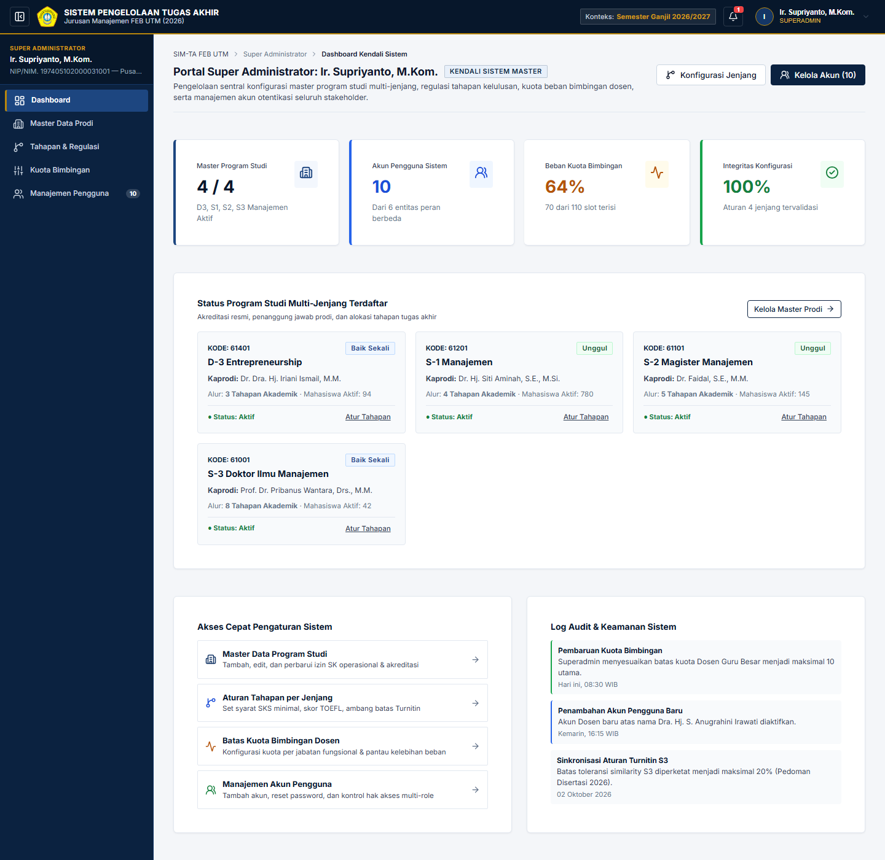

2. Klik menu **Master Data Prodi** untuk mengelola program studi (Gambar 44). Klik **Tambah Program Studi** untuk menambah prodi, atau **Edit** pada baris prodi.

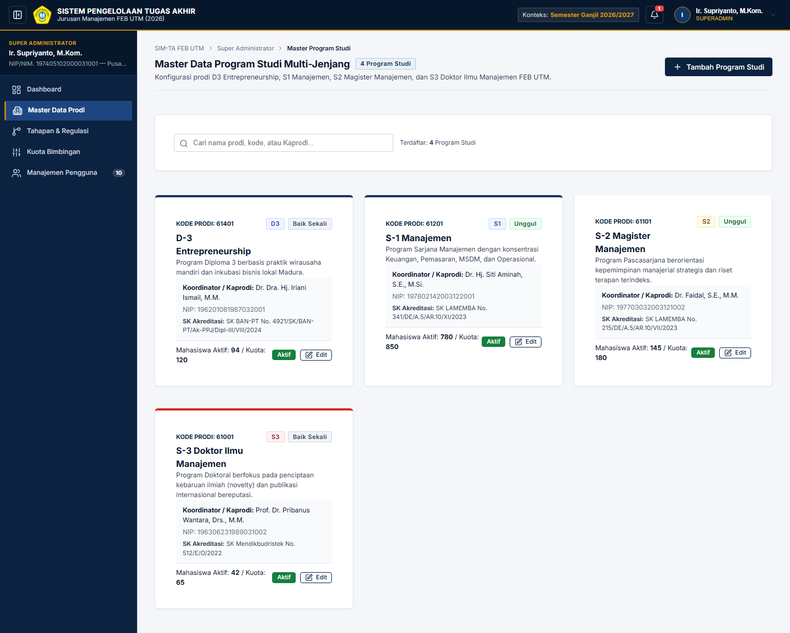

3. Klik menu **Tahapan & Regulasi** untuk menetapkan siklus dan aturan kelulusan (Gambar 45). Pilih jenjang (D3, S1, S2, S3), atur parameter aturan kelayakan, lalu klik **Simpan Konfigurasi** atau **Simpan Perubahan Regulasi**.

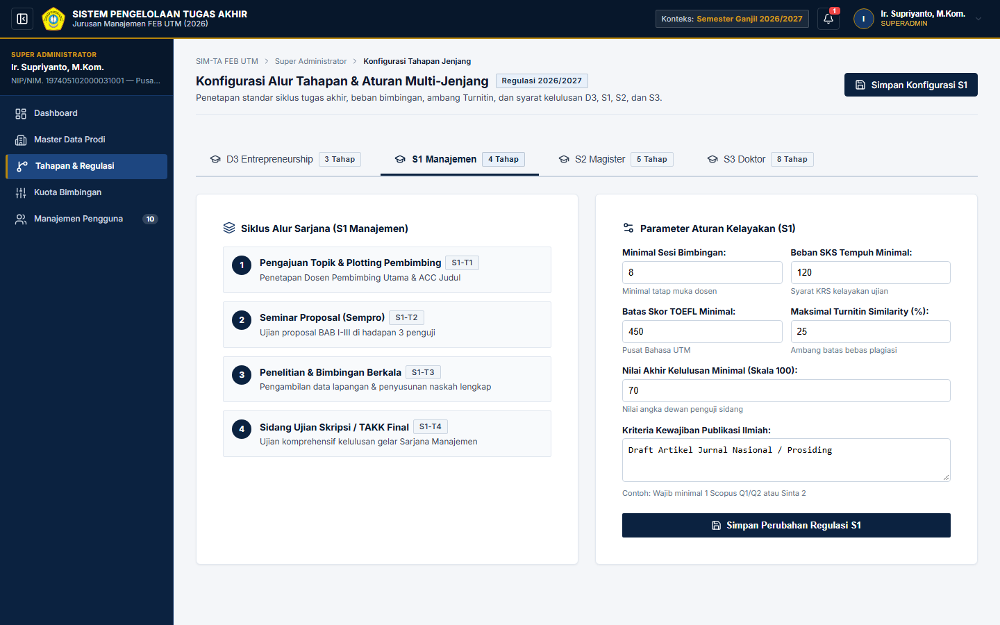

4. Klik menu **Kuota Bimbingan** untuk mendistribusikan beban bimbingan (Gambar 46). Klik **Atur Kuota** pada baris dosen.

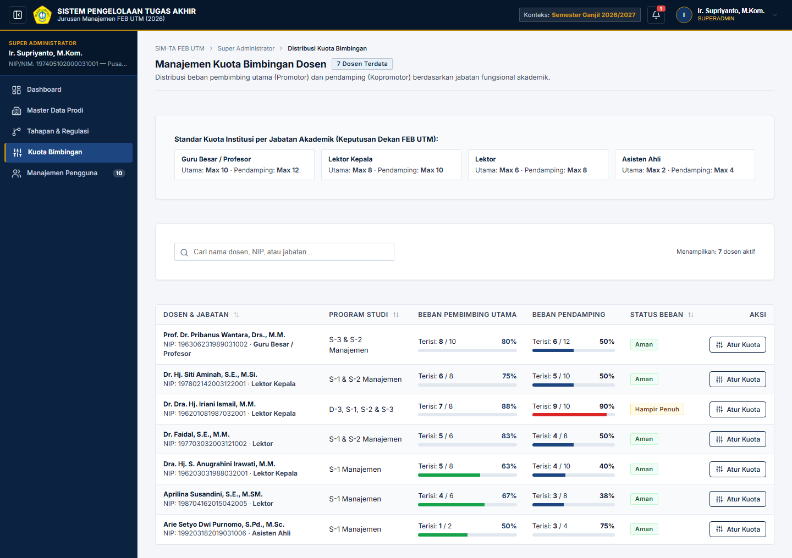

5. Klik menu **Manajemen Pengguna** untuk mengelola akun (Gambar 47). Gunakan filter **Semua Peran (Role)** dan **Semua Status**, serta tombol **Tambah Akun Pengguna**, **Import dari Excel**, **Unduh Template Excel**, dan **Reset**.

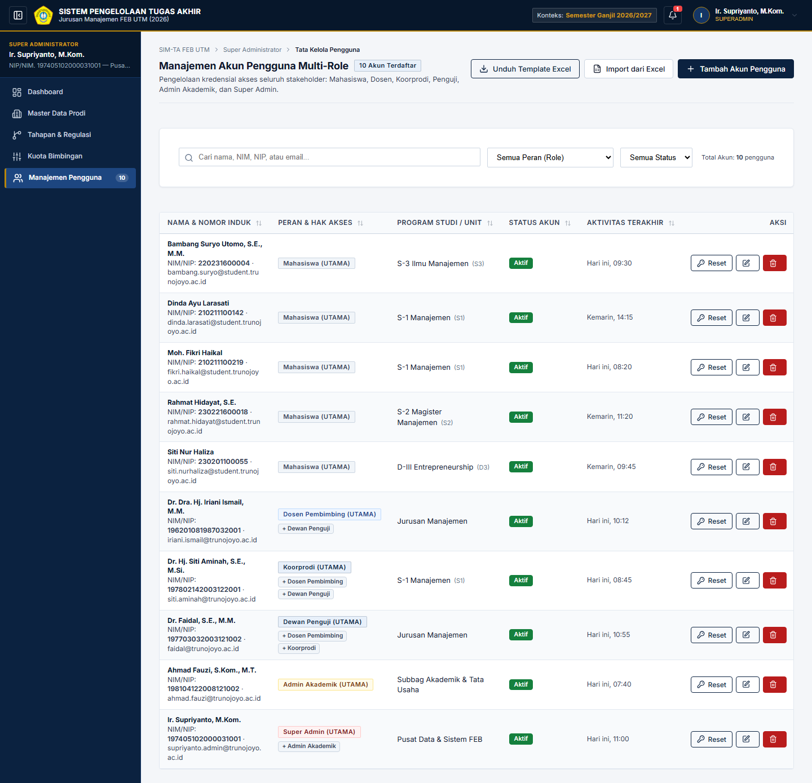

**c. Kolom dan tombol penting.**

| Halaman | Kolom | Tombol Utama |
|---|---|---|
| Master Data Prodi | Kode Prodi, Nama Prodi, Jenjang, Akreditasi, Status | Tambah Program Studi, Edit |
| Tahapan & Regulasi | Parameter Aturan Kelayakan (Minimal Sesi Bimbingan, Beban SKS, Batas TOEFL, Maksimal Turnitin, Nilai Akhir Kelulusan, Kewajiban Publikasi) | Simpan Konfigurasi, Simpan Perubahan Regulasi |
| Kuota Bimbingan | Dosen & Jabatan, Program Studi, Beban Pembimbing Utama, Beban Pendamping, Status Beban, Aksi | Atur Kuota |
| Manajemen Pengguna | Nama & Nomor Induk, Peran & Hak Akses, Program Studi / Unit, Status Akun, Aktivitas Terakhir, Aksi | Tambah Akun Pengguna, Import dari Excel, Reset |

**d. Catatan dan peringatan.**

- Perubahan konfigurasi tahapan dan regulasi berlaku lintas jenjang; pastikan parameter (SKS, TOEFL, Turnitin, nilai kelulusan) sesuai Buku Pedoman 2026 sebelum menyimpan.
- Kata sandi default akun baru yang dibuat administrator adalah **FEB-UTM-2026**; minta pengguna menggantinya melalui menu Ganti Kata Sandi.

---

## 8. Alur Proses Utama End-to-End

Alur berikut menggambarkan proses dari pendaftaran ujian oleh mahasiswa hingga revisi dan publikasi.

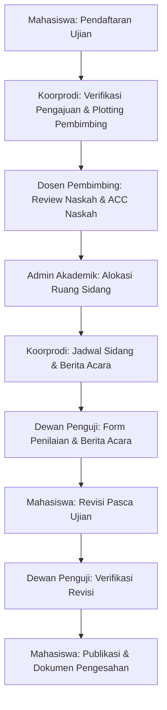

**Penjelasan tiap titik.**

1. **Mahasiswa mendaftar ujian.** Mahasiswa melengkapi berkas pada menu **Persyaratan** dan mengajukan ujian pada menu **Ujian** melalui tombol **Pendaftaran Ujian**, seperti pada Gambar 9.
2. **Koorprodi memverifikasi pengajuan dan melakukan plotting.** Koorprodi memeriksa **Pengajuan Masuk** dan menetapkan pembimbing pada **Plotting Pembimbing**, seperti pada Gambar 29 dan Gambar 30.
3. **Dosen pembimbing menyetujui naskah.** Dosen menelaah pada **Review Naskah** dan memberi keputusan pada **Persetujuan** melalui tombol **Setujui Maju Ujian**, seperti pada Gambar 17 dan Gambar 18.
4. **Admin Akademik mengalokasikan ruang.** Admin menetapkan ruang dan waktu pada **Alokasi Ruang Sidang**, seperti pada Gambar 42.
5. **Koorprodi menetapkan jadwal sidang dan berita acara.** Koorprodi mengelola **Jadwal Ujian & Sidang** serta menerbitkan berita acara, seperti pada Gambar 33, dan dapat menerbitkan dokumen kolektif seperti pada Gambar 32.
6. **Dewan penguji menilai dan mengesahkan berita acara.** Penguji mengisi **Form Penilaian** dan mengesahkan nilai serta mencetak **Cetak Berita Acara Digital (PDF)**, seperti pada Gambar 24.
7. **Mahasiswa menindaklanjuti revisi.** Mahasiswa memperbaiki naskah sesuai catatan pada menu **Revisi**, seperti pada Gambar 10.
8. **Dewan penguji memverifikasi revisi.** Penguji menyetujui perbaikan pada **Verifikasi Revisi** melalui tombol **Setujui (Acc)**, seperti pada Gambar 26.
9. **Publikasi dan pengesahan dokumen.** Mahasiswa mencatat luaran pada menu **Publikasi** dan mengunduh dokumen resmi pada menu **Dokumen**, seperti pada Gambar 11 dan Gambar 12.

---

## 9. Standar Operasional Prosedur (SOP)

Bab ini merangkum Standar Operasional Prosedur (SOP) yang berlaku di SIM-TA FEB UTM. Seluruh ketentuan di bawah ini bersumber dari data dan aturan yang tersimpan serta ditampilkan di dalam aplikasi (antara lain panel **Catatan SOP** pada menu **Jadwal Tahapan**, **Parameter Aturan Kelayakan** pada menu **Tahapan & Regulasi**, serta banner **Ketentuan** pada halaman ujian, penilaian, dan revisi), yang mengacu pada Buku Pedoman Tugas Akhir Jurusan Manajemen FEB UTM 2026.

### 9.1 SOP Bimbingan

**Tujuan.** Menjamin setiap sesi konsultasi tercatat, terverifikasi, dan terdokumentasi sebelum mahasiswa diizinkan maju ujian.

**Diagram alur SOP Bimbingan.**

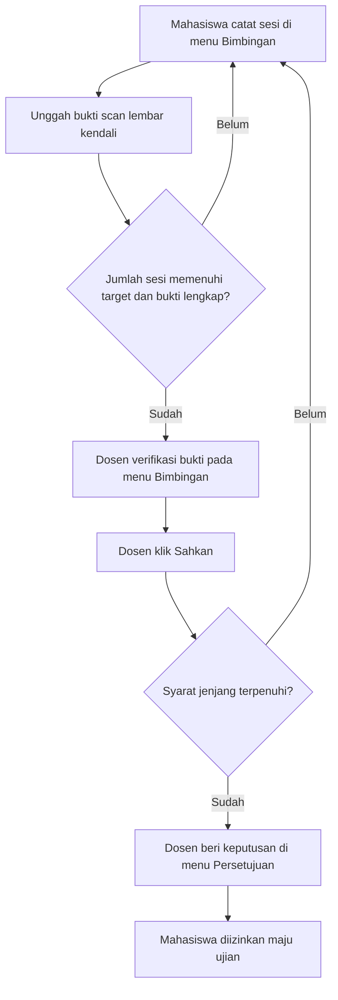

| No | Ketentuan SOP | Rujukan |
|---|---|---|
| 1 | Proses bimbingan wajib tercatat dalam Buku Kendali Konsultasi digital (SIM-TA) minimal **6 sesi**. | Ketentuan Penugasan Bimbingan (Surat Tugas) |
| 2 | Setiap sesi wajib memiliki bukti scan lembar kendali bertanda tangan dosen agar dapat disahkan. | Halaman **Bimbingan** (Mahasiswa/Dosen) |
| 3 | Dosen Pembimbing bertanggung jawab penuh atas substansi metodologis, orisinalitas, dan tata tulis. | Ketentuan Penugasan Bimbingan |
| 4 | Persetujuan seminar/sidang diberikan secara objektif setelah naskah memenuhi standar mutu penulisan karya ilmiah FEB UTM. | Halaman **Persetujuan** (Dosen) |
| 5 | Target minimal sesi bimbingan mengikuti aturan jenjang (S1: minimal 8 kali bimbingan terekam di sistem; S2: minimal 10 kali). | Catatan SOP **Jadwal Tahapan** |

**Langkah SOP (Mahasiswa).** Catat sesi pada menu **Bimbingan** → unggah bukti scan → tunggu pengesahan dosen. **Langkah SOP (Dosen).** Verifikasi bukti pada menu **Bimbingan** → klik **Sahkan** → berikan keputusan pada menu **Persetujuan** setelah syarat terpenuhi (Gambar 15 dan Gambar 18).

### 9.2 SOP Unggah Naskah, Uji Turnitin, dan Bebas Plagiasi

**Tujuan.** Memastikan naskah bebas plagiasi sebelum didaftarkan pada ujian.

**Diagram alur SOP Unggah Naskah dan Uji Plagiasi.**

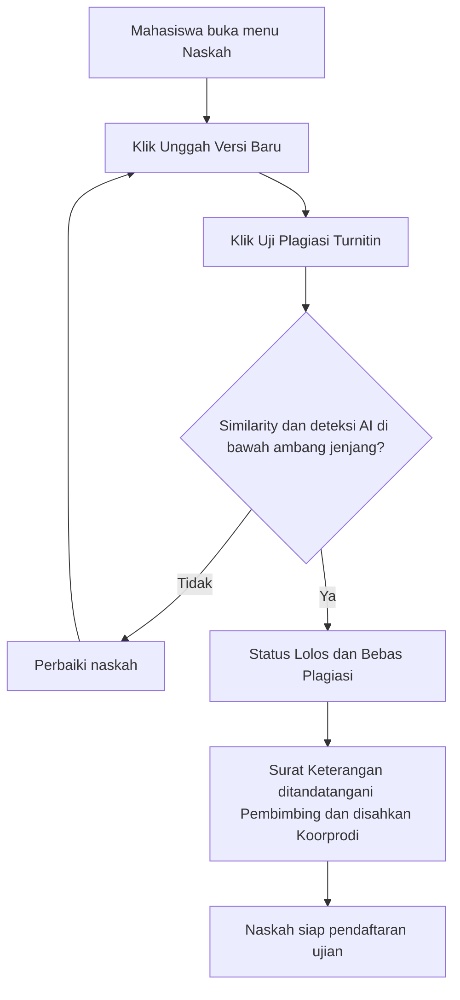

| No | Ketentuan SOP | Rujukan |
|---|---|---|
| 1 | Dasar hukum pemeriksaan plagiasi: **Peraturan Rektor Universitas Trunojoyo Madura Nomor 46 Tahun 2025**. | Halaman **Naskah** (Kotak Dasar Hukum / SOP) |
| 2 | Ambang Similarity Turnitin: **D3/S1 maksimal 30%** dan **S2/S3 maksimal 20%**. | Parameter Aturan Kelayakan |
| 3 | Ambang deteksi AI: **D3/S1 maksimal 40%** dan **S2/S3 maksimal 30%**. | Parameter Aturan Kelayakan |
| 4 | Perhitungan kemiripan **tidak mencakup** daftar pustaka, kutipan langsung bertanda petik, dan lampiran data kuesioner. | Peraturan Rektor UTM No. 46 Tahun 2025 |
| 5 | Surat Keterangan Pemeriksaan Plagiasi ditandatangani Dosen Pembimbing/Promotor dan disahkan Koorprodi. | Buku Pedoman 2026 (Lampiran 10) |

**Langkah SOP.** Buka menu **Naskah** → klik **Unggah Versi Baru** → klik **Uji Plagiasi Turnitin** → periksa hasil pada tab **Uji Plagiasi Turnitin** → pastikan status **Lolos** sebelum pendaftaran ujian (Gambar 8).

### 9.3 SOP Verifikasi Berkas dan Pendaftaran Ujian

**Tujuan.** Memastikan kelayakan administratif mahasiswa sebelum ujian.

**Diagram alur SOP Verifikasi Berkas dan Pendaftaran Ujian.**

| No | Ketentuan SOP | Rujukan |
|---|---|---|
| 1 | Pendaftaran berkas verifikasi dibuka setiap hari kerja pukul **08:00 – 15:00 WIB**. | Catatan SOP **Jadwal Tahapan** |
| 2 | Mahasiswa wajib membawa lembar konsultasi tercetak saat verifikasi ujian. | Catatan SOP **Jadwal Tahapan** |
| 3 | Verifikasi mencakup kelengkapan dokumen, syarat SKS, sertifikat TOEFL, uji bebas plagiasi Turnitin, dan luaran publikasi per jenjang. | Halaman **Verifikasi Berkas** (Admin) |
| 4 | Berkas yang disetujui sistem mengirimkan notifikasi ke mahasiswa; berkas yang ditolak dikembalikan untuk diperbaiki. | Halaman **Verifikasi Berkas** |

**Langkah SOP.** Mahasiswa mengunggah berkas pada menu **Persyaratan** → Admin Akademik memeriksa pada menu **Verifikasi Berkas** melalui tombol **Periksa Berkas** → Koorprodi memverifikasi pengajuan pada menu **Pengajuan Masuk** (Gambar 6, Gambar 40, dan Gambar 29).

### 9.4 SOP Plotting Pembimbing dan Penetapan Dewan Penguji

**Tujuan.** Menetapkan pembimbing dan komposisi penguji sesuai kuota dan ketentuan pedoman.

**Diagram alur SOP Plotting dan Penetapan Penguji.**

| No | Ketentuan SOP | Rujukan |
|---|---|---|
| 1 | Batas kuota bimbingan: **S1 maksimal 6**, **S2 maksimal 4**, **S3 maksimal 3** mahasiswa per dosen. | Halaman **Plotting Pembimbing** |
| 2 | SK Pembimbing Utama diterbitkan setelah plotting Koorprodi disetujui. | Catatan SOP **Jadwal Tahapan** |
| 3 | Penerbitan SK Pembimbing Tesis (S2) oleh Dekan FEB UTM. | Catatan SOP **Jadwal Tahapan** |
| 4 | Komposisi dewan penguji mengikuti ketentuan per jenis ujian (lihat tabel di bawah). | Buku Pedoman 2026 (Hal 68–71) |

**Komposisi Dewan Penguji Resmi.**

| Jenis Ujian | Komposisi |
|---|---|
| D3/S1 Seminar Proposal | Ketua Penguji (Dosen Pembimbing), Anggota Penguji I (Penguji Utama non-pembimbing), Anggota Penguji II (non-pembimbing) |
| D3/S1 Sidang | Ketua Penguji (Dosen Pembimbing), Anggota Penguji I, Anggota Penguji II |
| S2 Ujian Proposal | Ketua Penguji (Pembimbing II), Anggota Penguji I (Pembimbing I), Anggota Penguji II & III (non-pembimbing, keahlian relevan) |
| S2 Sidang Tesis | Pembimbing I, Pembimbing II (Pemimpin Sidang), Penguji I, Penguji II |
| S3 Ujian Kualifikasi | Pemimpin Sidang (Promotor), Anggota Penguji (Kopromotor), Anggota Penguji (1 penguji ahli) |
| S3 Ujian Proposal | Ketua Penguji (Promotor/Koorprodi), Anggota Penguji I (Kopromotor), Anggota Penguji II & III (keahlian sebidang) |
| S3 Ujian Kelayakan (Desk Review) | Penilai I (DPA), Penilai II (DPA), Penilai III (Pembimbing/Promotor) |
| S3 Ujian Tertutup | Pemimpin Sidang, Promotor, Kopromotor, 3 Penguji Internal UTM, 1 Penguji Eksternal luar UTM |
| S3 Ujian Terbuka | Ketua Sidang/Penguji, Sekretaris Sidang/Penguji, dan 5 Anggota Penguji (termasuk penguji eksternal) |

**Langkah SOP.** Koorprodi menetapkan pembimbing pada menu **Plotting Pembimbing** (Gambar 30) dan penguji pada menu **Dewan Penguji** (Gambar 31), lalu Admin Akademik menerbitkan SK (Gambar 41).

### 9.5 SOP Penjadwalan dan Pelaksanaan Ujian/Sidang

**Tujuan.** Menyelenggarakan ujian sesuai durasi, jumlah penguji, dan ambang kelulusan yang ditetapkan.

**Diagram alur SOP Penjadwalan dan Pelaksanaan Ujian.**

| Jenis Ujian | Durasi | Jumlah Penguji | Ambang Kelulusan |
|---|---|---|---|
| Sidang Sarjana (S1) | 90 menit | 3 dewan penguji | Minimal C (NA ≥ 56) |
| Sidang Tesis (S2) | 120 menit | 4 dewan penguji | Minimal B (NA ≥ 70) |
| Ujian Tertutup Disertasi (S3) | 120 – 150 menit | 7 penguji (termasuk 1 penguji eksternal luar UTM) | Minimal 75.00 (B+) |
| Ujian Terbuka (S3) | Sesuai jadwal senat | 7 penguji | NA ≥ 70 |

**Langkah SOP.** Koorprodi menjadwalkan pada menu **Jadwal Ujian & Sidang** melalui tombol **Jadwalkan Sidang Baru** (Gambar 33) → Admin Akademik menetapkan ruang pada menu **Alokasi Ruang Sidang** dengan deteksi bentrok otomatis (Gambar 42) → mahasiswa melihat jadwal pada menu **Ujian** (Gambar 9).

> **Ketentuan tambahan.** Pendaftaran sidang skripsi ditutup **5 hari kerja** sebelum tanggal ujian periode berjalan. Sidang Tesis (S2) berdurasi 120 menit dengan 4 dewan penguji; Ujian Tertutup Disertasi (S3) melibatkan 7 penguji dengan nilai kelulusan minimal 75.00 (B+).

### 9.6 SOP Penilaian dan Pengesahan Nilai

**Tujuan.** Menjaga objektivitas dan konsistensi penilaian ujian.

**Diagram alur SOP Penilaian dan Pengesahan Nilai.**

**Rubrik penilaian (D3/S1).** Rentang 0–100 dengan bobot: Tata Tulis dan Format Ilmiah 20%, Metodologi Penelitian 30%, Substansi dan Kedalaman Pembahasan 35%, serta Kemampuan Menyampaikan dan Mempertahankan Hasil 15%. Mahasiswa dinyatakan lulus dengan nilai sekurang-kurangnya **C (NA ≥ 56)**, dan selisih nilai antar penguji tidak boleh lebih dari **10 poin**.

**Konversi nilai huruf UTM.**

| Rentang Skor | Huruf | Bobot | Predikat |
|---|---|---|---|
| ≥ 80 | A | 4.00 | Sangat Baik (Lulus) |
| ≥ 75 | B+ | 3.50 | Lebih dari Baik (Lulus) |
| ≥ 70 | B | 3.00 | Baik (Lulus) |
| ≥ 65 | C+ | 2.50 | Lebih dari Cukup (Lulus D3/S1) |
| ≥ 56 | C | 2.00 | Cukup (Batas Minimal Kelulusan D3/S1) |
| ≥ 45 | D | 1.00 | Kurang (Tidak Lulus – Ujian Ulang) |
| < 45 | E | 0.00 | Gagal (Tidak Lulus) |

**Langkah SOP.** Dewan Penguji mengisi rubrik pada menu **Form Penilaian** (Gambar 24) → klik **Simpan & Sahkan Nilai** → cetak **Cetak Berita Acara Digital (PDF)**. Sistem mencatat nilai dan mengirimkan notifikasi penilaian selesai.

### 9.7 SOP Revisi Pasca Ujian

**Tujuan.** Memastikan perbaikan naskah selesai dalam tenggat dan disahkan penguji.

**Diagram alur SOP Revisi Pasca Ujian.**

| No | Ketentuan SOP | Rujukan |
|---|---|---|
| 1 | Batas waktu penyelesaian revisi maksimal **3 bulan** setelah tanggal ujian untuk jenjang D3/S1/S2 dan Ujian Kelayakan S3. | Buku Pedoman 2026 Bab X |
| 2 | Ujian Tertutup S3 memiliki batas maksimal **6 bulan**. | Buku Pedoman 2026 Bab X |
| 3 | Kelulusan dinyatakan **batal/gugur** jika melewati tenggang waktu tersebut. | Halaman **Verifikasi Revisi** |
| 4 | Halaman **Pemantauan Revisi** (Koorprodi) menampilkan indikator peringatan dini **SLA Batas Waktu (30 Hari)**. | Halaman **Pemantauan Revisi** |
| 5 | Setiap butir revisi harus disahkan penguji melalui keputusan **Setujui (Acc)** atau **Minta Perbaikan Ulang**. | Halaman **Verifikasi Revisi** |

**Langkah SOP.** Mahasiswa menindaklanjuti pada menu **Revisi** (Gambar 10) → Dosen memantau pada menu **Pemantauan Revisi** (Gambar 19) → Dewan Penguji memverifikasi pada menu **Verifikasi Revisi** (Gambar 26) → Koorprodi mengawasi pada menu **Pemantauan Revisi** (Gambar 35).

### 9.8 SOP Penerbitan Dokumen, SK, dan Berita Acara

**Tujuan.** Menerbitkan dokumen resmi secara sah, bernomor urut, dan dapat diverifikasi.

**Diagram alur SOP Penerbitan Dokumen.**

| No | Ketentuan SOP | Rujukan |
|---|---|---|
| 1 | SK Dekan diterbitkan sebagai **1 SK Dekan Induk Kolektif per gelombang** yang melampirkan matriks seluruh mahasiswa dan susunan dewan penguji. | Halaman **Penerbitan Dokumen Kolektif** |
| 2 | Berita Acara Ujian digenerate otomatis secara massal dengan nomor register urut unik dan **QR Code** sah. | Halaman **Penerbitan Dokumen Kolektif** |
| 3 | Penerbitan memerlukan **PIN Otorisasi Dekan** (e-signature HMAC-SHA256). | Halaman **Penerbitan Dokumen Kolektif** |
| 4 | Penomoran surat menggunakan sistem urut anti-bentrok otomatis dengan verifikasi QR Code terintegrasi. | Halaman **Otomasi Dokumen** |
| 5 | Dokumen diarsipkan pada **Arsip Dokumen Prodi** dan **Otomasi Dokumen** serta dapat diverifikasi melalui pemindaian QR. | Halaman Arsip & Otomasi |

**Langkah SOP.** Koorprodi memproses batch pada menu **Penerbitan Dokumen Kolektif** (Gambar 32); Admin Akademik menerbitkan dokumen satuan pada menu **Otomasi Dokumen** dan **Penerbitan SK** (Gambar 39 dan Gambar 41); dokumen tersimpan di menu **Arsip Dokumen Prodi** (Gambar 36).

### 9.9 SOP Publikasi Ilmiah dan Skema TAKK

**Tujuan.** Mengatur kewajiban/opsi publikasi dan jalur tugas akhir alternatif.

**Diagram alur SOP Publikasi dan Skema TAKK.**

- **Publikasi.** Pada jalur Skripsi Reguler (TAKT), publikasi bersifat opsional/anjuran diseminasi. Pada jenjang S2 dan S3, publikasi menjadi bagian syarat kelulusan (mis. S2: LoA artikel Sinta 2/Prosiding Internasional; S3: LoA/Accepted jurnal bereputasi minimal Q4 Scopus/WoS).
- **Skema TAKK.** Tugas Akhir Kontributif-Kreatif dengan dua skema:
  - **Skema 1 — Konversi Langsung.** Publikasi artikel pada jurnal SINTA 2/prosiding internasional bereputasi/Scopus minimal Q4/WoS sebagai penulis pertama, **atau** juara lomba bereputasi nasional/internasional. Penetapan melalui SK Dekan; mahasiswa **tidak diwajibkan** mengikuti ujian Tugas Akhir/Skripsi maupun publikasi tambahan, cukup diseminasi yang diatur Koorprodi.
  - **Skema 2 — Konversi Tidak Langsung (Portofolio).** Akumulasi capaian dalam bentuk poin; dinyatakan LAYAK bila Nilai Akhir (NA) minimal **70**, dengan kewajiban publikasi bertingkat (NA ≥ 70: SINTA 5; NA ≥ 80: SINTA 6; NA ≥ 90: jurnal nasional non-SINTA). Bila terpenuhi, capaian dikonversi menjadi Tugas Akhir dengan **Nilai A**.

**Langkah SOP.** Mahasiswa mendaftarkan luaran pada menu **Publikasi** (Gambar 11); verifikasi kelayakan dilakukan Koorprodi melalui menu **Pengajuan Masuk** dan **Matriks Persyaratan** (Gambar 29 dan Gambar 34).

### 9.10 Aturan Kelayakan Akademik per Jenjang

Aturan berikut ditampilkan pada menu **Tahapan & Regulasi** (Superadmin) dan menjadi acuan verifikasi kelayakan (Gambar 45).

**Diagram alur verifikasi kelayakan akademik.**

| Parameter | D3 | S1 | S2 | S3 |
|---|---|---|---|---|
| Beban SKS minimal | Lulus seluruh mata kuliah yang ditentukan | Lulus seluruh mata kuliah (D/D+ maks 2 MK, tanpa E) | Minimal 36 SKS | Lulus seluruh mata kuliah (maks 1 nilai B+) |
| IPK minimal | 2.00 | 2.00 | 3.00 | 3.00 |
| TOEFL minimal | 400 | 450 | 475 | 500 |
| Turnitin Similarity maksimal | 30% | 30% | 20% | 20% |
| Deteksi AI maksimal | 40% | 40% | 30% | 30% |
| Nilai kelulusan minimal | C | C | B | NA ≥ 70 |
| Batas waktu revisi | 3 bulan | 3 bulan | 3 bulan | 6 bulan (Ujian Tertutup) |
| Alokasi waktu ujian | 90 menit | 90 menit | 90 – 120 menit | 120 – 150 menit |
| Jumlah penguji | 3 | 3 | 4 | 7 |

### 9.11 SOP Administrasi dan Linimasa Tahapan per Jenjang

Tabel berikut merangkum SOP administrasi per tahap yang dikelola Admin Akademik pada menu **Jadwal Tahapan** (kolom **Catatan SOP** dan **Persyaratan**), seperti tampak pada Gambar 38.

**Diagram alur SOP administrasi dan linimasa tahapan.**

**D3 — D-III Entrepreneurship**

| Kode | Tahap | Persyaratan | Catatan SOP | Penanggung Jawab |
|---|---|---|---|---|
| D3-T1 | Pengajuan Ide & Topik Proyek Bisnis | Lulus ≥ 90 SKS, Form Usulan Bisnis disetujui Dosen Pembina | Persetujuan kelayakan ide usaha oleh Koorprodi. | Subbag Akademik D3 |
| D3-T2 | Pendampingan & Inkubasi Usaha Lapangan | Minimal 6 kali asistensi inkubator bisnis, logbook omzet & pemasaran | Wajib mengunggah lembar logbook berkala setiap dua pekan. | Subbag Akademik D3 |
| D3-T3 | Ujian Sidang Tugas Akhir & Gelar Produk | Laporan portofolio final, TOEFL ≥ 400, sampel produk usaha | Gelar produk usaha dilaksanakan di lobi Gedung RKB bersama dewan penguji. | Subbag Akademik D3 |

**S1 — S-1 Manajemen**

| Kode | Tahap | Persyaratan | Catatan SOP | Penanggung Jawab |
|---|---|---|---|---|
| S1-T1 | Pengajuan Topik & Plotting Pembimbing | KRS Aktif, Lulus ≥ 120 SKS, IPK ≥ 2.75, mengajukan 2 usulan topik | SK Pembimbing Utama diterbitkan setelah plotting Koorprodi disetujui. | Subbag Akademik FEB UTM |
| S1-T2 | Seminar Proposal (Sempro) | Proposal Bab I–III disetujui Dosen Pembimbing, Bebas Tanggungan SPP | Pendaftaran berkas verifikasi dibuka setiap hari kerja pukul 08:00 – 15:00 WIB. | Subbag Akademik FEB UTM |
| S1-T3 | Penelitian & Bimbingan Berkala | Minimal 8 kali bimbingan terekam di sistem, Turnitin naskah ≤ 25% | Mahasiswa wajib membawa lembar konsultasi tercetak saat verifikasi ujian. | Subbag Akademik FEB UTM |
| S1-T4 | Sidang Ujian Skripsi / TAKK Final | Lulus seluruh mata kuliah (≥ 144 SKS), TOEFL ≥ 450, Turnitin ≤ 25%, Draft Artikel Publikasi | Pendaftaran sidang skripsi ditutup 5 hari kerja sebelum tanggal ujian periode berjalan. | Subbag Akademik FEB UTM |

**S2 — S-2 Magister Manajemen**

| Kode | Tahap | Persyaratan | Catatan SOP | Penanggung Jawab |
|---|---|---|---|---|
| S2-T1 | Penetapan Pembimbing & Ujian Proposal Tesis | Lulus Teori Dasar (≥ 24 SKS), Draft Usulan Tesis disetujui Calon Pembimbing | Penerbitan SK Pembimbing Tesis oleh Dekan FEB UTM. | Subbag Pascasarjana FEB UTM |
| S2-T2 | Penelitian Lapangan & Penulisan Tesis | Minimal 10 kali bimbingan terdata di SIM-TA, pengumpulan data empiris | Monitoring berkala progres bab IV dan bab V bersama pembimbing. | Subbag Pascasarjana FEB UTM |
| S2-T3 | Seminar Hasil Tesis (Semhas) | Naskah Bab I–V lengkap, Turnitin ≤ 25%, TOEFL ≥ 475, bukti submit artikel Sinta 2 | Ujian dihadiri tim 3 penguji dan pembimbing tesis. | Subbag Pascasarjana FEB UTM |
| S2-T4 | Ujian Tesis (Sidang Tertutup Magister) | Revisi Semhas tuntas, LoA Artikel Jurnal Sinta 2 / Prosiding Internasional, Lunas SPP | Batas akhir pengumpulan naskah jilid lux 2 pekan setelah ujian dinyatakan lulus. | Subbag Pascasarjana FEB UTM |

**S3 — S-3 Doktor Ilmu Manajemen**

| Kode | Tahap | Persyaratan | Catatan SOP | Penanggung Jawab |
|---|---|---|---|---|
| S3-T2 | Ujian Kualifikasi Doktoral | Lulus mata kuliah keahlian (≥ 18 SKS), penguasaan teori fundamental manajemen | Penerbitan Surat Keterangan Lulus Kualifikasi oleh Ketua Program Studi S3. | Sekretariat Pascasarjana S3 |
| S3-T4 | Ujian Kelayakan (Desk Review Naskah Disertasi) | Draft Disertasi lengkap disetujui Promotor & Kopromotor, nilai desk review min 70 | Review buta (blind review) oleh 3 penilai independen dari universitas mitra. | Sekretariat Pascasarjana S3 |
| S3-T6 | Ujian Tertutup Disertasi (Sidang Tertutup) | Nilai kelayakan ≥ 70, Turnitin ≤ 20%, TOEFL ≥ 500, LoA Scopus Q1/Q2, 7 eksemplar naskah | Sidang formal dipimpin Dekan FEB UTM didampingi Promotor dan 5 dewan penguji. | Sekretariat Pascasarjana S3 |
| S3-T7 | Ujian Terbuka / Promosi Doktoral | Revisi Ujian Tertutup disetujui seluruh penguji, Surat Rekomendasi Promosi dari Promotor | Rapat senat terbuka pengukuhan gelar Doktor Ilmu Manajemen. | Sekretariat Pascasarjana S3 |

### 9.12 Matriks Ringkas SOP per Peran

**Diagram alur keterlibatan peran dalam SOP.**

| Aktivitas SOP | Mahasiswa | Dosen | Penguji | Koorprodi | Admin | Superadmin |
|---|---|---|---|---|---|---|
| Bimbingan & pengesahan logbook | Catat sesi | Sahkan | — | Pantau | — | — |
| Unggah & uji naskah (Turnitin/AI) | Unggah & uji | Telaah | Telaah | Pantau | — | Atur ambang |
| Verifikasi berkas & pendaftaran ujian | Ajukan | Setujui | — | Verifikasi | Periksa berkas | — |
| Plotting pembimbing & penetapan penguji | — | — | — | Tetapkan | Terbitkan SK | Atur kuota |
| Penjadwalan & ruang sidang | Lihat jadwal | Lihat jadwal | Lihat jadwal | Jadwalkan | Alokasi ruang | — |
| Penilaian & berita acara | Lihat hasil | — | Nilai & sahkan | Kelola BA | Terbitkan dokumen | — |
| Revisi pasca ujian | Tindak lanjut | Pantau | Verifikasi | Awasi SLA | — | — |
| Publikasi & pengesahan dokumen | Daftarkan & unduh | — | — | Arsipkan | Terbitkan | — |
| Konfigurasi aturan & pengguna | — | — | — | — | — | Kelola |

---

## 10. Fitur Lain

### 10.1 Notifikasi Real-Time

Ikon lonceng pada bilah atas membuka panel **Notifikasi & Action Item** dengan tab **Semua**, **Belum Dibaca**, dan **Action Item**, seperti pada Gambar 48.

1. Klik ikon lonceng di kanan atas.
2. Pilih tab yang diinginkan untuk menyaring notifikasi.
3. Klik sebuah notifikasi untuk menandainya sebagai dibaca, atau **Tandai semua dibaca** untuk menandai seluruhnya.
4. Klik **Log Email SLA** untuk melihat riwayat pengiriman email sistem.

### 10.2 Unduh Dokumen dan Verifikasi QR

- Unduh dokumen resmi melalui tombol **Unduh** pada daftar dokumen (mis. **Unduh Naskah Terkini**, **Cetak Lembar Pengesahan**, **Cetak Berita Acara Digital (PDF)**, atau **Unduh Master ZIP** pada Penerbitan Dokumen Kolektif).
- Berita Acara dan SK yang diterbitkan dilengkapi QR Code terintegrasi. Verifikasi keabsahan dokumen dilakukan dengan memindai QR Code; tautan verifikasi dapat pula dibuka langsung dengan menambahkan parameter `?code=` pada alamat aplikasi.

### 10.3 Ganti Kata Sandi

1. Klik nama/avatar pada kanan atas untuk membuka menu profil.
2. Klik **Ganti Kata Sandi**.
3. Isi **Kata Sandi Saat Ini**, **Kata Sandi Baru (Min. 6 Karakter)**, dan **Ulangi Kata Sandi Baru**, seperti pada Gambar 49.
4. Klik **Simpan Kata Sandi**.

> **Catatan.** Pada menu profil juga tersedia pilihan peran kerja aktif (bagi dosen multi-peran), tombol **Pedoman & SOP TA 2026**, dan **Keluar (Logout)**.

### 10.4 Tampilan Mobile

Pada layar kecil, navigasi utama dipindahkan ke menu drawer. Klik ikon menu (tiga garis) pada bilah atas untuk membukanya, seperti pada Gambar 50.

---

## 11. Troubleshooting dan FAQ

| Gejala | Kemungkinan Penyebab | Penanganan |
|---|---|---|
| Gagal login dengan pesan "Kredensial tidak valid" | NIM/NIP atau kata sandi salah, atau akun belum terdaftar | Periksa kembali Nomor Induk dan kata sandi. Gunakan panel **Akses Cepat Pengujian / Akun Demo** untuk akun demo. |
| Pesan "Terlalu banyak percobaan login" | Rate limiter login aktif (maksimal 10 percobaan per 15 menit) | Tunggu beberapa saat sebelum mencoba kembali. |
| Halaman menampilkan "Autentikasi Gagal — Failed to fetch" | Backend API pada port 5001 tidak berjalan | Jalankan `npm run fullstack` atau `npm start` sehingga API aktif pada http://localhost:5001. |
| Data tidak muncul atau tampilan kosong | Backend offline sehingga aplikasi memakai cache lokal, atau sesi kedaluwarsa | Pastikan API aktif, muat ulang halaman, lalu login kembali. |
| Muncul pesan "Memuat Modul Akademik" berkepanjangan | Modul halaman sedang diunduh atau koneksi lambat | Tunggu hingga modul selesai dimuat; muat ulang halaman bila perlu. |
| Tidak dapat berpindah peran | Akun tidak memiliki penugasan multi-peran | Perpindahan peran hanya tersedia bagi akun dengan lebih dari satu penugasan peran (mis. dosen). |
| Dokumen tidak dapat diunduh | Sesi/token tidak valid atau berkas belum tersedia | Login kembali, lalu unduh ulang dari halaman **Dokumen** atau **Arsip Dokumen Prodi**. |
| Tampilan tidak rapi pada layar kecil | Resolusi di bawah rekomendasi | Gunakan tampilan mobile dengan menu drawer atau perbesar jendela peramban. |

---

## 12. Glosarium

| Istilah | Penjelasan |
|---|---|
| TAKT | Tugas Akhir Karya Tulis (Skripsi Reguler) — jalur tugas akhir berbasis naskah skripsi. |
| TAKK | Tugas Akhir Karya Kompetensi (Portofolio Bisnis) — jalur tugas akhir berbasis portofolio/karya kompetensi. |
| Tesis | Karya ilmiah akhir program magister (S2). |
| Disertasi | Karya ilmiah akhir program doktor (S3). |
| SK Dekan | Surat Keputusan Dekan FEB UTM, antara lain untuk penetapan dosen pembimbing dan dewan penguji. |
| SK Dekan Induk Kolektif | Satu SK Dekan per gelombang yang melampirkan matriks seluruh mahasiswa terdaftar beserta susunan dewan penguji. |
| Berita Acara | Dokumen resmi hasil pelaksanaan ujian/sidang, dilengkapi QR Code untuk verifikasi keabsahan. |
| Turnitin | Layanan pemeriksaan kemiripan naskah (Similarity) dan deteksi konten AI. |
| SLA | Service Level Agreement — batas waktu layanan; pada pemantauan revisi ditampilkan sebagai SLA batas waktu. |
| Sempro | Seminar Proposal — ujian proposal sebelum penelitian/sidang akhir. |
| Semhas | Seminar Hasil — pemaparan temuan penelitian (khusus jenjang magister/doktor). |
| Ujian Kelayakan | Ujian kelayakan naskah (desk review) pada jenjang doktor. |
| Ujian Tertutup | Sidang tertutup disertasi pada jenjang doktor. |
| Ujian Terbuka | Sidang senat terbuka untuk promosi gelar doktor. |
| Koorprodi | Koordinator Program Studi yang mengelola proses tugas akhir pada program studinya. |
| Kuota Bimbingan | Batas jumlah mahasiswa bimbingan per dosen: S1 maksimal 6, S2 maksimal 4, S3 maksimal 3. |
| Plotting | Penetapan/alokasi dosen pembimbing bagi mahasiswa. |
| NIM/NIP | Nomor Induk Mahasiswa / Nomor Induk Pegawai, digunakan sebagai identitas login. |
| JWT | JSON Web Token — token sesi terverifikasi yang diterbitkan sistem saat login. |
| QR Code Verifikasi | Kode dua dimensi pada dokumen resmi untuk memeriksa keabsahan dokumen. |
| SOP | Standar Operasional Prosedur — ketentuan baku pelaksanaan tahapan tugas akhir. |
| DPA | Dewan Pertimbangan Akademik yang menilai Ujian Kelayakan disertasi. |
| LoA | Letter of Acceptance — surat penerimaan artikel pada jurnal/prosiding. |
| Desk Review | Penelaahan naskah berbasis dokumen (tanpa sidang) pada Ujian Kelayakan S3. |
| Blind Review | Penelaahan buta oleh penilai independen tanpa identitas penulis. |
| Buku Kendali Konsultasi | Kartu/log bimbingan digital yang mencatat sesi konsultasi mahasiswa dengan dosen. |
| Portofolio (TAKK) | Akumulasi capaian akademik mahasiswa yang dikonversi menjadi nilai tugas akhir. |

---

*Pedoman ini disusun berdasarkan antarmuka SIM-TA FEB UTM versi 1.0 dan Buku Pedoman Tugas Akhir Jurusan Manajemen FEB UTM 2026. Tangkapan layar dihasilkan secara otomatis melalui `scripts/capture-guide.mjs`.*
